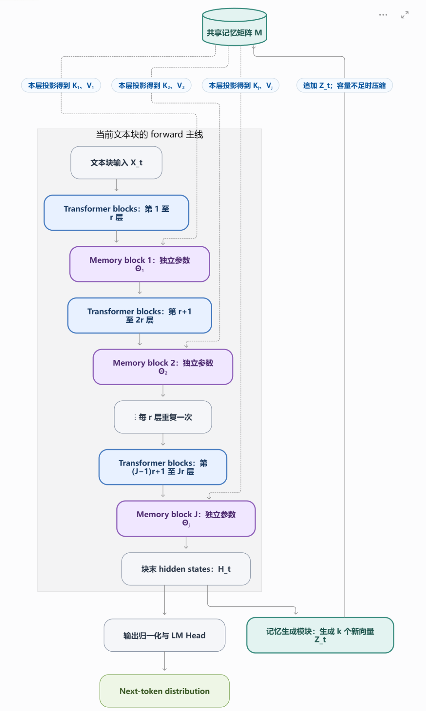
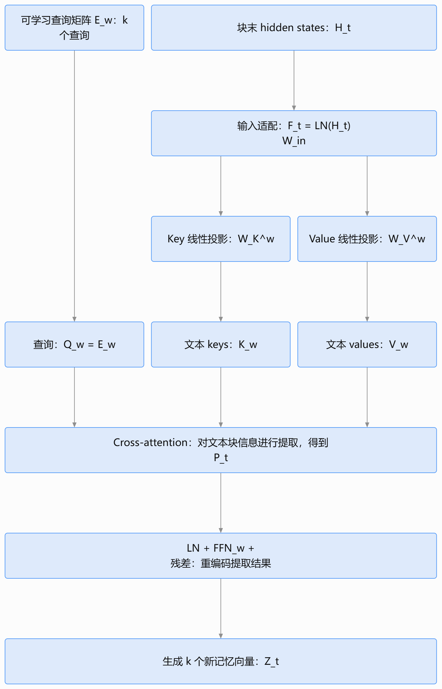
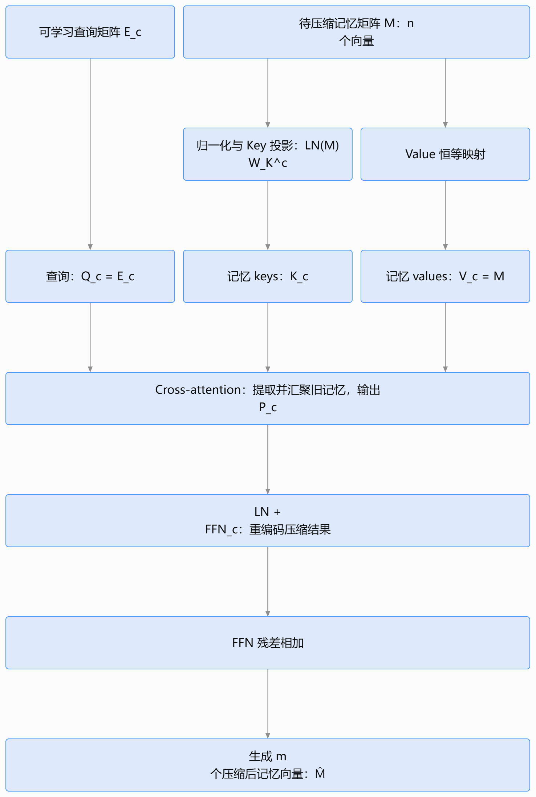
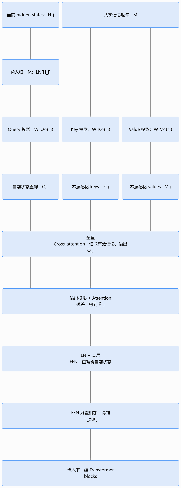

### 核心idea

当前的常见长文本处理范式为：上下文窗口长度接近上限就进行文本压缩，通过离散文本的压缩腾出空间。即：上下文的语义存在于架构之外的上下文中，上下文的压缩功能也独立于架构本身。

一种可以考虑的思路是：1.通过架构中增加记忆生成模块从而将记忆内容生成向量形式；2.通过forward计算过程中融入记忆写入模块的信息从而吸取上下文的记忆内容；3.通过训练压缩模块将当前的向量库压缩，通过操作连续的向量组进行信息压缩而不是离散的文本序列。

### 总体架构

架构中的4种对象：**Transformer Block**，从记忆向量库中读取信息融入hidden states的**Memory Block**，将当前文本块（如预训练中seq len长度的上下文窗口）中信息生成记忆向量写入记忆向量库的**记忆生成模块**、记忆向量库中信息压缩的**记忆压缩模块**

初步的设计为：
* 原先的Transformer由多层堆叠，现在每forward $r$层即插入一个Memory block，将记忆库$M$中的信息加入hidden state中。相当于在原先负责语言生成的blocks中插入了若干个记忆注入的blocks
* 最后一层结束后得到块末hidden states，原先的Transformer直接将其经过线性层输出next token distribution，现在再加入一条并行线路，将hiden states经过记忆生成模块生成当前文本块的记忆向量组$Z_t$（共k个向量），以此更新记忆向量库$M$
* $Z_t$更新向量库的方法为：向量库限额数为$N$，当前向量数为$n$。若$n+k\leq N$则直接将$k$个向量加入$M$中，否则将当前的$n$个向量经过记忆压缩模块压缩为$m$个向量，然后再加入$k$个向量。

### 记忆生成模块

* 总体架构：一个Cross-attention模块，一个含残差的FFN模块。
* Cross-attention：期望将文本块中的信息提取为k个记忆向量。这k个记忆向量可以表征不同维度的记忆信息。
  * $Q$向量：直接学习$k$个Q向量，可理解成每个记忆维度关注的问题，即$Q_w$
  * 将Transformer block的hidden state语义空间投影到记忆空间：原有的hidden states记为$H_t$。归一化后线性变化为$F_t=\text{LN}(H_t)W_{in}$，即为记忆空间中的映射向量
  * $KV$向量：$K_w=F_tW_K^w, V_w=F_tW_V^w$
  * Attn output：$P_t=\text{Softmax}(\frac{Q_wK_w^T}{\sqrt{d_a}})V_w$
* $Z_t=P_t+\text{FFN}_w(\text{LN}(P_t))$

### 记忆压缩模块

* 总体架构：一个Cross-attention模块，一个含残差的FFN模块。
* Cross-attention：期望将文本块中的信息提取为m个记忆向量。这m个记忆向量可以表征不同维度的记忆信息。
  * $Q$向量：直接学习$m$个Q向量，可理解成m个目标压缩槽位中，每个记忆槽位关注的问题，即$Q_c$
  * $K$向量：$K_c=\text{LN}(M)W_k^c$，即对于当前的记忆向量库矩阵$M$中的每一个向量做投影
  * $V$向量：$V_c=M$，因为attention output（即压缩后的m个向量）考虑可以设计成$M$中各向量的加权组合。
  * Attn output：$P_c=\text{Softmax}(\frac{Q_cK_c^T}{\sqrt{d_a}})V_c$
* $\hat{M}=P_c+\text{FFN}_c(\text{LN}(P_c))$

### 记忆读取模块

* 总体架构：一个Cross-attention模块，一个含残差的FFN模块。
* Cross-attention：期望根据当前文本块的hidden states状态，从记忆向量库M中吸收记忆相关的信息加到hidden state中。
  * $Q$向量：来源于$H_r$（当前hidden states），$Q_r=\text{LN}(H_r)W_Q^r$
  * $KV$向量：$K_r=MW_K^r$，$V_r=MW_V^r$
  * Attn output：$O_r=\text{Softmax}(\frac{Q_rK_r^T}{\sqrt{d_a}})V_r$
* 融合到hidden state空间中：$\tilde{H_r}=H_r+O_rW_O^r$
* $H_r^{out}=\tilde{H_r}+FFN_r(\text{LN}(\tilde{H_r}))$

### 目前可能需要继续思考的地方

* Loss函数如何设计？是否考虑仍然采用交叉熵损失？如果采用交叉熵损失，我们能否仅通过文本序列的训练就让模型自动学会记忆？是否需要添加和记忆表现相关的Loss项？因为考虑到一个问题：自然语言文本中，可能只有部分的token才会依靠历史记忆的内容，训练信号会明显稀疏。
* 训练数据如何选择？原先的LLM预训练只需要训练seq len长度的文本序列即可锻炼语言输出能力，而不同seq之间不存在前后关联也问题不大；但现在涉及到前后记忆，尤其是超出当前上下文窗口的历史信息的记忆读写，可能需要不同seq len长度的文本序列之间也存在逻辑关系，从而能在后面的seq中需要用到前面seq的信息。因此对于数据的要求可总结为：
  * 后面输入的训练数据必须与前面输入的训练数据存在逻辑上的关系，才能够有记忆读写的需求，形成有效的训练信号
* 由于一般LLM的训练有batch size的设置，所以在batch内部的安排可能也需要特别调整：如一段完整训练样本为($X_{A1}X_{A2}\dots X_{An}$)，则先后的batch需要考虑设为($X_{A1}X_{B1}X_{C1}$),($X_{A2}X_{B2}X_{C2}$),($X_{A3}X_{B3}X_{C3}$)……
* 是否可以考虑：预训练的第一阶段只训练Transformer Block语言模型的参数而冻结记忆相关的参数，当语言模型训练基本收敛，再冻结Transformer Block相关的参数只训练记忆相关的参数。因为考虑到前者对于数据质量（如前后逻辑关联）的要求更低，且Transformer block训练完全后，记忆相关的模块可以直接利用成熟的语义表示进行学习，从而能够较好的分清两阶段的主要学习任务（语义学习和记忆学习）
* 从目前的架构来看，记忆相关的模块与Transformer block相互耦合，不具备可插拔性。要达成可插拔性，是否能够设计出像Memory Decoder一样，直接通过输出分布层面的线性插值就能融合记忆信息的影响的架构？
  * 关于这种架构有一个比较粗糙的idea：专门训练一个记忆相关的模型，仍包括记忆生成、压缩、读取等模块。模块内部架构不变，唯一的区别在于先前的记忆读取和Transformer Block相互耦合，而现在直接根据上下文内容生成分布，与主模型线性插值。
  * 或者说，是否还有除了next token distribution之外的融合位点同样能够实现直接插拔？