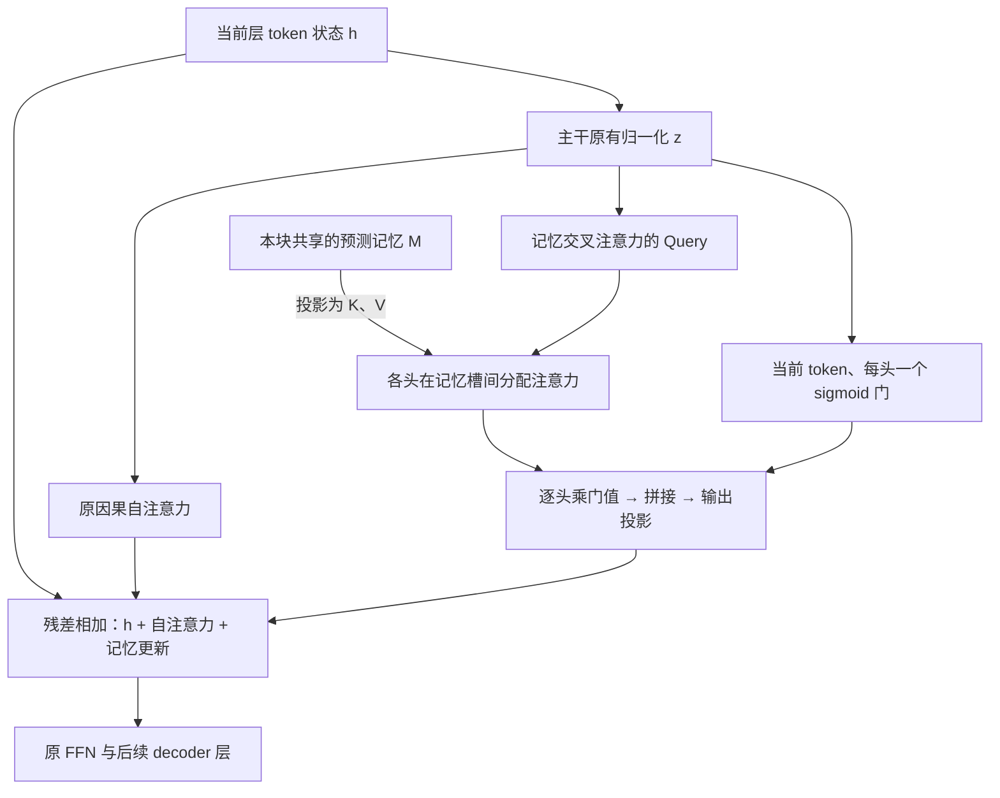
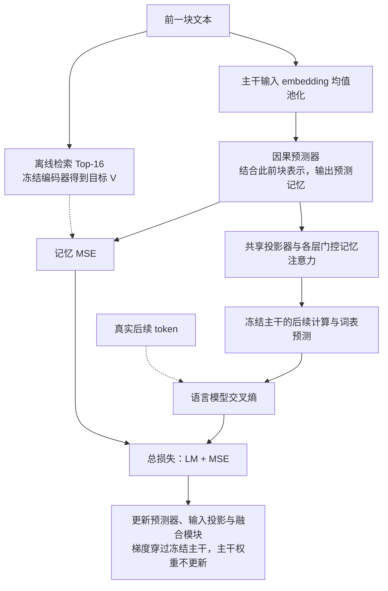
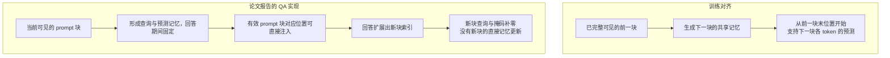

# Deep Fusion Memory: A Chunk-Level Parametric Memory for Large Language Models

Rubin Wei 等，LUMIA Lab／上海交通大学、上海人工智能实验室，2026。以下依据 [arXiv v1 原文及附录 A–E](https://arxiv.org/pdf/2610.25100v1)，页码均指这份 25 页 PDF。下文简称 DFM。

## 0.摘要翻译

大语言模型需要有效的方法，来获取和使用其预训练参数之外的外部知识。继续预训练可能导致灾难性遗忘，而推理时检索又可能引入显著开销。外部参数化记忆能够避免在线检索，但其训练数据的构造需要大量离线搜索，而且输出层的概率插值只能提供浅层融合。我们提出 Deep Fusion Memory（DFM），一种减少监督数据构造工作量、并将学到的记忆融入中间隐藏状态的参数化记忆架构。一个因果记忆预测器根据前文生成记忆，以从语料库检索得到的文本块向量作为监督。预测记忆在每个文本块内的 token 间共享，并通过带门控的交叉注意力融入它们的隐藏状态。记忆预测与融合在冻结主干的条件下端到端训练，推理时无需显式检索。相比通常构造 token 级记忆目标的已有参数化记忆方法，DFM 构造训练数据所需的检索查询数减少到其 1/32，检索返回项数减少到其 1/2048。在六项问答任务上，DFM 在 Mistral-7B-v0.3 和 Qwen3-8B-Base 上相对最强基线分别提升 12.71% 和 11.19%。问答之外，领域适配相对 Qwen3-4B-Base 和 Qwen3-8B-Base 的平均提升分别为 6.51 和 4.38 分。代码将于后续发布。[原文摘要，p.1](https://arxiv.org/pdf/2610.25100v1#page=1)

## 1. 开篇讲清楚：论文做了什么，核心 idea 是什么

DFM 希望把外部语料中的知识学进一个附加模块，使模型生成时不必再查资料库，同时减少逐 token 构造检索监督的成本。核心做法是：让一个较小的预测器根据前文生成一组连续记忆向量，供后面一整块文本的预测共享；主模型在若干中间层用注意力读取这些向量，让记忆参与后续层的计算。

相比 MLP Memory 只在最终词表概率上融合，DFM 把记忆接入隐藏状态，因此同一份记忆可以被不同 token、不同层选择性使用。长期知识保存在预测器等新增模块的参数里，每次生成的向量是根据上下文产生的临时表示；它不是一个能按文档 ID 随时增删的外部 KV 库。[§1、§3，pp.2–5](https://arxiv.org/pdf/2610.25100v1#page=3)

## 2. 开始梳理详细的方法：先理清各项设计的逻辑关系，再逐步构建完整方法

### 2.1 从逐 token 检索监督，改为预测一组块级语义向量

要让模型免于在线检索，可以离线检索，再让一个神经网络学习检索结果。MLP Memory 的目标是逐 token 的下一词概率分布，但这需要为语料中的大量位置分别搜索邻居。DFM 首先改变的是**预测对象和监督粒度**：每 32 个 token 作为一块，只准备一组检索向量，供整块预测使用。[§3.1，p.3](https://arxiv.org/pdf/2610.25100v1#page=3)

将训练序列写为 $X_0,\dots,X_{J-1}$，块长为 $C=32$。对 $j\ge1$，用前一块 $X_{j-1}$ 查询训练资料库，取相似度最高的 $K=16$ 个文本块。冻结的 Qwen3-Embedding-0.6B（把文本编码为语义检索向量的模型）用末 token 的输出形成 1024 维向量，并做 L2 归一化（将向量长度变为 1）。将取回向量按检索排名堆叠，得到：

$$
V_j=[v_{j,1};\dots;v_{j,K}]\in\mathbb R^{K\times d_m},\qquad d_m=1024.
$$

这里 $V_j$ 是预测 **$X_j$** 时所需记忆的训练目标，查询只来自 $X_{j-1}$；第一块没有前一块，因此不构造对应监督。检索排名固定了槽位的含义：第一个输出槽学习第一名邻居的向量，第二个槽学习第二名，依此类推。[§3.1、附录A.1，pp.3、14](https://arxiv.org/pdf/2610.25100v1#page=14)

资料库只含训练块，通过 FAISS IVF-PQ（先把向量分组、再用压缩编码加速近邻搜索的索引）完成离线检索；保存的目标是取回块的完整向量。附录说明保留最近邻，没有将“删除自身邻居”设为该构造步骤的统一规则。不能把案例展示时另做的去重，套用成整个训练库的处理方式。

原文图6用“巴肯纳姆铁路由谁运营”等例子展示，前一块检索到的片段可能含有下一块需要的信息。但保存的监督是这些片段的向量，而非下一块原文或词表概率。

*原文图6，p.25。左列是查询块，中列是取回片段，右列是真实后续文本；棕色标出了相关信息。这里只展示检索监督的可用性，尚未证明预测器恢复了相同事实。*

### 2.2 在线不能检索，怎样从前文生成这些记忆？

监督对象确定后，需要一个只依赖可见上下文的预测器。DFM 不在线调用上述检索编码器，而是直接使用冻结主模型的输入 embedding。对前一块取平均，再在需要时做可学习的线性投影：

$$
C_j=W_{\mathrm{in}}\left(\frac1C\sum_{i=(j-1)C}^{jC-1}E_\theta(x_i)\right),\quad j\ge1.
$$

这里 $C_j$ 是块表示，不是块长 $C$；$E_\theta$ 是主模型原有的 embedding，$W_{\mathrm{in}}$ 将它映射到预测器宽度。**检索目标向量来自外部文本编码器，预测器输入却来自主模型的词嵌入均值，两者来源不同。** 均值池化丢失块内词序，但主模型自身仍按正常 token 顺序计算；块序则交给预测器处理。[§3.2，p.4](https://arxiv.org/pdf/2610.25100v1#page=4)

预测器是一个因果 Transformer（每个位置只能读取自己及此前位置），默认 28 层、宽度 1024、FFN 中间宽度 3072、16 个 query 头和 8 个 KV 头。输入为这些块表示，$C_0$ 是被掩蔽的占位符。它在位置 $j$ 的输出仅依赖 $C_1,\dots,C_j$，也就是 $X_0,\dots,X_{j-1}$：

$$
s_j=\operatorname{CausalTransformer}_\phi(C_{\le j})_j,
\qquad \hat v_{j,k}=A_k s_j+b_k,
$$

$$
\hat V_j=[\hat v_{j,1};\dots;\hat v_{j,K}]\in\mathbb R^{K\times1024}.
$$

$K$ 个独立线性输出头分别产生有序的 $K$ 个槽；它们是预测器的输出头，不是主模型里交叉注意力的多头。附录还把预测向量各坐标裁剪到 $[-1,1]$，与归一化目标的坐标范围相符，但不对预测向量再次做 L2 归一化。[式(1)、附录A.1，pp.4、14](https://arxiv.org/pdf/2610.25100v1#page=14)

注意，$\hat V_j$ 是网络生成的连续数值，没有真的搜出 16 个文档 ID。即使训练时每个槽对齐一条邻居，推理时也不能直接把这些向量当成有出处、可逐字核对的检索证据。

### 2.3 向量如何进入主模型：先映射空间，再在中间层读取

预测出来的向量位于检索编码器空间，不能直接当作主模型的隐藏状态。DFM 用一个投影器逐槽变换：

$$
M_j=P_\psi(\hat V_j)\in\mathbb R^{K\times d},
$$

其中 $d$ 是主模型隐藏维度，$P_\psi$ 依次执行 LayerNorm、线性层、GELU、线性层。这份 $M_j$ 在多个融合层共享，因此不必为每层重新生成或单独投影一套记忆。[§3.2，p.4](https://arxiv.org/pdf/2610.25100v1#page=4)

*原文图1，p.4。左侧离线目标仅用于监督；中间绿色记忆分支才是训练和推理时实际使用的路径。*

默认在主模型零起算的第 $[9,16,24,31]$ 层增加记忆交叉注意力（以当前 token 状态为 query、另一组记忆向量为 key/value 的注意力）。在某个融合层，对当前位置状态 $h_t$ 先做主干原有归一化：$z_t=\operatorname{Norm}(h_t)$。每个头 $a$ 计算：

$$
q_{t,a}=W_{Q,a}z_t,\quad K_{j,a}=M_jW_{K,a},\quad V_{j,a}=M_jW_{V,a},
$$

$$
o_{t,a}=\operatorname{softmax}\!\left(\frac{q_{t,a}K_{j,a}^{\top}}{\sqrt{d_a}}\right)V_{j,a}.
$$

同块 token 共享 $M_j$，但 query 不同，故可对 16 个槽分配不同权重。记忆预测器和投影器跨融合层共享，而每个融合层有自己的注意力投影参数；这些参数也独立于主干原有自注意力参数。[§3.2、式(2)–(3)，pp.4–5](https://arxiv.org/pdf/2610.25100v1#page=4)

### 2.4 同一块共享记忆，为什么还需要逐 token、逐头门控？

注意力解决“读哪个槽”，仍需决定“这一步到底该让记忆影响多少”。DFM 对每个 token 的每个头计算一个标量门：

$$
g_t=\sigma(W_gz_t+b_g)\in(0,1)^H,
\qquad u_t=W_O\operatorname{Concat}_{a=1}^H(g_{t,a}o_{t,a}).
$$

$\sigma$ 是 sigmoid。一个头的全部通道共享同一个门值；先缩放各头输出，再拼接并做输出投影。门既不是为整块固定一个值，也不是在最终两份词表分布之间做插值。[式(2)，pp.4–5](https://arxiv.org/pdf/2610.25100v1#page=5)

记忆分支与原有因果自注意力并行，进入同一次残差更新：

$$
\tilde h_t=h_t+\operatorname{SelfAttn}(z_{\le t})+u_t.
$$

随后经过原主干的 FFN、归一化和残差连接。记忆因此会改变后续层的输入，后续层还能将它与上下文继续组合；这就是本文“深度融合”的实际含义。[式(3)，p.5](https://arxiv.org/pdf/2610.25100v1#page=5)

门权重初始化为零，偏置默认为 $-2$，初始输出 $\sigma(-2)\approx0.119$，让记忆分支先以较小幅度接入。这个初值并非完全关闭分支，也没有保证模型输出永远接近原模型。后面实验中偏置为 0 的均值反而更高，因此 $-2$ 应理解为保守默认值，而非已验证的最优值。

**融合层：记忆分支与原自注意力并行**

解读图：投影后的记忆跨融合层共享，各层记忆注意力和门参数独立。记忆在中间隐藏状态生效，后续层继续处理它。对应 §2.3–2.4、原文式(2)–(3)。

### 2.5 检查时间对齐：记忆服务的是“下一个 token 所在块”

现在一个记忆块会服务多个预测位置。如果直接按当前位置划块，边界上就可能错用记忆，甚至把尚未生成的文本用于池化。作者明确规定：零起算位置 $t$ 的状态预测 $x_{t+1}$，它使用的块索引为：

$$
j=\left\lfloor\frac{t+1}{C}\right\rfloor.
$$

因此 $t=C-1$ 时，前一块刚完整可见，就可用它的均值表示产生 $M_1$，来预测下一块的第一个 token。随后预测该块其余 token 时，继续共享 $M_1$。第一块的预测位置不注入记忆，也不计算相应记忆监督。这个索引偏移和预测器因果掩码共同保证训练通路不读取尚未出现的下一块。[§3.2，p.5](https://arxiv.org/pdf/2610.25100v1#page=5)

这只说明训练计算的因果性。离线资料库可以提供外部参考，而不是把监督的下一块直接作为预测器输入；资料重复、训练语料与评测语料重叠，是需要另行检查的问题。

### 2.6 联合学习：既预测检索向量，也让它真正帮助生成

只回归向量，不保证它对语言模型有用；只优化生成，也不保证预测器保留检索监督。DFM 同时使用下一 token 交叉熵和记忆均方误差：

$$
\mathcal L=\mathcal L_{\mathrm{LM}}+\beta\mathcal L_{\mathrm{MSE}},\qquad\beta=1,
$$

$$
\mathcal L_{\mathrm{MSE}}=
\frac{\sum_{j=1}^{J-1}\|\hat V_j-V_j\|_F^2}{(J-1)K d_m}.
$$

$\|\cdot\|_F^2$ 表示把矩阵所有坐标的平方误差相加，分母再将其变成逐坐标平均。目标向量已归一化，预测向量不重新归一化，因此这个损失既约束方向，也约束数值大小。语言模型损失则评价融合记忆后能否预测真实后续 token。[式(4)，p.5](https://arxiv.org/pdf/2610.25100v1#page=5)

**主模型从训练开始就读取预测记忆 $\hat V_j$，真实检索目标 $V_j$ 仅用于计算 MSE。** 因而不存在“训练直接喂真实检索向量、推理才改喂预测向量”的切换。

参数更新分工如下：

| 部分 | 是否更新 | 学习信号 |
| --- | --- | --- |
| 主干 embedding、原 Transformer、原 LM head | 冻结 | 提供原有计算及误差传播路径 |
| 输入投影、因果预测器、输出槽头 | 更新 | 记忆 MSE，以及经融合通路传回的 LM 损失 |
| 共享记忆投影器 | 更新 | LM 损失 |
| 各层记忆注意力与门 | 更新 | LM 损失 |
| 检索编码器与离线目标 | 冻结 | 提供固定监督 |

“冻结”是参数不更新，不是把整个主干放在不传梯度的计算中。较早层的新增模块需要接收到经过后续冻结层传回的误差，才能知道怎样改变生成。本文的端到端训练覆盖预测器和融合模块，不包含离散近邻搜索本身。[§3.2，p.5](https://arxiv.org/pdf/2610.25100v1#page=5)

问答训练用 Wikipedia 2018，文章级划分训练/验证/测试集，再去除跨划分完全重复文本、打包成 2048-token 序列。主干分别为 Mistral-7B-v0.3、Qwen3-8B-Base，新增约 0.75B 参数。训练 1 个 epoch，16 张 A800 80GB，全局批量 128，AdamW 学习率 $10^{-5}$、500 步预热、余弦衰减、零权重衰减、梯度裁剪 1、BF16。正文概称约 4B token；实际训练分词量为 Mistral 4.70B、Qwen3 4.29B，不能把资源计数所用的统一 4B 当作两个训练集的精确大小。[§4.1、附录A.1，pp.6、14](https://arxiv.org/pdf/2610.25100v1#page=14)

**联合训练：目标只作监督，主模型始终读取预测记忆**

解读图：目标 V 不作为主模型记忆输入。离散检索不在反向传播通路中，新增模块接受生成损失，预测器另接受 MSE。对应 §2.6。

### 2.7 实际 QA 推理改变了记忆查询与刷新规则

训练规则已经因果对齐，但论文报告的 QA 评测采用另一种实现，附录A.1 交代得比正文更具体：[§3.3、附录A.1，pp.5、14](https://arxiv.org/pdf/2610.25100v1#page=14)

| 环节 | 训练 | 报告的 QA 推理 |
| --- | --- | --- |
| 形成块级查询 | 用前一块 $X_{j-1}$ | 用当前可见的 prompt 块 |
| 记忆来源 | 预测器产生；另有离线目标监督 | 预测器产生，无检索目标 |
| 随文本前进 | 按下一 token 所属块使用对应预测记忆 | 从 prompt 形成的查询和记忆保持固定 |
| 新增回答块 | 训练序列中有对应块的预测通路 | 新块位置的查询和有效掩码补零，无直接记忆更新 |
| 预测器缓存 | 训练可并行处理块序列 | 所报实现没有使用增量预测器缓存 |

这意味着不能把实验解释成“每生成满 32 token，就根据刚生成的内容刷新 16 个记忆槽”。直接记忆注入限于有效 prompt 块对应的位置；新增加的块不再得到直接注入，但仍可通过自注意力读取此前受记忆影响的上下文。若回答位置仍落在已有的有效块索引范围内，使用的也是该固定记忆，并非新检索或新预测的知识。

QA 的完整问题本来就已知，用可见问题构造查询不等于泄漏未知答案；不过它确实改变了训练时“前一块支持下一块”的输入分布。论文没有用消融比较两种对齐规则，也未验证持续刷新的长文本生成，因此这里的问答结果只支持所报告的固定 prompt 记忆实现。

**训练与实际 QA：查询来源、刷新方式不同**

解读图：QA 回答不会每满一块就刷新记忆；新块仍可通过自注意力使用先前受记忆影响的上下文。此处画的是原文实际评测规则，不是按训练规则设想的持续刷新流程。对应 §2.7、附录A.1。

### 2.8 分别走完训练、问答推理和领域适配

**训练例子。** 为看清边界，暂把块长从 32 缩为 4：$X_0=(x_0,\dots,x_3)$，$X_1=(x_4,\dots,x_7)$。离线用 $X_0$ 检索得到目标 $V_1$；在线将 $X_0$ 的主干输入 embedding 均值池化，得到 $C_1$，预测 $\hat V_1$，投影成 $M_1$。主模型在位置 3 预测 $x_4$ 时，已经看完 $X_0$，所以能读取 $M_1$；位置 4、5、6 预测 $x_5,x_6,x_7$ 时继续共享它。到位置 7，要预测 $x_8$，便可利用已完整出现的 $X_1$ 及此前块表示产生 $M_2$。用真实后续 token 算 LM 损失，用固定目标算 MSE，更新所有新增模块。

**所报 QA 推理例子。** 输入“巴肯纳姆铁路由哪个公司运营？”及问答模板。先对可见 prompt 分块，按 QA 规则形成查询，由预测器输出连续记忆，再投影并在指定层注入。模型随后逐 token 生成答案，门可以随当前位置、头和层改变，但 prompt 记忆保持固定；回答扩展出新的块索引后不再获得该块的直接记忆更新。在线没有调用 Qwen3-Embedding 编码器，没有向量搜索，也没有原文证据取回。这个流程仅说明如何运行，不预设该问题一定回答正确。

**领域适配。** 代码和数学各用 100M 训练 token，法律用 123.5M token；在各域训练资料上单独构造同样的块级目标，冻结主干，分别训练一套新增模块。Qwen3-4B 的新增参数约 0.6B，8B 约 0.75B。每个领域使用独立检查点，不是把三个领域依次写进同一个模块后证明没有遗忘。代码/数学用原始领域文本做语言建模；法律数据保留已有的参考、输入和输出字段，再按文本训练。[§4.1、附录A.2，pp.6、15](https://arxiv.org/pdf/2610.25100v1#page=15)

资料更新后，DFM 需要重新构造相应监督并继续训练模块，不能只更换一个在线索引就获得新知识。不同主模型上分别训练成功，说明这套架构可适配多种主干，并不证明同一份预测器、投影器和融合参数能直接跨模型复用。

## 3. 围绕问题解释实验：为什么做，结果怎样，得到什么回答

### 3.1 无在线检索，问答能力能否优于现有适配方法？

作者在两种冻结主干上比较完整方案：RAG 和 xRAG 仍在线检索，RETRO 在线取回文本并内部融合；CPT、LoRA、MLP Memory 则通过训练吸收资料。QA 使用零样本贪心生成，未给标准答案文档或推理链示例。[§4.1、表1、附录A.1，pp.6–7、14–15](https://arxiv.org/pdf/2610.25100v1#page=7)

| 主干与方法 | NQ | WebQA | HotpotQA | 2Wiki | MuSiQue | Bamboogle | 均值 |
| --- | ---: | ---: | ---: | ---: | ---: | ---: | ---: |
| Mistral Base | 20.30 | 29.28 | 20.96 | 5.87 | 1.43 | 3.91 | 13.63 |
| Mistral xRAG | 27.39 | 40.06 | 27.55 | 27.78 | 9.57 | 12.51 | 24.14 |
| Mistral MLP Memory | 26.32 | 39.57 | 24.83 | 22.36 | 7.36 | 12.08 | 22.09 |
| Mistral DFM | 33.57 | 42.47 | 29.53 | 25.00 | 10.05 | 22.65 | **27.21** |
| Qwen3 Base | 17.60 | 41.78 | 24.65 | 24.83 | 9.72 | 17.66 | 22.71 |
| Qwen3 MLP Memory | 18.30 | 43.26 | 25.27 | 27.47 | 10.81 | 17.66 | 23.80 |
| Qwen3 DFM | 27.46 | 39.47 | 26.46 | 32.38 | 12.89 | 20.09 | **26.46** |

除 WebQA 用子串匹配外，其余任务用答案 token F1（衡量预测与标准答案词项重合的精确率和召回率）；均值是六项指标的等权平均，不是同一种正确率。各任务样本量不同，Bamboogle 只有 125 题，仍占六分之一权重。[表4，p.15](https://arxiv.org/pdf/2610.25100v1#page=15)

Mistral 相对最强基线 xRAG 从 24.14 到 27.21，约提升 **3.07 点、相对 12.71%**；Qwen3 相对 MLP Memory 从 23.80 到 26.46，提升 **2.66 点、相对约 11.19%**。相对比例按未四舍五入分数计算；它们不是增加了 12.71 或 11.19 个百分点。

DFM 并未逐项胜出：Mistral 的 2Wiki 25.00 低于 RAG 的 31.02；Qwen3 的 HotpotQA 26.46 低于 xRAG 的 27.74，WebQA 39.47 还低于 Base 的 41.78。冻结原权重保留了原参数，但附加通路仍可能降低当前任务的表现。

附录进一步在 OLMo-3-1025-7B 上得到 25.49，优于 Base 的 17.99 和最强对照 RETRO 的 23.63；WebQA、HotpotQA 依然略低于 Base。这增加了架构可适配性的证据，仍不等于同一模块权重的跨模型迁移。[表5，p.16](https://arxiv.org/pdf/2610.25100v1#page=16)

这些比较支持组合方案有较好的平均收益，但 RAG 仅用 Top-1 文档，未全面优化多跳检索；DFM 还接受了额外模块训练，不能据此推断参数化记忆普遍胜过所有检索系统。MLP Memory 的插值权重是在各报告评测划分上分别挑选的最佳值，属于逐任务调参结果，也不是统一固定设置。[附录A.1，p.14](https://arxiv.org/pdf/2610.25100v1#page=14)

### 3.2 “分块”是否真的减少成本，减少的是哪种成本？

先看可直接复算的监督构造量。固定语料有 $N=4\times10^9$ 个 token，忽略序列首块和末尾不足一块的影响：[图2、附录D，pp.9、23](https://arxiv.org/pdf/2610.25100v1#page=23)

| 项目 | MLP Memory 对照 | DFM | 比例 |
| --- | ---: | ---: | ---: |
| 检索查询数 | $N=4$B | $N/32=125$M | 32 倍 |
| 每次返回的邻居数 | 1024 | 16 | 64 倍 |
| 总返回槽数 | $1024N=4.096$T | $16N/32=2$B | 2048 倍 |

最后一个数同时来自减少查询和减少邻居，即 $32\times64=2048$。它统计搜索返回的槽位，MLP Memory 的数字在去除自身邻居和聚合词概率之前计算；不是去重后的文档数量、检索扫描候选数、目标文件字节数或运算量。DFM 每项是 1024 维向量，MLP 的目标则是 token 分布，不能用返回项数量直接换算存储比。

*原文图2，p.9。中间是实测训练耗时比例，右边是按共同语料规模计算的检索工作量，两者证据类型不同。*

另有实测训练时间：同一语料和 epoch 数、16 张 A800，MLP Memory 约 64 小时，DFM 约 24 小时，即 1024 对 384 GPU 小时，减少约 62.5%。该统计只覆盖训练，不含目标构造与评测。新增参数也从 1.5B 变为 0.75B，因此不能把全部时间收益归于分块粒度。[§4.4、附录D，pp.8–9、23](https://arxiv.org/pdf/2610.25100v1#page=23)

论文没有报告离线构造的实际耗时，也没有推理延迟、吞吐或长回答测试。没有在线检索，确实省去一种运行依赖；新增预测器和交叉注意力本身仍有计算成本，所以尚不能给出 DFM 相对 Base 或 RAG 的实际推理加速倍数。

### 3.3 记忆需要多细、多大？

作者固定其余配置，改变块长和槽数，考察减少监督量后是否损害 QA：[图3、附录C.1，pp.9–10、20–21](https://arxiv.org/pdf/2610.25100v1#page=20)

| 改动 | 六任务均值 | 回答的问题 |
| --- | ---: | --- |
| 块长 16 | 26.51 | 查询更多，没有平均收益 |
| 块长 32，默认 | 27.21 | 当前默认折中 |
| 块长 64 | 27.07 | 查询减半，均值仅少 0.14 点 |
| 2 个槽 | 26.88 | 比 16 槽只少 0.33 点 |
| 4 个槽 | 27.04 | 更少目标向量仍可用 |
| 8 个槽 | 27.09 | 与 16 槽均值接近 |

这支持块级共享并不一定需要很细的监督。不过 Top-8 实际在五项任务上高于 Top-16，差异主要由 Bamboogle 低 3.07 点拉开。所有消融均为单次运行，小均值差不宜解释为稳定排序；默认 32/16 也不是所有成本约束下的最佳配置。

### 3.4 内部融合是否需要足够早地介入？

为了检验后续层加工记忆是否重要，作者改变融合层数量与位置：[图3、附录C.1，pp.10、20–21](https://arxiv.org/pdf/2610.25100v1#page=20)

| 融合位置，零起算 | 均值 |
| --- | ---: |
| 仅第 31 层 | 21.11 |
| 第 9、31 层 | 27.54 |
| 第 9、16、24、31 层，默认 | 27.21 |
| 末四层 28、29、30、31 | 22.07 |
| 第 2、10、21、31 层 | 26.32 |

同为四层，分布式的中后层融合比集中在末四层高 5.14 点左右；只在最后一层接入也明显较弱。这支持记忆需要在模型内部有一定处理空间，不能只看模块数量。两层配置反而最高，六层和八层约为 27.22、27.09，继续加层没有一致收益。

*原文图3，p.10。默认四层并非平均分最高；末四层的下降则较明显。*

但这里没有在完全相同的目标、预测器、参数量下，把内部融合与词表概率插值直接替换比较。它证明的是 DFM 内部放置方式重要，尚不能独立证明“所有相对 MLP Memory 的增益都来自深度融合”。第 2 层起始配置同时改变了多个位置，也不能只把差异归因于“开始得太早”。

### 3.5 门控、预测器和向量监督各自有什么证据？

门控消融的六任务均值为：不加门 26.83，初始偏置 $-6/-4/-2/0$ 时分别为 25.10、26.73、27.21、27.90。默认门相对无门仅提高 0.38 点；偏置 0 最高，过度压低初始记忆贡献反而较差。结果支持门控有帮助，但不是精确证明 $-2$ 最优或每个 token 的门已学到可解释的知识需求。[表3，p.11](https://arxiv.org/pdf/2610.25100v1#page=11)

附录中的其余比较包括：[表9–12，pp.21–22](https://arxiv.org/pdf/2610.25100v1#page=21)

| 比较 | 均值 | 可以支持的判断 |
| --- | --- | --- |
| 共享投影器／各融合层独立投影器 | 27.21／26.88 | 共享不增加模块复制，此处均值略高 |
| 预测器 14／28／56 层 | 27.31／27.21／26.47 | 更深没有一致收益，14 层也可用 |
| raw MSE／余弦预测损失 | 27.21／26.87 | 两种向量监督在此处接近 |
| 学习率 $10^{-5}$／$2\times10^{-5}$ | 27.21／27.10 | 对这次两倍变化不敏感 |

MSE 对余弦损失的比较，不能回答“有没有检索监督是否一样”。文中没有移除 MSE、换成随机目标、仅训练同容量普通适配器、或直接输入真实目标记忆的完整对照，也没有量化预测向量的事实保真度。因此尚不能分清检索蒸馏、额外容量和语言模型联合训练分别贡献多少。

### 3.6 问答之外是否有用，是否保住了原能力？

作者分别在代码、数学和法律数据上适配 Qwen3，考察生成式领域任务。代码用 HumanEval、HumanEval+ 的程序运行正确性，数学用 GSM8K，法律用 LawBench 的 20 个子任务宏平均。最终 Avg 对这四个 benchmark 等权，并不是三个领域各占三分之一；代码占其中两项。[表2、附录A.2，pp.8、15](https://arxiv.org/pdf/2610.25100v1#page=15)

| 主干与方法 | HumanEval | HumanEval+ | GSM8K | LawBench | 均值 |
| --- | ---: | ---: | ---: | ---: | ---: |
| Qwen3-4B Base | 62.04 | 57.32 | 83.40 | 29.96 | 58.18 |
| Qwen3-4B CPT | 66.62 | 58.54 | 84.84 | 41.66 | 62.92 |
| Qwen3-4B DFM | 69.51 | 62.80 | 86.05 | 40.41 | **64.69** |
| Qwen3-8B Base | 69.36 | 59.15 | 85.60 | 38.45 | 63.14 |
| Qwen3-8B LoRA | 69.05 | 65.85 | 87.19 | 45.73 | 66.96 |
| Qwen3-8B DFM | 73.02 | 64.02 | 86.43 | 46.61 | **67.52** |

DFM 相对 Base 平均提高 6.51 和 4.38 点，但相对本表最强非 DFM 方法的平均优势为 1.77 和 0.56 点。4B 法律不如 CPT，8B HumanEval+ 与数学不如 LoRA。它说明完整方案可以用于不同领域，不能解释为每个领域都优于常规适配。

冻结主干也未完全避免行为退化。比如 8B 的 LawBench 法律选择问答子任务从 70.60 降至 53.80，而整体法律均值仍提高；4B 的若干法律应用子任务也低于 Base。[附录B.2、表6–8，pp.17–19](https://arxiv.org/pdf/2610.25100v1#page=19)

领域实验分别训练模块，没有在适配后系统测试域外通用能力，也没有连续学习多个新领域。因此可确认“原主干权重未变”，尚不能确认“接入模块后全面避免灾难性遗忘”。停用新增分支原则上可返回原主干计算，这是结构性质；正常启用时的能力保持仍需评测。

## 4. 围绕同一个问题，解释已有方法及其特点

### 4.1 直接改主干：知识与原能力共同存进参数

继续预训练把新增语料作为下一 token 预测数据，更新模型参数；LoRA 则冻结原权重，用可学习的低秩矩阵增量改变线性层。两者推理时不必查资料，但仍要训练才能写入新知识，学到的新行为也可能影响原任务。DFM 同样是“离线学习、在线执行”，区别在于把新增参数组织成有检索监督的预测器和专门读取记忆的通路。[§2，pp.2–3](https://arxiv.org/pdf/2610.25100v1#page=2)

### 4.2 在线检索：读取真实资料，保留搜索依赖

一种方式是保存“上下文表示—后续 token”的配对，生成时查找近邻，按相似度聚合邻居后续 token 的概率，再与主模型分布插值。这是 kNN-LM：知识留在配对数据库中，换库即可改变信息来源，代价是逐位置搜索。[kNN-LM原论文](https://arxiv.org/abs/1911.00172)

另一种方式保存文本和索引，取回资料供模型阅读：RAG 拼原文到 prompt；RETRO 用块级检索和额外编码器，把取回文本通过交叉注意力接入 decoder。这两者保留了推理时的实际证据，但还需要搜索和证据处理。RETRO 已经具备块级记忆与内部注意力融合，DFM 并非首先提出这两种组件。[§2，p.3；RETRO原论文](https://arxiv.org/abs/2112.04426)

还可以直接利用资料的检索向量：先学习一个投影器，把取回文档的向量变成一个伪 token，放到问题前面。这是 xRAG，减少了模型处理的参考长度，但推理时依然需要取回那个向量。DFM 的区别在于通过预测器生成向量，从参数中近似恢复所需信息，而非查询实际文档库。[xRAG原论文](https://arxiv.org/abs/2405.13792)

### 4.3 把检索结果学进独立模块：DFM 最直接的前身

MLP Memory 先离线构造 kNN 下一 token 分布，训练一个 MLP 根据主模型表示预测它；生成时分别得到主模型与记忆模块的词表分布，再加权。其长期知识存于 MLP 参数，在线省去搜索，但两条通路主要在最终概率上相遇。[MLP Memory原论文](https://arxiv.org/abs/2508.01832)

Memory Decoder 用独立的小型因果 decoder 读取文本、学习检索分布，再与主模型输出融合。相比依赖主模型内部表示的记忆，小 decoder 可保有更独立的输入接口；但其直接输出仍是词表概率。DFM 换成“检索块向量”作为监督，并增加从连续槽到主干隐藏状态的连接，所以必须为主模型的内部空间和层结构训练对应模块。[§2，p.3；Memory Decoder原论文](https://arxiv.org/abs/2508.09874)

### 4.4 与 Memory³ 对照：都使用向量，知识所在位置却不同

Memory³ 预先用主模型编码每条参考，保存对应的稀疏 KV；在线检索参考 ID，再把实际参考的 KV 接入自注意力。DFM 把语料知识学进新增参数，在线生成一组记忆槽，以独立交叉注意力融合。二者都缩短了读取原文的路径，但一个保留可寻址的外部资料库，一个用参数近似其知识。[Memory³，§3.1–3.3](https://arxiv.org/pdf/2407.01178v1#page=13)

| 方法 | 长期知识存在哪里 | 在线调用 | 更新、复用与代价 |
| --- | --- | --- | --- |
| RAG／RETRO | 文本库与索引 | 检索实际文本，再编码融合 | 资料易替换；有搜索和读取开销 |
| xRAG | 文档向量与索引 | 检索真实向量，投影为伪 token | 输入更短；仍要搜索，投影器需适配 |
| Memory³ | 每条资料对应的稀疏 KV 库 | 检索、加载 KV，联合自注意力 | 可按资料更新；存储、传输及模型版本兼容有成本 |
| MLP Memory | MLP 参数 | 预测词表分布，与主模型插值 | 无在线搜索；更新需训练，监督构造较密集 |
| Memory Decoder | 独立 decoder 参数 | 读取文本、预测分布并插值 | 无在线搜索；接口相对独立，但仍需训练写入 |
| DFM | 预测器、投影和融合模块参数 | 预测连续槽，在中间层读取 | 无在线搜索；有新增计算，资料更新和跨模型使用需适配 |

DFM 因此适合愿意先离线训练、希望在线服务不依赖资料库的场景；若要求及时修改单条事实、给出可核对来源或精确删除资料，本文并未提供与显式检索库等价的操作能力。

## 5. 说明论文继承了什么，真正贡献了什么

**第一，继承检索蒸馏，改变预测对象和粒度。** kNN-LM 已经利用检索分布，MLP Memory、Memory Decoder 已经把检索行为学入参数。DFM 将逐 token 的词概率目标改成每块共享的有序检索向量，使查询数与返回槽数显著下降。32 倍和 2048 倍计数是这一设计的直接结果；实际构造时间和目标存储节省仍没有完整测量。[§3.1、§4.4、附录D](https://arxiv.org/pdf/2610.25100v1#page=23)

**第二，继承内部注意力融合，把在线证据换成参数预测的记忆。** RETRO 已有检索块与 decoder 内交叉注意力，xRAG 已有检索向量到模型空间的投影。DFM 将因果预测、多槽连续表示、共享投影、逐头门控和分布式中间层融合组合起来，使在线过程无需实际取回文档。末四层融合明显弱于中后层分布式融合，是“内部连接位置有实际影响”的证据；还不足以单独分离深度融合相对所有其他变化的收益。[§3.2、§5.1、附录C.1](https://arxiv.org/pdf/2610.25100v1#page=20)

**第三，联合训练生成任务与记忆预测，保持主干权重固定。** 语言模型交叉熵、MSE、冻结主干和门控本身都是已有组件；本文把它们用于同一条“预测记忆→内部读取→生成”的通路，且训练始终消费预测记忆。这使监督学习与最终用途相接，比只检查向量相似度更完整。但缺少无检索监督和同容量普通适配器对照，尚不能证明检索目标本身是全部收益的关键来源。[§3.2、附录C.5](https://arxiv.org/pdf/2610.25100v1#page=5)

**第四，给出多主干、问答与领域适配的组合证据。** 两个主干的六任务平均领先，以及额外 OLMo、代码、数学、法律结果，支持方法具有一定适用范围；0.75B 新增参数和训练时间对照也提供了可核查的资源依据。它没有证明同一模块跨模型复用、持续生成时动态刷新有效，或启用模块后全面保持原能力。尤其 QA 固定 prompt 记忆与训练对齐规则的差异，需要在理解实验时保留下来。[§4、附录A–D](https://arxiv.org/pdf/2610.25100v1#page=14)

这篇论文最值得保留的新意，是把检索蒸馏的目标从“每步该输出哪个词”改成“后面一块文本可共享什么语义信息”，再让主模型在中间层自行读取和处理这些信息。关键是监督粒度与融合接口共同变化，而非单独多加一层注意力。后续最需要补上的验证，是检索监督的独立贡献、训练与实际生成规则的对齐、真实端到端延迟，以及新知识更新和域外能力保持。
