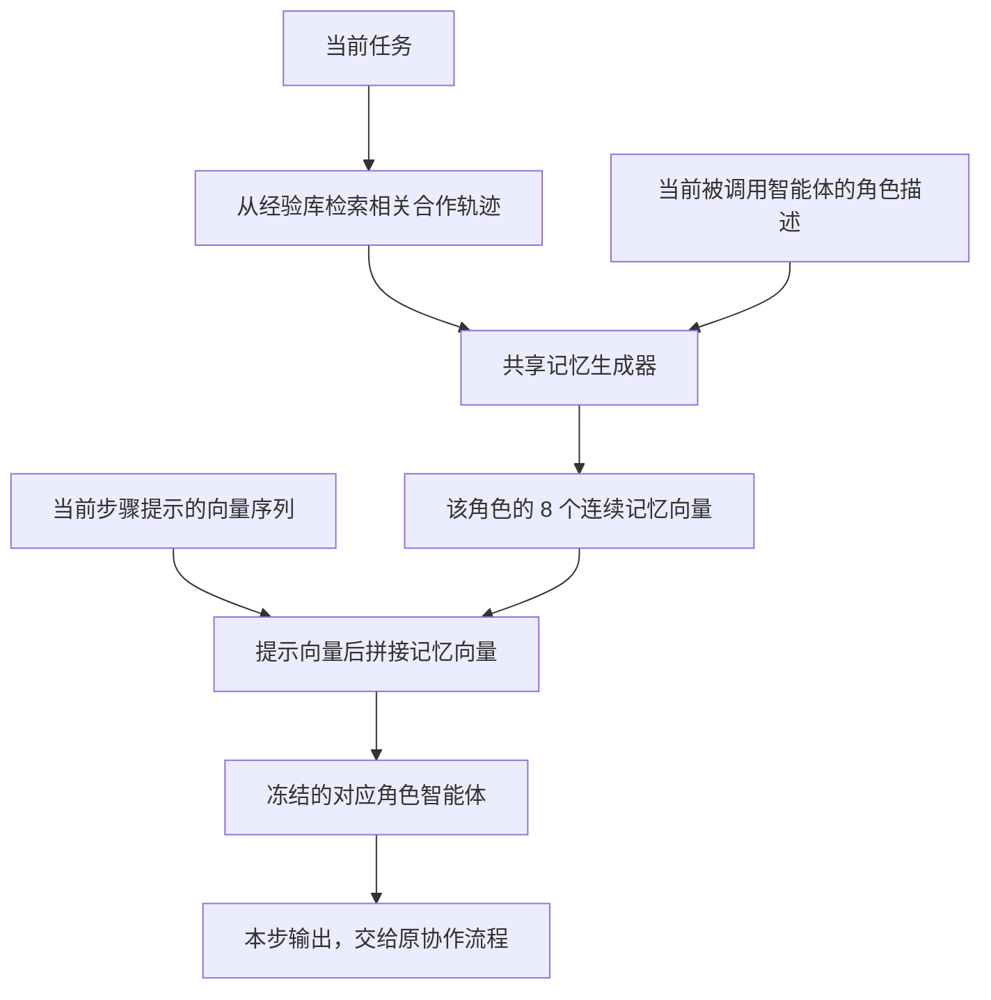
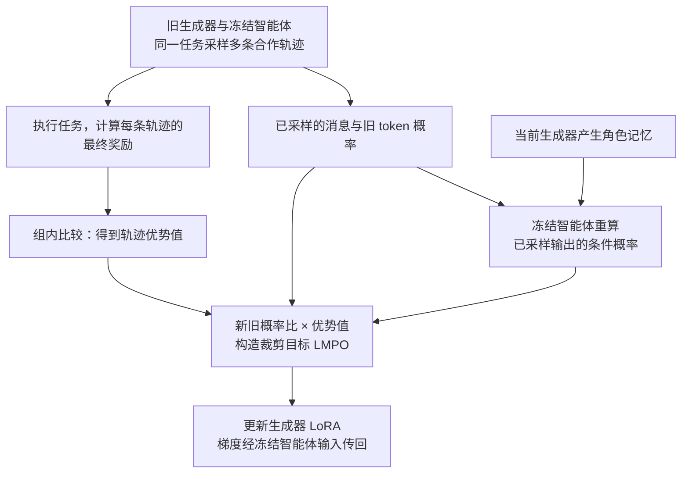
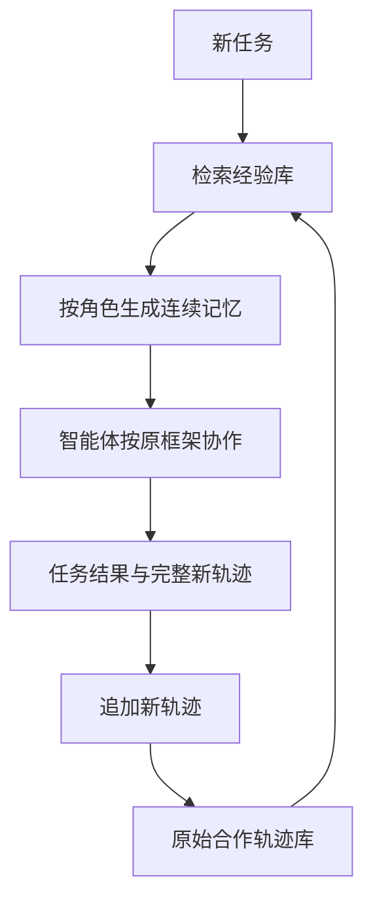

# LatentMem: Customizing Latent Memory for Multi-Agent Systems

## 0.摘要翻译

大语言模型驱动的多智能体系统展现出了显著的集体智能，而多智能体记忆是实现持续适应的关键机制。然而，现有设计仍受到两个根本瓶颈的限制：一是角色感知定制不足造成的记忆同质化，二是向智能体提供过于细碎的文本记忆所引发的信息过载。为此，我们提出 LatentMem：一个可学习的多智能体记忆框架，在减少文本上下文的同时，为各个智能体定制经验记忆。具体而言，LatentMem 包含一个轻量存储原始交互轨迹的经验库，以及一个根据检索经验和智能体特定上下文，合成紧凑潜在记忆的记忆生成器。此外，我们提出潜在记忆策略优化（LMPO），将任务级优化信号通过潜在记忆传递，以学习紧凑且有用的潜在表示。在六个基准、四种主流多智能体框架上的广泛实验表明，LatentMem 相比基础设置最高提升 19.36%，并持续优于现有记忆架构，无需修改智能体层的工作流程。代码已公开。

来源：[EMNLP 2026 正式版摘要，PDF p.1](https://aclanthology.org/2026.emnlp-main.457.pdf#page=1)。下文页码均指该正式版 PDF。

## 1. 开篇讲清楚：论文做了什么，核心 idea 是什么

LatentMem 解决的是多智能体系统怎样复用过去合作经验：把同一份长记录交给规划者、执行者和检查者，既占上下文，也未必符合各自职责。论文的核心做法是保留共享的历史轨迹，针对当前任务先检索相关经历，再让一个可训练的 Transformer 根据智能体角色，把这些经历转换成少量连续向量，作为该智能体的额外输入。

训练时不直接规定这些向量应该“写什么”，而是运行整个多智能体系统，根据最终任务做得好不好，更新生成向量的模块，保持执行任务的智能体权重冻结。推理时仍然检索历史，但各角色读入的是定制后的短向量序列；完成任务后，新轨迹加入经验库供以后使用。[原文 §4，pp.3–5](https://aclanthology.org/2026.emnlp-main.457.pdf#page=3)

## 2. 开始梳理详细的方法：先理清各项设计的逻辑关系，再逐步构建完整方法

方法的依赖关系是：**保存可复用的合作记录 → 检索相关记录 → 按角色压缩为连续向量 → 让智能体实际使用这些向量 → 根据整次任务结果学习压缩方式 → 累积新的合作记录。** 角色定制和压缩由同一个生成器共同完成，训练信号则必须穿过使用记忆的智能体才能到达它。

原文图 2，展示完整系统。雪花表示执行任务的智能体冻结，生成器通过 LMPO 训练。[来源：p.3](https://aclanthology.org/2026.emnlp-main.457.pdf#page=3)

### 2.1 首先保存什么：完整合作轨迹，而非提前规定的经验摘要

论文把系统表示为 $\mathcal X=(\mathcal A,\mathcal G,\mathcal M)$：$\mathcal A$ 是智能体集合，$\mathcal G$ 决定谁在什么时候发言或行动，$\mathcal M$ 是记忆模块。第 k 个智能体具有角色描述 $\gamma_k$ 和语言模型策略 $\pi_{\theta_k}$；“策略”就是根据输入产生输出的条件概率分布。

要复用协作经验，历史不能只保留最终答案，还要记录各个角色怎样接力。因此经验库 $\mathcal B$ 存储：

$$
\tau=\{(\alpha_j,p_j,o_j)\}_{j=1}^{H}.
$$

$\alpha_j$ 表示第 j 步哪个智能体被调用，$p_j$ 是它当时收到的输入，$o_j$ 是对应输出，H 是交互步数。记录可以包含规划、代码、测试、纠错以及环境交互信息，但不预先把它们整理成固定的“反思”“技能”等类别。论文将筛选、抽象的主要责任交给后面的生成器。[原文 §3、§4.2，pp.2–4](https://aclanthology.org/2026.emnlp-main.457.pdf#page=3)

实验中，先让 AutoGen 和 MacNet 在四个训练域运行，收集 40,580 条原始轨迹初始化经验库。下一步需要解决的是：不能把所有历史都交给生成器，应该先找出与当前任务有关的部分。

### 2.2 如何取出相关经历：按当前任务检索原始轨迹

对新任务 q，计算任务和历史轨迹的向量表示，然后按余弦相似度选择前 K 条：

$$
\mathcal T_q=
\operatorname{TopK}_{\tau\in\mathcal B}
\operatorname{cos}\bigl(v(q),v(\tau)\bigr).
$$

$v$ 是文本编码器（把文本映射为适合比较语义相似度的向量），默认使用 all-MiniLM-L6-v2，实验默认 K=1。它负责粗筛相关经历，不负责生成最终记忆。[原文式 (3)、§5.1，pp.4–6](https://aclanthology.org/2026.emnlp-main.457.pdf#page=4)

这里检索条件首先是任务 q；角色差异留给下一步处理。相同任务的智能体可以基于同一批历史，得到不同的记忆。原文没有把检索器写成 LMPO 的训练对象，也没有规定长轨迹一定能被其向量表示完整保留，因此检索质量仍是前置约束。

### 2.3 同一份历史如何变成不同角色的记忆？

检索只能回答“哪些经历相关”，不能回答“当前角色该学其中什么”。把原始轨迹直接加入每个智能体的提示，还会增加输入长度。因此引入共享的记忆生成器：

$$
m_j=\sigma_\phi(\gamma_{\alpha_j},\mathcal T_q)
\in\mathbb R^{L'\times D}.
$$

输入是当前角色描述与检索轨迹，输出是 $L'$ 个 D 维连续向量。实现用预训练 Transformer 初始化生成器，取其最后一层的最后 $L'$ 个隐藏状态组成 $m_j$；默认 $L'=8$，D 与使用记忆的骨干模型隐藏维度匹配。[原文 §4.3，式 (5)，p.4](https://aclanthology.org/2026.emnlp-main.457.pdf#page=4)

这八个“潜在 token”没有对应的词表 ID，不是生成八个汉字或英文词，也不需要先把它们解码成自然语言。每个向量已经通过生成器的注意力聚合前文信息，可以直接作为下游模型的输入。

例如，同一条“写代码—测试失败—修改边界条件—测试通过”的历史，对代码角色可能有用的是实现中的边界处理，对测试角色可能有用的是触发错误的输入。论文没有给这些内容提供逐条人工标签，而是希望任务奖励使不同角色的向量具有不同用途。这个例子用于说明设计意图，不能把某个向量逐字解释成上述规则。

还要区分公式和较宽泛的文字表述：式 (5) 明确列出的生成器条件是角色与检索轨迹，当前步骤的具体任务提示 $p_j$ 则进入智能体。不能据此进一步声称，生成器已显式联合读取每一步全部实时上下文。

**角色定制：同一段经历，生成不同的连续输入**

解读图：每次调用按当前角色生成记忆；图中“共享”指生成器权重共享，不是各角色共用同一份输出向量。当前任务先用于检索，生成器显式条件按原文式(5)为角色与检索轨迹。对应 §2.2–2.4。

### 2.4 连续向量怎样改变智能体的生成？

记忆已经生成，但必须接到智能体的实际计算里。设输入提示对应的向量序列为：

$$
h_j\in\mathbb R^{L\times D}.
$$

论文将记忆拼到该序列后面，形成 $(L+L')\times D$ 的扩展输入：

$$
\widetilde\pi_{\theta_{\alpha_j}}(p_j,m_j)
=\pi_{\theta_{\alpha_j}}\bigl(\operatorname{concat}(h_j,m_j)\bigr).
$$

之后由智能体自回归生成输出 $o_j$。后续输出位置能够通过注意力利用这 L′ 个向量，记忆由此进入推理过程，而非在最终答案概率上做插值。[原文式 (6)–(8)，pp.4–5](https://aclanthology.org/2026.emnlp-main.457.pdf#page=4)

原文把 $h_j$ 称为提示的隐藏状态序列，但没有在该公式中详细指定所有层的注入操作；可以确定的是模型级连续表示接口，不能自行扩展为在每一层加入记忆。所谓“无需修改框架”，指智能体之间的任务分工和调用流程可以保留，底层仍需要支持连续输入及训练时对输入求梯度。只有文本收发能力的封闭接口不能直接据此实现。

### 2.5 如何学习这些向量：用任务结果更新生成器

现在完整任务已经能够运行，但没有“正确记忆向量”作为监督。论文使用 LMPO（潜在记忆策略优化：比较同一任务多次运行的结果，让生成器产生更有助于成功的记忆），它采用 GRPO 的组内比较思路（同一任务采样多条结果，以组内奖励的相对高低决定更新方向）。

**先运行整个系统，取得最终奖励。** 对同一任务和检索历史，采样 G 条完整合作轨迹 $\hat\tau_1,\ldots,\hat\tau_G$。轨迹概率可分解为：

$$
P_\phi(\tau\mid q,\mathcal T_q)
=\prod_{j=1}^{H}\prod_t
\widetilde\pi_{\theta_{\alpha_j}}
\left(o_j^{(t)}\mid p_j,o_j^{(<t)},
\sigma_\phi(\gamma_{\alpha_j},\mathcal T_q)\right).
$$

执行完后，用任务评判函数得到 $R_i=R(\hat\tau_i)$，再计算：

$$
\hat A_i=
\frac{R_i-\operatorname{mean}(R_1,\ldots,R_G)}
{\operatorname{std}(R_1,\ldots,R_G)+\delta}.
$$

$\hat A_i$ 是优势值（这次运行比同组平均结果好多少），$\delta$ 防止除零。高于平均的运行为正，低于平均的为负；组内奖励完全相同时，这个信号为零。[原文式 (7)–(10)，pp.4–5](https://aclanthology.org/2026.emnlp-main.457.pdf#page=5)

**再比较新旧记忆生成器对同一输出的支持程度。** 固定已采样的轨迹，针对其中每个智能体输出 token，计算：

$$
r_{i,j,t}(\phi)=
\frac{
\widetilde\pi_{\theta_{\alpha_{i,j}}}
(o_{i,j}^{(t)}\mid p_{i,j},o_{i,j}^{(<t)},\sigma_\phi(\gamma_{\alpha_{i,j}},\mathcal T_q))
}{
\widetilde\pi_{\theta_{\alpha_{i,j}}}
(o_{i,j}^{(t)}\mid p_{i,j},o_{i,j}^{(<t)},\sigma_{\phi_{\mathrm{old}}}(\gamma_{\alpha_{i,j}},\mathcal T_q))
}.
$$

分子和分母的智能体参数相同，改变的是生成器产生的记忆。这个比值衡量：新记忆使智能体更倾向还是更不倾向于产生已采样的输出。**计算的不是连续记忆向量本身的概率。**

LMPO 最大化下式：

$$
J(\phi)=
\mathbb E\left[
\frac{1}{Z}\sum_{i,j,t}
\min\left(
r_{i,j,t}\hat A_i,\,
\operatorname{clip}(r_{i,j,t},1-\epsilon,1+\epsilon)\hat A_i
\right)\right],
$$

其中 Z 是这组轨迹的生成 token 总数，$\epsilon=0.2$。正优势鼓励提高该次输出的概率，负优势鼓励降低它；裁剪限制单次更新幅度。按所有输出 token 汇总，意味着较长轨迹贡献更多 token 项，而非先对每条轨迹各取平均后等权求和。整个轨迹内使用同一个 $\hat A_i$，没有直接识别每个角色、每个 token 各贡献了多少成功或失败。[原文式 (11)–(13)，p.5；附录表 4，p.16](https://aclanthology.org/2026.emnlp-main.457.pdf#page=5)

**梯度怎样穿过冻结模型？** 固定采样输出后，条件概率对输入记忆可微，因此：

$$
\nabla_\phi J
=\sum_j
\frac{\partial J}{\partial m_j}
\frac{\partial\sigma_\phi(\gamma_{\alpha_j},\mathcal T_q)}{\partial\phi}.
$$

冻结智能体权重不等于关闭其整段梯度计算：仍需通过智能体前向图求出输入记忆的梯度，只是不更新 $\theta$。语言 token 的离散采样、测试程序和环境反馈没有被直接求导；它们通过策略优化中的奖励权重影响更新。不能把“端到端”理解成对整个环境或跨智能体文本消息链直接做普通反向传播。

**训练：奖励来自完整协作，梯度经冻结智能体回到生成器**

解读图：只更新生成器 LoRA；旧概率固定。离散消息采样、程序执行和奖励评判不直接反向传播。对应 §2.5，省略 token 求和与归一化细节。

### 2.6 训练怎样落地，部署时又怎样更新？

生成器实际使用骨干预训练 LLM 加 LoRA（固定原矩阵，仅训练低秩增量 $BA$，使权重变为 $W+BA$），并非仅含八个向量的小网络。附录设置为只适配 q_proj、v_proj，秩 16，缩放参数 32，学习率 $10^{-5}$，训练 1 轮，KL 惩罚系数为 0。论文报告一次训练约需两张 H200 运行 15 小时。[附录 B.4，pp.15–16](https://aclanthology.org/2026.emnlp-main.457.pdf#page=15)

公开仓库还说明训练包括“轨迹收集 → SFT 冷启动 → LMPO”；SFT（用已知输出做监督训练）在此用于初始化生成器。正式版对这一冷启动没有给出同样充分的目标构造细节，因此不能把 README 的额外步骤省略，也不宜擅自补出具体标签方案。[官方训练说明](https://github.com/KANABOON1/LatentMem)

长轨迹、多智能体一起保留计算图会占用大量显存。SAGA（按智能体依次计算梯度，再累加后统一更新）将轨迹拆成角色对应的消息批次，避免同时保存所有角色的激活。论文称相对智能体数量的峰值激活占用从 O(N) 降为 O(1)，前提是每次仅处理一个角色，且按相同 token 归一化累加；它不表示总计算量或模型权重内存也变成 O(1)。[附录 B.4.3，pp.15–16](https://aclanthology.org/2026.emnlp-main.457.pdf#page=16)

部署时，生成器和智能体参数固定，执行：

$$
q\longrightarrow\mathcal T_q
\longrightarrow m_j
\longrightarrow o_j
\longrightarrow\tau_{\mathrm{new}},
\qquad
\mathcal B\leftarrow\mathcal B\cup\{\tau_{\mathrm{new}}\}.
$$

“持续适应”首先来自经验库追加新轨迹，并不意味着每完成一道题就在线训练 LoRA。论文给出的更新式是追加，也没有完整展开去重、删除、容量控制或只保留成功轨迹的规则。[原文 §4.2，式 (4)，p.4](https://aclanthology.org/2026.emnlp-main.457.pdf#page=4)

**部署：参数固定，新的经验进入外部库**

解读图：经验库追加会改变下一次可检索的历史；此循环不包含在线 LoRA 更新。生成器和智能体在部署时均固定。对应 §2.6。

### 2.7 用同一个任务分别走完训练与推理

以“实现一个处理空列表的函数”为示意任务。历史记录中包含一次“代码角色漏掉空列表—测试角色发现错误—代码角色修复”的合作过程。以下例子只解释计算，不是论文实测样本。

**训练阶段：** 先检索历史；生成器分别输入代码角色、测试角色的描述和同一条历史，输出各自的 $8\times D$ 记忆。系统据此多次编写、测试、修改代码。假设四次最终测试奖励为 $(1,1,0,0)$，组内均值为 0.5，标准差为 0.5，则优势值约为 $(1,1,-1,-1)$。训练时重新计算这些已采样消息的 token 概率，提高成功轨迹的支持程度、降低失败轨迹的支持程度；梯度穿过冻结智能体，最后只更新生成器 LoRA。SAGA 按角色逐批计算并累加同一目标。

**推理阶段：** 面对另一道需要边界处理的题，重新检索当前经验库。生成器根据当前角色合成向量，代码角色写实现，测试角色生成检查，系统按原有流程协作；不采样奖励组，不计算优势值，也不反向传播。结束后把这次合作追加进库。若换成未参与训练的 CAMEL，记忆接口不变，但使用 CAMEL 的角色描述与协作流程；这正是论文测试框架迁移的方式。

## 3. 围绕问题解释实验：为什么做，结果怎样，得到什么回答

### 3.1 在什么条件下比较，是否真的提高了任务表现？

论文用 Qwen3-4B-Instruct-2507 和 Llama-3.1-8B-Instruct 分别构建系统。训练域为 TriviaQA、PopQA、KodCode、StrategyQA，覆盖事实问答、代码和推理问答；BigCodeBench 和 PDDL 是未参与训练的代码、符号规划任务。AutoGen、MacNet 出现在训练中，CAMEL、DyLAN 没有。后者引入新的角色和协作模式，因此同时检验任务迁移与框架迁移。[原文 §5.1；附录 B.1、B.3–B.4](https://aclanthology.org/2026.emnlp-main.457.pdf#page=5)

为比较记忆设计，作者从同一批训练域轨迹构建各方法的记忆，比较无记忆、原始记录、反思摘要、分层记忆与 LatentMem。下表摘录 Qwen3-4B 的六任务平均分；它汇总不同类型任务的作者报告分数，不应视为统一定义的单一准确率：

| 系统                | 无记忆 | G-Memory | LatentMem | 相对无记忆的绝对变化 |
| ------------------- | -----: | -------: | --------: | -------------------: |
| AutoGen，训练中出现 |  53.61 |    56.09 |     62.75 |                +9.14 |
| MacNet，训练中出现  |  50.73 |    57.21 |     60.02 |                +9.29 |
| CAMEL，未见框架     |  53.22 |    55.27 |     61.12 |                +7.90 |
| DyLAN，未见框架     |  51.51 |    56.15 |     60.72 |                +9.21 |

AutoGen 的具体任务结果为：

| 方法      | TriviaQA | KodCode | StrategyQA | PopQA | BigCodeBench |  PDDL |
| --------- | -------: | ------: | ---------: | ----: | -----------: | ----: |
| 无记忆    |    60.31 |   68.40 |      58.25 | 38.78 |        79.53 | 16.39 |
| G-Memory  |    60.56 |   71.40 |      63.89 | 42.67 |        80.96 | 17.06 |
| LatentMem |    76.51 |   76.80 |      65.48 | 52.70 |        81.49 | 23.49 |

来源：[原文表 1，p.6](https://aclanthology.org/2026.emnlp-main.457.pdf#page=6)。

结果支持平均收益及一定的双重迁移能力，收益却不均匀：AutoGen 的 TriviaQA 增加 16.20 个百分点，BigCodeBench 仅增加 1.96。摘要“最高 19.36%”对应 DyLAN-PopQA 从 24.89 到 44.25，实际是**增加 19.36 个百分点**，相对增幅约为 77.8%。不能把绝对差与相对改善混用。

换用 Llama-3.1-8B，AutoGen-KodCode 从 47.45 到 65.90，增加 18.45 个百分点；MacNet 从 48.50 到 65.50。说明方法对另一种骨干也有效，但论文分别训练匹配的生成器，没有证明 Qwen 生成器可原样接到 Llama。[附录表 7，p.18](https://aclanthology.org/2026.emnlp-main.457.pdf#page=18)

各文本记忆基线是适配到这些框架后的实现，收益应限定在论文的移植方式、提示和预算下。主表未报告充分的多随机种子误差范围，小幅差异不宜过度解释。

### 3.2 改善来自角色定制和经验复用，还是仅仅多了可学习输入？

作者分别移除角色描述和经验库更新，检验两项设计的作用：

左图改变记忆长度，右图比较完整方法与两种消融。[来源：原文图 7，p.8](https://aclanthology.org/2026.emnlp-main.457.pdf#page=8)

移除角色后，MacNet-KodCode 从 78.90 降到 72.45，下降 6.45 个百分点；AutoGen 从 76.80 降到 74.50，下降 2.30。复杂协作中角色条件更重要，但并非所有系统同等依赖它。

“无经验”版本的具体操作是**关闭式 (4) 的经验库更新**，不能理解成完全没有初始历史库。MacNet-KodCode 降低 3.60 个百分点，PDDL 从 25.13 降到 17.50，降低 7.63，支持在线积累历史确有作用。[原文 §5.6，p.8](https://aclanthology.org/2026.emnlp-main.457.pdf#page=8)

为排除“只需给每个角色学几个固定向量”的解释，附录加入角色条件 prefix-tuning（学习固定的角色输入向量，而不根据检索轨迹动态生成）对照：

| 方法，AutoGen    | KodCode | PopQA |
| ---------------- | ------: | ----: |
| 角色条件固定前缀 |   70.15 | 42.78 |
| LatentMem        |   76.80 | 52.70 |

动态经验条件的方案明显更好，支持生成器在利用检索内容，而非只学习一套角色提示。不过更大生成器的参数容量与动态检索的作用尚未完全分开。[附录 C.4，表 8，p.18](https://aclanthology.org/2026.emnlp-main.457.pdf#page=18)

### 3.3 为什么需要 LMPO，直接监督训练或微调智能体是否足够？

固定记忆架构，对比 SFT 与 LMPO，直接检验任务级奖励的价值：

| 训练方法，AutoGen | TriviaQA | KodCode | StrategyQA | PopQA | PDDL，未见域 |
| ----------------- | -------: | ------: | ---------: | ----: | -----------: |
| SFT               |    60.82 |   74.55 |      61.92 | 45.80 |        10.34 |
| LMPO              |    76.51 |   76.80 |      65.48 | 52.70 |        23.49 |

PDDL 增加 13.15 个百分点，且 SFT 的 10.34 低于无记忆的 16.39。说明在这些设置下，学会模仿已有输出不足以保证生成的记忆真正有用，结果级优化尤其有助于迁移。由于论文没有完整展开 SFT 标签和冷启动细节，不能据此推广为所有监督式压缩都不如强化学习。[附录表 5，p.17](https://aclanthology.org/2026.emnlp-main.457.pdf#page=17)

作者还与直接训练智能体骨干的 MARTI 比较，称使用相同训练预算和数据。AutoGen-TriviaQA 为 64.78 对 76.51，MacNet-KodCode 为 73.10 对 78.90，LatentMem 更高。这支持“优化记忆接口”是值得考虑的参数更新位置；它没有证明所有骨干微调方法都不如记忆训练。[原文 §5.4，表 2，p.7](https://aclanthology.org/2026.emnlp-main.457.pdf#page=7)

### 3.4 压缩长度和检索质量怎样影响效果？

**记忆长度。** 图 7 从 2 到 32 个向量增加容量，效果总体提高，但到 8 之后收益明显趋缓，因此默认取 8。这是性能与成本的经验折中，不能理解为八个向量无损包含整段经历。

**检索条数。** 增加 K 时，G-Memory 在 K>3 后下降，例如 KodCode 从 K=3 的 72.95 降到 K=5 的 70.25；LatentMem 在测试范围内继续受益。它表明固定长度的中间表示能缓解新增历史造成的输入负担，尚未证明任意多历史都不会过载。[附录 C.3，图 10，p.17](https://aclanthology.org/2026.emnlp-main.457.pdf#page=17)

**检索器能力。** 将 MiniLM 换成 Qwen3-Embedding-8B（更大的文本向量编码器），AutoGen-TriviaQA 从 76.51 到 77.36，KodCode 从 76.80 到 77.20，PDDL 从 23.49 到 23.81，改善有限；同样更换检索器的 Generative 基线仍明显较低。这支持生成方式具有独立价值，而不是收益全部由检索器带来。[附录表 6，p.17](https://aclanthology.org/2026.emnlp-main.457.pdf#page=17)

### 3.5 是否真的形成角色差异，并随经验增长而进步？

作者把每份记忆的 L′ 个向量平均，再用 t-SNE（把高维点映射到二维、尽量保留局部邻近关系的可视化方法）画图。不同角色在已见与未见设置中形成不同点簇，表明表示受角色条件影响。但输入本来就有角色描述，聚类本身不能证明这些差异一定对应有效技能；结合“去角色”消融才更有说服力。[原文图 4；附录 C.2，pp.7、17](https://aclanthology.org/2026.emnlp-main.457.pdf#page=17)

图 5 展示按题目顺序累计的表现，随更多经验积累而提高。累计平均也会因样本增多自然变稳，且受题目顺序影响；证明“越来越会学习”的更强证据，应是固定测试集合上比较不同经验库规模，而非只看累计曲线。图 6 和附录案例展示避免重复动作、检查合法动作后纠错的可能过程，但案例没有直接揭示每个潜在向量储存的语义。[原文 §5.5–5.7，pp.7–9](https://aclanthology.org/2026.emnlp-main.457.pdf#page=7)

### 3.6 少量潜在 token 是否真的更省？

每个小图横轴是任务表现，纵轴是资源消耗；右下方向代表较好的性能与成本组合。[来源：原文图 3，p.7](https://aclanthology.org/2026.emnlp-main.457.pdf#page=7)

论文说推理成本在检索与记忆注入之后测量。图 3 中，DyLAN-TriviaQA 的总时间从 OAgents 的约 68,400 秒降至 LatentMem 的约 31,500 秒，约快 2.17 倍；AutoGen-KodCode 的 token 从 G-Memory 约 304 万降至约 176 万，减少约 42%。后者还略低于无记忆的 177 万，可能与减少错误和重复生成有关。

不过效率收益并非处处超过无记忆：MacNet-TriviaQA 的 LatentMem 约 1,980 万 token，无记忆约 970 万；DyLAN-TriviaQA 的 31,500 秒也高于无记忆的 21,700 秒。可靠结论是相比这些**文本记忆基线**，取得了更好的性能与成本组合。[原文 §5.3，图 3；附录 C.1](https://aclanthology.org/2026.emnlp-main.457.pdf#page=7)

潜在输入只有八个位置，不代表整个系统只处理八个 token：生成器仍要读检索轨迹，经验库仍要存储和搜索，部署还多了一套预训练 LLM 及适配参数。论文的 token 统计不能自动等同于所有模块完整的浮点运算成本或账单；硬件、运行并发和各模块计费口径仍需更完整报告。

## 4. 围绕同一个问题，解释已有方法及其特点

### 4.1 保存原始记录或文字摘要：让智能体读得懂的记忆

最直接的路线是保存消息、动作与观察，检索后加入上下文；再进一步，可以从记录中提炼反思、经验规则或可执行技能。例如 Generative Agents 同时保存观察和反思，Voyager 保存可复用程序，MetaGPT 用共享消息池支持角色协作。它们的知识载体可阅读、可检查，修改某条内容也比较直接，但读取较多文字会增加上下文成本，抽象粒度需要额外设计。

LatentMem 继承原始轨迹存储，把“本次该从历史提炼什么”交给受任务反馈训练的生成器。它减少直接交给智能体的文字，却使记忆内容更难人工审阅，并增加生成器运行成本。上述基线在本文中的适配方法见[附录 B.2，p.14](https://aclanthology.org/2026.emnlp-main.457.pdf#page=14)。

### 4.2 将合作经验分层组织：最接近的文本记忆 G-Memory

一种更精细的路线，先用查询图定位相似任务，再向上寻找高层洞见、向下寻找交互记录，根据角色提供相应文字。G-Memory 使用洞见图、查询图、交互图三层结构，完成任务后更新这些图。它已经考虑跨任务复用和智能体特定需求，因此不能把 LatentMem 的贡献写成“第一次按角色定制记忆”。[G-Memory 原论文](https://arxiv.org/abs/2506.07398)；[本文附录 B.2](https://aclanthology.org/2026.emnlp-main.457.pdf#page=14)。

两者的区别主要是：G-Memory 通过显式结构和文本处理组织、筛选经验；LatentMem 保留较简单的原始轨迹库，让可训练生成器把检索内容映射为角色条件连续表示。前者便于追踪内容，后者用任务目标学习压缩，但依赖可接收连续输入的模型。

### 4.3 生成连续记忆或直接交流隐藏状态：MemGen 与 LatentMAS

另一条路线让记忆模块直接产生连续向量，参与语言模型推理。MemGen 包含决定何时调用记忆的触发器，以及按当前状态产生潜在序列的生成模块，研究单智能体的记忆与推理交织。连续记忆的生成和注入因此已有基础；LatentMem 的变化是显式检索多人交错的合作轨迹，再根据不同角色生成记忆，并用整支团队的结果训练它。[MemGen 原论文](https://arxiv.org/abs/2509.24704)；[本文 §2，p.2](https://aclanthology.org/2026.emnlp-main.457.pdf#page=2)。

LatentMAS 则研究当前多个智能体之间的潜在表示通信，重点是同一次任务如何合作。LatentMem 关注可跨任务保留的历史经验，潜在向量是读取共享经验后的产物，不是把智能体之间全部文字消息都替换掉。[LatentMAS 原论文](https://arxiv.org/abs/2511.20639)。

### 4.4 固定软提示与直接训练智能体：为什么选择训练生成器？

学习固定连续前缀，可以让角色长期获得一套参数化提示，部署简单，但不会根据本次检索记录变化。直接用团队奖励训练智能体骨干，则把经验写进执行模型本身，影响范围较广。LatentMem 选择中间位置：冻结执行模型，训练一个读取外部经历的动态生成器。表 8 的固定前缀对照、表 2 的 MARTI 对照分别支持动态经验条件和训练位置的价值，但这些对照尚不足以把参数容量、训练方式和输入内容的全部影响彻底分离。

## 5. 说明论文继承了什么，真正贡献了什么

**继承历史检索，改变记忆的交付形式。** 过去的多智能体记忆已能保存、检索合作轨迹，G-Memory 也能按角色筛选。本文把原始经验和角色条件交给可训练 Transformer，输出固定长度连续表示，减少向任务智能体直接暴露的细碎文字。去角色消融、固定前缀对照和成本实验支持这一组合有用；“经验库 + 检索”本身不是新贡献。[原文 §4.2–4.3；图 3、图 7、表 8](https://aclanthology.org/2026.emnlp-main.457.pdf#page=4)

**继承潜在记忆，转向多人协作经验的定制。** MemGen 等已研究连续记忆的生成与使用；本文处理的是不同角色交错的轨迹，在不同协作步骤生成角色特定输入。跨 CAMEL、DyLAN 与未见任务的实验是重要支持，但只表明在这些设置上迁移有效，不等于跨模型隐藏空间或所有组织结构都可直接复用。[原文表 1；附录 A.2](https://aclanthology.org/2026.emnlp-main.457.pdf#page=6)

**继承组内策略优化，明确奖励到生成器的参数路径。** LMPO 的关键是对“智能体在生成记忆条件下的输出概率”构造更新目标，让团队结果更新前面的记忆生成器。裁剪、组内优势、LoRA 和梯度累积都是已有工具；SAGA 是让长轨迹、多角色训练更省激活内存的安排。新意主要在目标对象和模块连接，并非发明新的奖励函数或通用强化学习估计器。[原文 §4.4，式 (7)–(13)；附录 B.4.3](https://aclanthology.org/2026.emnlp-main.457.pdf#page=5)

**证据支持系统方案，但机制与成本仍有边界。** 角色定制、动态经验条件、结果优化各有对照，六任务四框架使证据覆盖较广。尚未充分解决的问题包括：同一轨迹的全局奖励怎样准确归因给各角色；潜在表示能否保留罕见但重要的信息；错误轨迹不断回写后是否污染记忆；经验库如何长期控制规模；生成器的完整推理成本与更新收益如何平衡。二维聚类和少量纠错案例不能单独证明这些机制已经得到解决。

LatentMem 最值得保留的新意，是把 **“从共享合作经历中，为不同角色生成少量可用输入”变成任务结果驱动的学习问题**。它用持续增长的原始轨迹库保留经历，用角色条件生成器决定本次怎样利用经历，再通过冻结智能体的输出概率训练这条接口。下一步更关键的是细化协作归因、验证长期记忆质量，并在完整成本预算下判断连续压缩相比精细文本筛选究竟在哪些场景更划算。
