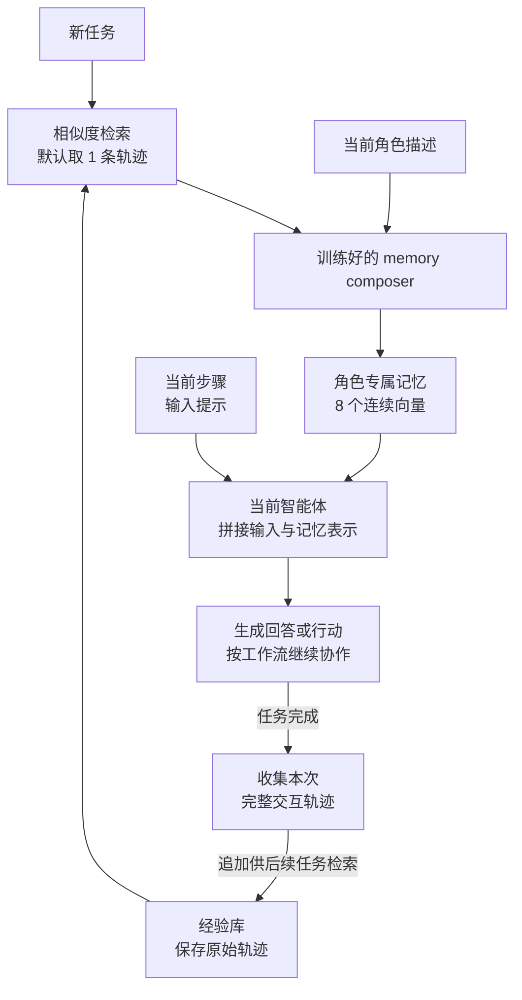
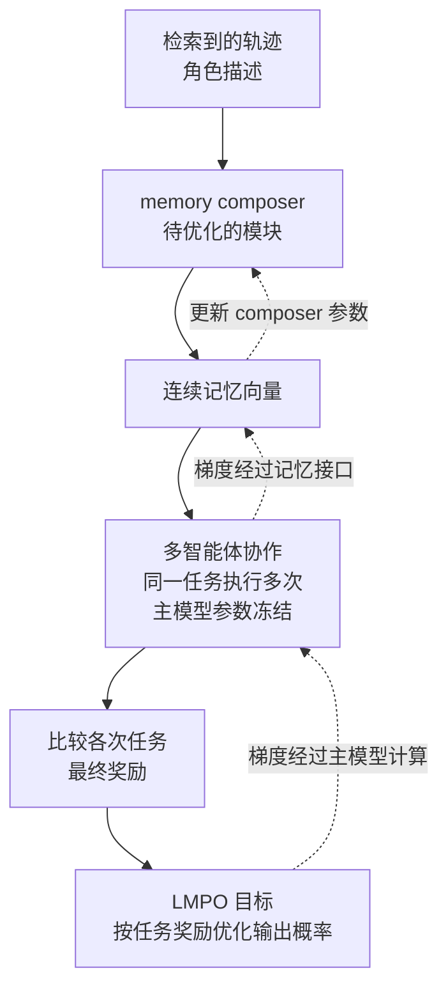

# LatentMem：把多智能体经验变成按角色定制的向量记忆

**论文**：LatentMem: Customizing Latent Memory for Multi-Agent Systems  
**作者与年份**：Muxin Fu、Xiangyuan Xue 等，EMNLP 2026  
**来源**：[正式发表页面](https://aclanthology.org/2026.emnlp-main.457/) · [本地正式版原文](LatentMem_Original/LatentMem_EMNLP2026.pdf)  
**标签**：多智能体、经验检索、连续向量记忆、任务奖励优化  
**版本**：依据 EMNLP 正式版；预印本发表于 2026 年 2 月。

## 1. 研究问题：同一段历史经验，怎样以较少的上下文帮助不同角色？

多智能体系统（多个承担不同角色的语言模型协作完成任务）可以保存过去的交互轨迹，供后续任务参考。但完整轨迹很长，而且规划者、执行者、检查者需要关注的内容并不相同。把相同记录交给所有角色，可能增加上下文负担，也可能让角色机械模仿不适合当前任务的操作。LatentMem 希望学习一种记忆生成方式：从共同经验中提取每个角色需要的信息，并以紧凑形式供其使用。[§1](LatentMem_Original/LatentMem_EMNLP2026.pdf#page=1)

## 2. 核心思路：检索原始经历，按角色压缩，再用任务成败训练压缩方式

框架保留一个存放原始交互轨迹的经验库。新任务到来后，先按向量相似度找出相关轨迹，再把轨迹和当前智能体的角色描述交给 memory composer（将经验转换成角色专属记忆的可训练模型）。默认只检索一条轨迹，为每个角色产生 8 个连续向量，作为额外输入表示交给智能体。[§4.1—4.3、图2、§5.1](LatentMem_Original/LatentMem_EMNLP2026.pdf#page=3)

这 8 个位置不是八个可读词，而是 composer 最后一层的隐藏状态。例如，过去的一次编程经历，可以为规划角色提供任务拆分线索，为测试角色提供检查线索；但具体记忆保存在向量中，不能直接读出一份文字摘要。智能体读取这些向量后继续生成自己的回答。[§4.3、式5—6](LatentMem_Original/LatentMem_EMNLP2026.pdf#page=4)

composer 通过 LMPO（利用整个多智能体任务的结果来优化记忆生成的方法）训练：同一问题采样多次任务执行，比较最终奖励，使 composer 倾向于产生能改善任务结果的记忆。训练时智能体主模型参数冻结，但梯度通过它的计算传回 composer。推理时使用训练好的 composer，完成任务后把新轨迹加入经验库；增加经验不等于在线更新模型参数。[§4.2、§4.4](LatentMem_Original/LatentMem_EMNLP2026.pdf#page=4)

**Pipeline 1：推理时读取经验，并随任务完成积累新经历。**

同一任务中，每个角色执行时使用自己的角色描述生成记忆。这里更新的是经验库，composer 和智能体的参数保持不变。[§4.1—4.3、图2](LatentMem_Original/LatentMem_EMNLP2026.pdf#page=3)

**Pipeline 2：训练时，用整个任务的结果优化 composer。**

实线表示前向执行与奖励评估，虚线表示梯度回传。主模型参数冻结，但它仍参与计算并传递梯度；被训练的是生成记忆的 composer。[§4.4、式7—13](LatentMem_Original/LatentMem_EMNLP2026.pdf#page=4)

## 3. 主要发现：任务效果和部分成本改善，角色信息也确实有贡献

- **已见任务与未见协作框架均有收益。**使用 Qwen3-4B-Instruct-2507，AutoGen 在 TriviaQA 上从 60.31 提高到 76.51；未用于训练的 DyLAN 在 PopQA 上从 24.89 提高到 44.25。后者是摘要所称的最高提升，按数值为 **19.36 个百分点**，并非相对增长 19.36%。训练经验来自 AutoGen、MacNet 在四个域内数据集上的 40,580 条轨迹。[§5.1—5.2、表1](LatentMem_Original/LatentMem_EMNLP2026.pdf#page=5)
- **紧凑记忆有机会减少整个任务的用量。**AutoGen＋KodCode 的图示总 token 消耗约为 176 万，G-Memory 为 304 万，无记忆为 177 万；LatentMem 同时取得更高分数。成本统计包含检索和记忆注入后的推理过程，但这里不包含一次性的 composer 训练成本，不能将单个设置推广为所有任务固定省一半。[§5.3、图3](LatentMem_Original/LatentMem_EMNLP2026.pdf#page=7)
- **按角色生成并非可有可无。**移除角色描述、让不同角色共享同一记忆后，MacNet 在 KodCode 上下降 6.45 个百分点，AutoGen 下降 2.30 个百分点。这支持角色定制的价值，也说明收益大小受协作方式影响。[§5.6、图7](LatentMem_Original/LatentMem_EMNLP2026.pdf#page=8)

## 4. 研究位置与边界：经验仍在外部，压缩后的读取接口位于模型内部

与 G-Memory 等组织、检索文本记忆的路线相比，LatentMem 将更多工作交给可学习的 composer：外部保存原始轨迹，读取时生成角色专属向量。与主要服务单智能体经验利用的 MemGen 相比，它聚焦不同角色交错参与的历史轨迹，并按整个协作任务的结果训练记忆。[§2、§4.2](LatentMem_Original/LatentMem_EMNLP2026.pdf#page=2)

“不修改智能体工作流”仍然需要模型层面的记忆注入接口。作者明确指出它更适合开放权重或可控制内部表示的模型，不能直接视为适配所有黑盒 API。现有评估主要覆盖文本任务，多模态和长时程稳定性仍待研究。[Limitations](LatentMem_Original/LatentMem_EMNLP2026.pdf#page=9)

composer 也有规模和训练成本：附录以预训练语言模型初始化它，再用 LoRA（只训练少量附加参数的微调方式）优化；报告的训练约需两张 H200 运行 15 小时。[§5.1](LatentMem_Original/LatentMem_EMNLP2026.pdf#page=6)、[附录B.4.4](LatentMem_Original/LatentMem_EMNLP2026.pdf#page=16)

## 5. 阅读所得：记忆的价值取决于谁来读，以及能否改善最终行动

值得保留的想法是，把经验保存与经验利用分开：共同保存原始经历，在使用时按角色提取信息，再用任务效果检验这种提取是否有用。经验库增长、composer 学习、主模型参数更新也是三个不同过程，需要分别判断。

若继续阅读，优先看§4.3—4.4，理解向量注入和奖励如何影响 composer；再看图7及附录B.4，核查角色定制、经验积累与训练预算分别贡献了什么。
