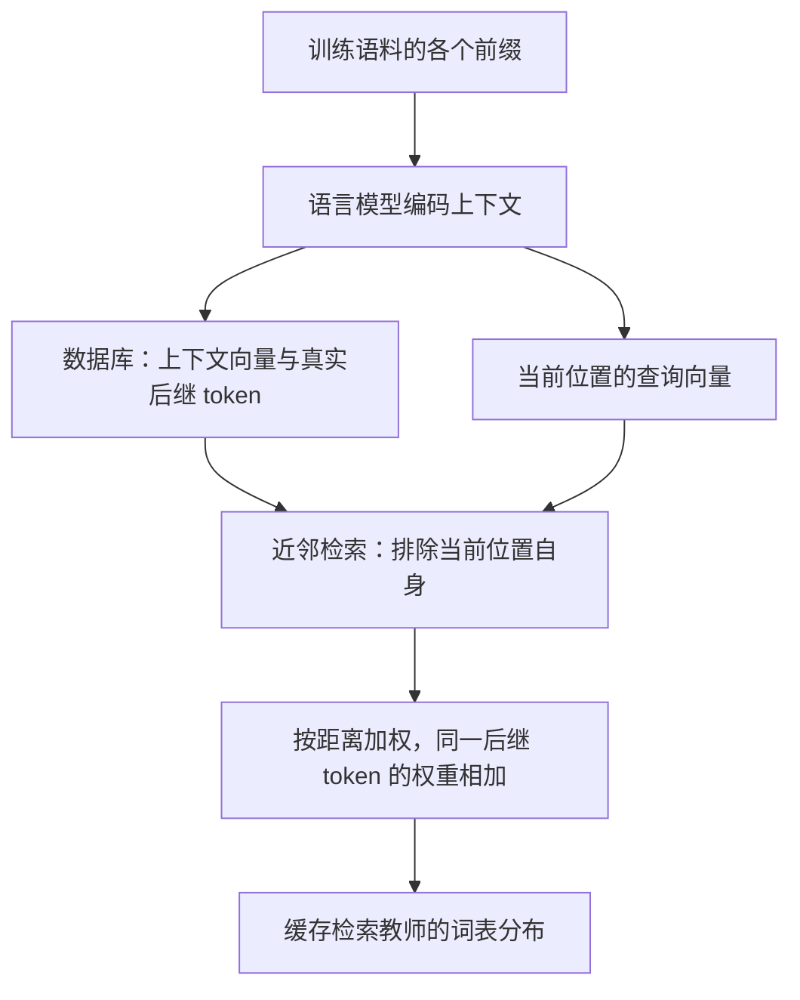
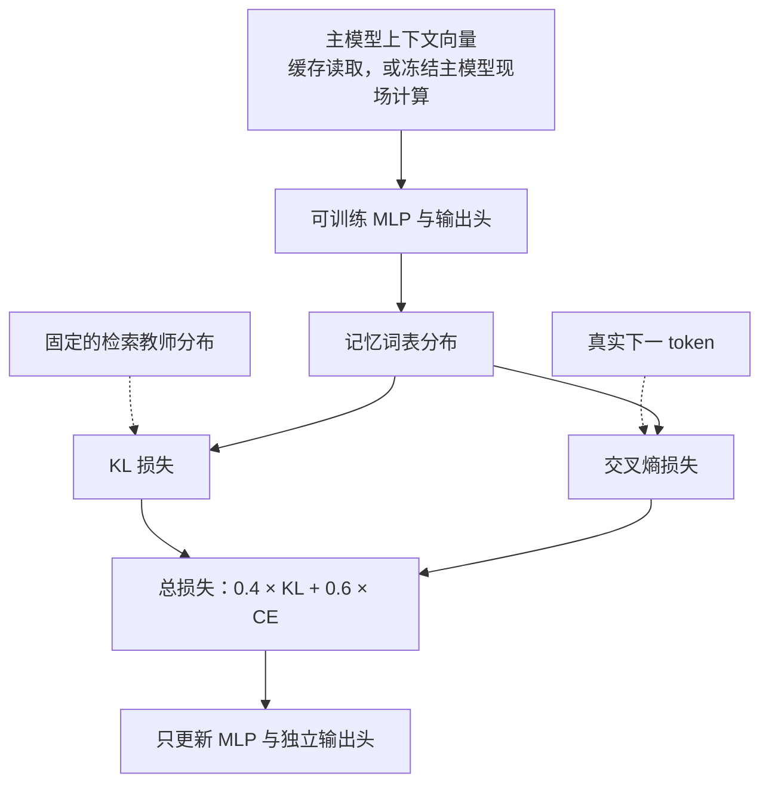
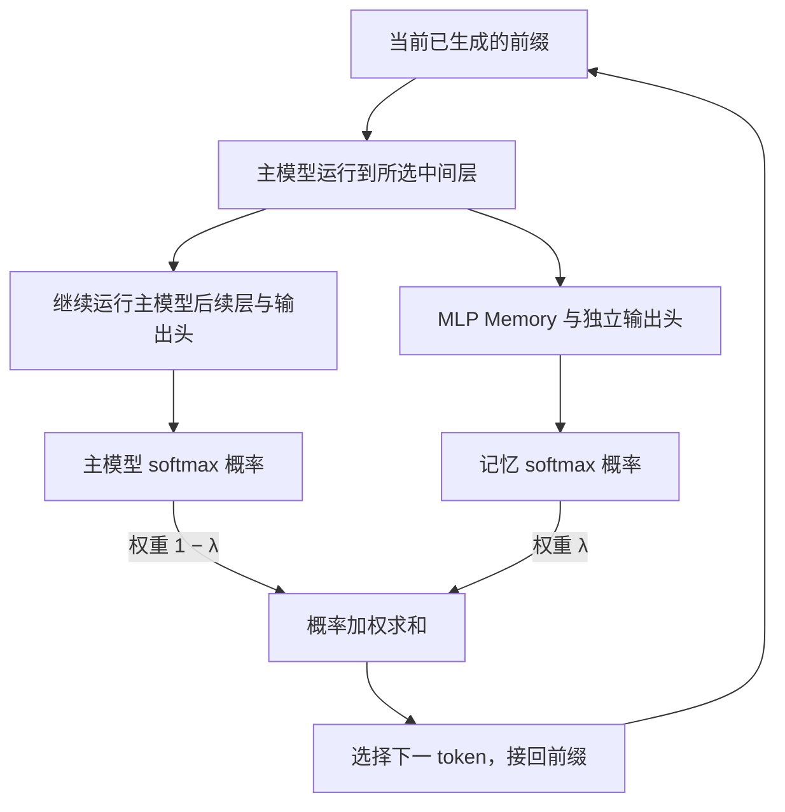

# MLP Memory：把检索分布学进独立 MLP

## 1. 开篇讲清楚：论文做了什么，核心 idea 是什么

MLP Memory 希望给大模型补充语料中的知识，同时减少在线检索的存储和延迟开销。核心做法是：先让检索器根据当前上下文给出下一 token 的概率分布，再训练一个独立 MLP，让它输入主模型的隐藏向量，就能预测这份检索分布。语料中相似上下文的续写规律因此被学进 MLP 参数，部署时用一次前向计算代替搜索大型向量库。

生成时，主模型照常计算下一 token 分布，MLP 根据主模型中间层的表示计算记忆分布，两者线性插值后选出下一 token。主模型提供上下文理解和原有预测能力，额外 MLP 补充从检索中学到的信息；训练记忆模块时可以冻结主模型。以下依据论文 *MLP Memory: A Retriever-Pretrained Memory for Large Language Models* 的 [arXiv v4 正文及附录 A–J](https://arxiv.org/pdf/2508.01832v4)。

## 2. 开始梳理详细的方法：先理清各项设计的逻辑关系，再逐步构建完整方法

实现这个想法，需要依次确定：**检索输出什么 → 怎样生成监督 → MLP 如何获得上下文并预测分布 → 怎样训练 → 怎样接入生成。** 输入层、容量和缓存方式分别服务于这些环节。

### 2.1 先确定要替代的检索行为：从上下文向量得到下一 token 分布

论文选择模仿 kNN-LM（把上下文编码成向量，查找语料中最相似的若干上下文，再用它们后面的 token 估计下一 token 概率）。

给定前缀 $c_t=(w_1,\ldots,w_{t-1})$，先用语言模型对训练语料做前向计算，保存：

$$
\mathcal D_{\mathrm{store}}
=\{(\mathbf k_i,v_i)\}_{i=1}^{N},
\qquad
\mathbf k_i=f(c_i),\quad v_i=w_i.
$$

每个 key 是一个上下文隐藏向量，value 是该上下文后面实际出现的 token ID。例如，前缀“The Eiffel Tower is in”的 key 表示这段上下文，value 可以是 Paris 对应的 token。库中一个位置贡献一个后继 token。

预测新位置时，计算 query $q=f(c_t)$，找到距离最近的 k 个 key，记作 $\mathcal N_k(q)$。按距离加权：

$$
a_i(q)=
\frac{\exp(-\|q-\mathbf k_i\|_2^2/\tau)}
{\sum_{j\in\mathcal N_k(q)}
\exp(-\|q-\mathbf k_j\|_2^2/\tau)},
$$

$$
p_{\mathrm{kNN}}(y\mid c_t)
=\sum_{i\in\mathcal N_k(q)}
\mathbf 1[v_i=y]\,a_i(q).
$$

$\tau$ 是温度：越小越偏向最近的邻居，越大则邻居权重越接近。具有相同后继 token 的邻居，其权重会相加。上式是原文式 (3) 的归一化形式，并写出了代码使用的温度。[原文 §2，式 (2)–(3)，p.4](https://arxiv.org/pdf/2508.01832v4#page=4)；[检索实现](https://github.com/LUMIA-Group/MLPMemory/blob/6801e43fc54a40f3217c2245a0c0019bbf137372/knn_utils/saveKNNMulti.py)。

假设四个邻居的权重是 0.4、0.3、0.2、0.1，后继 token 是 Paris、Paris、London、Beijing，那么检索分布就是 Paris 0.7、London 0.2、Beijing 0.1。这说明，虽然检索要访问大量条目，生成器最终使用的只是一个**词表概率向量**。

于是可以把待学习任务明确为：

$$
\text{上下文向量 }q
\longmapsto
\text{检索产生的词表分布 }p_{\mathrm{kNN}}(\cdot\mid c_t).
$$

确定这个接口后，下一步才是为它制造训练样本。

### 2.2 怎样生成监督：逐位置检索，同时排除自己

对训练语料中的每个位置，计算检索分布并保存：

$$
\bigl(q_t,\ r_t,\ w_t\bigr),
\qquad
r_t=p_{\mathrm{kNN}}(\cdot\mid c_t).
$$

其中 $q_t$ 是 MLP 输入，$r_t$ 是检索教师分布，$w_t$ 是真实下一 token。“教师”指提供训练目标的系统，此处就是检索器。

因为 query 来自建库语料，库里也包含它自己。如果允许检索自身，距离通常为 0，value 又恰好是真实答案，监督便容易退化为把原标签直接交回来。因此生成 $r_t$ 时排除当前位置自身，让分布由其他相似上下文形成。排除自身不等于去除了语料中的重复段落，也不能代替训练集与评测集去重。[原文 §3.2，p.6](https://arxiv.org/pdf/2508.01832v4#page=6)

原文使用 $k=1024$ 生成目标，向量和检索分布可以离线缓存。官方实现通过近似向量索引加速搜索，并只保存有效 token 概率以减少缓存体积。这些安排把较重的建库和搜索集中在训练之前；部署阶段省去检索，仍然需要先支付监督构造成本。[附录 F，pp.22–23](https://arxiv.org/pdf/2508.01832v4#page=22)；[官方训练流程](https://github.com/LUMIA-Group/MLPMemory#-training-mlp-memory)。

教师和学生还可以使用不同来源的上下文表示：教师用较大模型的向量搜索，学生用自己的输入向量预测对应位置的教师分布。两者不必维度相同，但文本位置、tokenizer 和输出 token ID 必须对齐。附录 E 用不同 GPT-2 模型生成教师目标，训练同一个小型学生，验证的就是这种配置。[附录 E，p.22](https://arxiv.org/pdf/2508.01832v4#page=22)

**监督构造：先搜索，再把邻居变成词表分布**

解读图：数据库只用于离线制造监督，后继 token 聚合后才形成 MLP 的学习目标。对应 §2.1–2.2。

### 2.3 MLP 怎样理解上下文：复用主模型表示，再逐位置变换

监督已有，但独立 MLP 不读整段文本，它的上下文从哪里来？主模型已经通过因果注意力处理过前缀，因此直接取某层当前位置的表示：

$$
q_t=f_\theta^{(K)}(c_t)\in\mathbb R^d.
$$

这个向量包含截至 $w_{t-1}$ 的上下文，用于预测 $w_t$。MLP 负责把已经上下文化的向量映射到词表，不再单独执行一套 token 间的注意力。对于形状为 $B\times T\times d$ 的一批隐藏状态，它在各个位置使用同一组参数，位置之间不交换信息。[原文 §3.1，pp.5–6](https://arxiv.org/pdf/2508.01832v4#page=5)

**输入层影响向量是否适合这个任务。** 作者在 GPT-2 的不同深度接入 MLP，发现较好位置集中在约 70% 网络深度附近。可以理解为：浅层上下文处理不足，最后几层又更贴近原模型输出目标；这是解释性分析，论文未证明其机制。这个经验来自 GPT-2 消融，不能直接视为所有骨干的统一最优层。[原文 §5.5，图 6(b)，p.11](https://arxiv.org/pdf/2508.01832v4#page=11)

接下来需要一个足以拟合复杂分布的网络。结合附录和代码，Llama/Mistral 版本使用带归一化、门控和残差的 MLP 块。令 $z^{(0)}=q_t$，第 $\ell$ 块为：

$$
u^{(\ell)}=\operatorname{RMSNorm}(z^{(\ell)}),
$$

$$
z^{(\ell+1)}
=z^{(\ell)}
+W_{\mathrm{down},\ell}
\left[
\operatorname{SiLU}(W_{\mathrm{gate},\ell}u^{(\ell)})
\odot
(W_{\mathrm{up},\ell}u^{(\ell)})
\right].
$$

RMSNorm（按向量元素的均方根归一化，并学习逐维缩放）控制表示尺度；SiLU 是激活函数 $x\sigma(x)$；$\odot$ 是逐元素乘法。一条投影分支调节另一条分支的特征，再投影回原维度并加上残差。GPT-2 版本沿用该系列的 LayerNorm、GELU 和两层前馈结构。[附录 I，pp.26–27](https://arxiv.org/pdf/2508.01832v4#page=26)；[Mistral 结构代码](https://github.com/LUMIA-Group/MLPMemory/blob/6801e43fc54a40f3217c2245a0c0019bbf137372/models/mlpMistral.py)。

经过 m 个块，再用记忆模块自己的输出头映射到词表：

$$
\ell_\phi=W_{\mathrm{out}}\operatorname{Norm}(z^{(m)}),
\qquad
p_\phi(\cdot\mid c_t)=\operatorname{softmax}(\ell_\phi),
$$

其中 $W_{\mathrm{out}}\in\mathbb R^{|V|\times d}$，$\phi$ 包含记忆模块的全部可训练参数。

| 主模型 | 记忆块数 | 隐藏维度 | 前馈中间维度 |
|---|---:|---:|---:|
| Llama-2-7B | 8 | 4096 | 11008 |
| Mistral-7B-v0.3 | 8 | 4096 | 14336 |

论文把这些模块统称为约 1B 参数。按上述矩阵维度估算，仅前馈投影分别约为 1.08B、1.41B，另有词表输出头，因此这是量级描述，精确部署预算应按具体模型统计。[附录 I，表 11，p.27](https://arxiv.org/pdf/2508.01832v4#page=27)

原文图 4：左侧两条路径共享主模型隐藏向量，右侧检索器只在训练时提供监督。图中 λ 的权重标注与正文式 (7) 相反，下文统一按式 (7) 解释。[来源：p.5](https://arxiv.org/pdf/2508.01832v4#page=5)

到这里，MLP 已能输出分布。剩下的问题是：只要求它模仿检索，是否会把邻居中的错误也学进去？

### 2.4 怎样训练：检索分布提供多候选信息，真实标签负责纠偏

论文同时使用两种监督。第一种是检索分布，通过 KL 散度（衡量两份概率分布差异的量）使学生接近教师：

$$
\mathcal L_{\mathrm{KL}}(t)
=D_{\mathrm{KL}}(r_t\|p_\phi)
=\sum_y r_t(y)
\log\frac{r_t(y)}{p_\phi(y\mid c_t)}.
$$

它让 MLP 学习多个合理后继 token 及其相对权重，而不只是一个标签。第二种是实际语料中的下一 token，通过交叉熵纠正不适合当前样本的邻居预测：

$$
\mathcal L_{\mathrm{CE}}(t)
=-\log p_\phi(w_t\mid c_t).
$$

两者合成：

$$
\mathcal L(t)
=\alpha\mathcal L_{\mathrm{KL}}(t)
+(1-\alpha)\mathcal L_{\mathrm{CE}}(t),
\qquad \alpha=0.4.
$$

这是原文式 (4)–(6)。$\alpha=0$ 退化为普通下一 token 监督，$\alpha=1$ 完全拟合检索；中间值同时利用邻域统计和当前真实标签。[原文 §3.2，p.6](https://arxiv.org/pdf/2508.01832v4#page=6)

为了看清更新方向，可以将损失等价改写为对混合标签做交叉熵：

$$
\widetilde r_t(y)
=\alpha r_t(y)+(1-\alpha)\mathbf 1[y=w_t],
$$

$$
\mathcal L(t)
=-\sum_y\widetilde r_t(y)\log p_\phi(y\mid c_t)
+\text{与 }\phi\text{ 无关的常数}.
$$

因为教师分布固定，其熵不影响参数更新。相应地，对 logits 的梯度为 $p_\phi(y\mid c_t)-\widetilde r_t(y)$：提高预测概率低于目标的 token，降低高于目标的 token。这是对原文损失的推导。

**主要实验冻结主模型，只更新 MLP。** 教师分布也固定。向量已经缓存时，训练可以完全不运行主模型；在线计算输入向量时，主模型只做前向，不求梯度。官方代码将前一 token 位置的隐藏状态与下一 token 标签对齐，避免输入提前看到答案；补齐序列的位置不计入损失。[训练封装](https://github.com/LUMIA-Group/MLPMemory/blob/6801e43fc54a40f3217c2245a0c0019bbf137372/models/mlpMemory.py)；[损失实现](https://github.com/LUMIA-Group/MLPMemory/blob/6801e43fc54a40f3217c2245a0c0019bbf137372/utils/cal_loss.py)。

论文说模块“可微分”，表示结构上允许梯度经过 MLP 输入传回主模型，不代表主要实验已经联合更新两者。实际流程选择冻结骨干，以保留其权重并减少训练负担。

**训练：固定输入与教师，只学习 MLP**

解读图：此处损失评价的是 MLP 自己的输出；最终概率插值发生在使用阶段。主模型和检索教师均不更新。对应 §2.4。

### 2.5 怎样接入生成：只在输出概率处融合

训练好 MLP 后，每个位置分别计算主模型分布 $p_{\mathrm{LM}}$ 与记忆分布 $p_\phi$，然后：

$$
p_{\mathrm{final}}(y\mid c_t)
=\lambda p_\phi(y\mid c_t)
+(1-\lambda)p_{\mathrm{LM}}(y\mid c_t).
$$

$\lambda$ 控制记忆影响，按任务验证集选择；它与控制训练监督的 $\alpha$ 不同。融合对象是分别 softmax 后的概率，不能直接改成 logits 加权。这里采用式 (7) 和官方代码的定义：λ 越大，记忆权重越高。[原文 §3.3，式 (7)，p.7](https://arxiv.org/pdf/2508.01832v4#page=7)

对应图 4(a)，MLP 输出没有写回当前 token 的主模型隐藏状态，两条路径在输出端汇合。选出的 token 会进入下一步前缀。推理不访问教师库，不需要真实答案，也不会自动更新记忆参数。

**推理：两份概率在输出端汇合**

解读图：λ 按正文式(7)表示记忆权重。记忆分支不写回同一步主模型隐藏状态，推理不访问检索库。对应 §2.5。

### 2.6 用一个例子串起训练、推理和候选评分

以下数字仅用于说明计算，暂把实体看成单个 token。

**训练。** 对“The Eiffel Tower is in”，真实 token 为 Paris。主模型先产生 $q_t$；排除自身后，检索教师给 Paris、London、Beijing 的概率为 0.7、0.2、0.1。若 $\alpha=0.4$，混合训练标签就是：

$$
\widetilde r_t=(0.88,\ 0.08,\ 0.04).
$$

MLP 输入 $q_t$，输出概率，计算 KL+CE，仅更新其参数。对所有训练位置重复。

| 训练方式 | 输入向量从哪里来？ | 教师分布从哪里来？ | 参数更新 |
|---|---|---|---|
| 离线训练 | 读取预先保存的向量 | 读取缓存 | 只更新 MLP |
| 在线训练 | 现场运行冻结的主模型 | 读取缓存 | 只更新 MLP |

在离线方式下，这条样本直接读取缓存的 $q_t$、教师分布和 Paris 标签，运行 MLP 后更新参数；在线方式则先把这段文本送入冻结的主模型得到 $q_t$，再执行同样的损失与更新。后者少存一份输入向量，但增加前向开销；“在线”不表示在用户对话中即时学习。[官方训练说明](https://github.com/LUMIA-Group/MLPMemory#-training-mlp-memory)

**自由生成。** 对新前缀“You'll find the Eiffel Tower in”，主模型给三个候选及“其他”的概率为 $(0.30,0.45,0.10,0.15)$，MLP 给出 $(0.80,0.10,0.05,0.05)$。若 $\lambda=0.4$：

$$
p_{\mathrm{final}}
=0.6(0.30,0.45,0.10,0.15)
+0.4(0.80,0.10,0.05,0.05)
=(0.50,0.31,0.08,0.11).
$$

贪心生成会选 Paris。将其接回前缀，再重复两条分支的计算。实体被 tokenizer 切成多个 token 时，同样逐 token 处理。

**候选答案评分。** 若任务给定候选答案 $a=(a_1,\ldots,a_L)$，则逐位置使用融合分布，累计：

$$
\log p_{\mathrm{final}}(a\mid c)
=\sum_{j=1}^{L}\log p_{\mathrm{final}}(a_j\mid c,a_{<j}).
$$

例如候选是“Paris”和“London”，在上述概率下分别得 $\log 0.50$、$\log 0.31$，前者更高。多 token 答案继续按候选自己的前文评分；不需要先自由生成答案。通用分类任务还会校正标签的常见程度，具体口径见实验部分。

## 3. 围绕问题解释实验：为什么做，结果怎样，得到什么回答

语言建模实验使用 GPT-2 系列、WikiText-103（约 100M tokens）与 Web 混合语料（约 600M tokens）；大模型实验使用 Llama-2-7B、Mistral-7B-v0.3 及各自单独训练的记忆模块。QA 用 Wikipedia-2021，通用 NLP 用百科、评论、新闻等混合语料，幻觉评测复用 QA 记忆。因此，覆盖“整个语料”指选定的记忆训练语料，并非已经重建了这两个 7B 模型全部原始预训练数据。[原文 §4–5.1，pp.7–8；附录 A，p.18](https://arxiv.org/pdf/2508.01832v4#page=7)

作者使用 32 张 A800 80GB；大模型记忆训练采用 AdamW 优化器（根据各参数的梯度历史调整更新步长），学习率 $4\times10^{-4}$，前 3% 步数预热后线性下降，训练 5 轮。正文称预算相当于 7B 模型训练 1 轮，但没有完整拆分建库、检索目标生成和缓存成本。以下结果均为论文报告值。[原文 §4；附录 A，表 4](https://arxiv.org/pdf/2508.01832v4#page=18)

### 3.1 给新增容量安排检索任务，是否比继续训练 decoder 更有效？

如果只比较“原模型”和“原模型加大模块”，收益可能只是参数增多。作者因此在给定计算预算下，以总参数量为横轴，比较继续训练 GPT-2 与 GPT-2 加 MLP，范围约为数亿至 1.5B 参数。

原文图 5：左、中分别是两份语料上的总参数缩放，右图固定模型规模、增加训练计算。[来源：p.8](https://arxiv.org/pdf/2508.01832v4#page=8)

指标为 PPL（真实 token 平均负对数概率取指数，越低越好），拟合形式为 $\mathrm{PPL}=(\beta N)^\gamma$：

| 数据集 | 继续训练 decoder 的 γ | 主模型 + MLP 的 γ | 指数绝对值相对增加 |
|---|---:|---:|---:|
| WikiText-103 | -0.143 | -0.168 | 17.5% |
| Web | -0.216 | -0.268 | 24.1% |

17.5% 来自 $(0.168-0.143)/0.143$，另一项同理。它们表示**拟合曲线指数的改善，不是 PPL 直接降低相同比例**。固定参数、增加训练计算时，组合系统的 Web PPL 也持续下降，测试范围内没有明显过拟合。[原文 §5.1，图 5、式 (8)–(9)，pp.8–9](https://arxiv.org/pdf/2508.01832v4#page=8)

这些结果支持：在给定规模、数据和预算下，把部分新增容量用于学习检索分布，比只继续训练 decoder 更有效。实验基于已有 GPT-2 权重，参数点也较少，尚不能外推为更大模型从零预训练时的普适规律。

### 3.2 学到的记忆能否改善问答？

作者用同一 Wikipedia 语料比较 RAG、kNN-LM、CPT、LoRA 和 MLP Memory。RAG 检索前 5 篇文档；LoRA 调整低秩维度，使训练参数量与记忆模块相近；kNN-LM 固定 λ=0.1、τ=10，MLP 的 λ 则按任务验证集选择。

NQ、WebQA、TriviaQA、HotpotQA 使用 EM（规范化答案与参考答案完全匹配的比例）。TruthfulQA 则根据候选答案概率评分，综合最佳正确答案是否胜过错误答案、正确答案总概率，以及胜过最高分错误答案的正确候选比例，取三项均值。Mistral 结果如下：

| 方法 | NQ | WebQA | TriviaQA | TruthfulQA | HotpotQA | 平均 |
|---|---:|---:|---:|---:|---:|---:|
| 原模型 | 20.63 | 29.28 | 57.65 | 32.09 | 20.96 | 32.12 |
| + RAG | 22.56 | 24.90 | 54.21 | 35.47 | 29.77 | 33.38 |
| + kNN-LM | 21.05 | 30.51 | 57.77 | 32.33 | 21.20 | 32.57 |
| + CPT | 12.16 | 34.06 | 61.21 | 29.18 | 16.04 | 30.53 |
| + LoRA | 18.17 | 34.50 | 61.60 | 30.91 | 16.23 | 32.28 |
| + MLP Memory | **25.20** | **37.45** | 60.99 | 32.54 | 24.14 | **36.06** |

来源：[原文表 1，p.9；指标见附录 A，p.18](https://arxiv.org/pdf/2508.01832v4#page=9)；[TruthfulQA 评分实现](https://github.com/LUMIA-Group/MLPMemory/blob/6801e43fc54a40f3217c2245a0c0019bbf137372/downstream/eval_truthfulqa.py)。

Mistral 平均增加 3.94 个百分点，相对提高 12.3%；Llama-2 平均从 32.81 到 35.38，相对提高 7.8%。两个骨干都受益，说明收益能够转化为下游问答表现。

但 MLP 没有在每项都胜过所有基线：RAG 在 Mistral 的 TruthfulQA、HotpotQA 更好，LoRA 在 TriviaQA 更好。表中平均也混合了不同指标。加上 kNN 与 MLP 的调参口径不同，这组结果支持平均收益，不能单独证明参数化压缩必然优于充分调优的检索。

### 3.3 补充知识时，是否保留通用能力并减少幻觉？

**通用能力。** 冻结主模型只保证其权重不被覆盖，最终分布仍会改变，因此需要实际测试。论文在九项分类任务上评测 Mistral，覆盖情感、新闻倾向、文本蕴含与主题分类。使用 domain-conditional PMI（从输入条件下的候选标签得分中，减去领域提示下标签本身的常见程度，减少常见标签的优势）评分，基本形式为：

$$
s(a,c)=\log p(a\mid c)-\log p(a\mid c_{\mathrm{domain}}).
$$

MLP 在九项上均高于原模型，平均从 67.86 到 73.07，增加 5.21 个百分点；RAG、kNN、CPT、LoRA 的平均分别为 70.79、68.50、70.58、67.88。CR 从 62.30 到 75.95，CB 从 69.64 到 76.79，RTE 从 59.57 到 64.62。结果支持这组任务上的能力改善，但使用的是另行训练的混合语料记忆，不能写成同一个百科模块在全部任务上都无损，也没有覆盖数学、代码等能力。[原文表 2，p.10；附录 A，p.18](https://arxiv.org/pdf/2508.01832v4#page=10)

**幻觉识别。** HaluEval 让模型判断给定内容是否包含不实或不一致信息，测量的是识别准确率。它检验事实知识能否帮助判断，不直接测自由生成中的幻觉比例：

| 方法 | 对话 | QA | 摘要 |
|---|---:|---:|---:|
| 原模型 | 57.18 | 53.99 | 50.27 |
| + CPT | 51.68 | 46.49 | 47.39 |
| + LoRA | 55.51 | 50.02 | 50.38 |
| + RAG | 59.06 | **65.09** | 未测 |
| + MLP Memory | **66.86** | 64.07 | **52.41** |

按主表，MLP 分别增加 9.68、10.08、2.14 个百分点；RAG 的 QA 仍略好。摘要没有测 RAG，因为任务主要依据给定原文判断。[原文 §5.4，表 3，p.10](https://arxiv.org/pdf/2508.01832v4#page=10)

原文有一处数值冲突：附录表 5 将对话、QA 的最优值写成 64.07、66.86，与表 3 对调。这里按正文表 3 报告，具体任务与最优 λ 的对应仍需作者确认。可靠结论是这组幻觉识别结果改善，不能改写为“自由生成幻觉率下降 10 个百分点”。[附录 B，表 5，p.19](https://arxiv.org/pdf/2508.01832v4#page=19)

### 3.4 各项设计是否必要，收益受什么限制？

**检索监督是否有用？** 图 6(a) 固定架构，改变 KL 权重 α。三个 GPT-2 尺度都在 α≈0.4 时最好，纯 CE 与纯检索监督都较差，支持两种信号互补。纵轴把各组 PPL 线性缩放到 0%–100%，只表示相对好坏。§5.5 把“高 α”解释为偏向语言建模，与式 (6) 相反；应按公式理解为更偏向检索 KL。

**输入表示是否重要？** 图 6(b) 改变输入层，较好区域集中在约 70%–85% 深度，作者概括为约 70%。它支持对接入层做选择，但尚未在所有骨干验证同一个比例。[原文 §5.5，图 6，p.11](https://arxiv.org/pdf/2508.01832v4#page=11)

原文图 6：左图比较训练监督配比，右图比较输入层深度；两图纵轴均为各组归一化后的 PPL。[来源：p.11](https://arxiv.org/pdf/2508.01832v4#page=11)

**更强教师能否帮助同一个学生？** 附录 E 固定小型主模型和 MLP，教师从 GPT2-small 换到 medium、large、xl，最终 PPL 约为 12.91、12.87、12.85、12.84。方向上支持更好的检索目标，但改善较小且没有误差范围。这是更换监督来源，不是把训练好的 MLP 直接换接到其他主模型。[附录 E，图 8，p.22](https://arxiv.org/pdf/2508.01832v4#page=22)

**邻居数为什么用 1024？** 附录 F 在 GPT2-large-CPT 上测 kNN-LM：原 PPL 10.43，k=16 时为 9.71，k=1024 为 9.43，k=2048 为 9.42。教师检索质量在较大 k 后趋于饱和，支持选 1024。但表 9 测的是 kNN-LM，未分别训练不同 k 的 MLP 学生，不能当作学生对 k 的完整消融。[附录 F，表 9，p.23](https://arxiv.org/pdf/2508.01832v4#page=23)

**记忆越大越划算吗？** 固定 GPT2-large，增加记忆层数：

| 配置 | 记忆参数量 | WikiText-103 PPL |
|---|---:|---:|
| 原模型 | 无 | 15.81 |
| + 8 层记忆 | 221M | 11.41 |
| + 15 层记忆 | 359M | 11.35 |
| + 36 层记忆 | 772M | 11.25 |

8 层已取得大部分收益，再增加约 551M 参数只改善 0.16 PPL，说明容量收益递减，支持默认采用较浅配置。[附录 I–J，表 12–13，p.27](https://arxiv.org/pdf/2508.01832v4#page=27)

**融合权重能否任意增加？** 附录 B 的较好 λ 多在 0.35–0.55。摘要列中 λ=0.35 得 52.41，λ=0.9 降到 46.67，低于原模型 50.27，说明过度依赖记忆仍会损害表现。冻结骨干不能替代融合验证。[附录 B，表 5，p.19](https://arxiv.org/pdf/2508.01832v4#page=19)

### 3.5 MLP 学到了怎样的分布？

作者在 20,000 个测试位置上比较分布形态：

| 统计量 | 普通 LM | kNN | MLP |
|---|---:|---:|---:|
| 非零概率 token 数 | 50,257 | 251 | 50,257 |
| 累积 80% 概率所需 token 数 | 23 | 22 | 13 |
| 累积 99% 概率所需 token 数 | 617 | 126 | 308 |

MLP 保持完整词表支持，尾部比 LM 集中，但没有复制 kNN 的严格稀疏性；在 80% 概率阈值下，它甚至比两者都更集中。结果与“学习检索信号，同时被参数化模型和真实标签平滑”相符，不能只用“介于两者之间”概括所有性质。[附录 D，表 7–8，pp.20–21](https://arxiv.org/pdf/2508.01832v4#page=20)

附录 H 的少量案例还显示，MLP 可提高罕见实体的概率，同时避免 kNN 在某些功能词上的失准。这提供机制线索，但不是长尾事实覆盖率的系统测量。附录 G 的正确回答案例同样能说明可能性，不能替代整体基准。[附录 G–H，pp.23–26](https://arxiv.org/pdf/2508.01832v4#page=23)

### 3.6 省去检索以后，实际节省了多少成本？

原文图 1：右侧箭头以原始 7B 模型为参照，MLP 与检索方法的直接比值需由柱状图数值另算。[来源：p.1](https://arxiv.org/pdf/2508.01832v4#page=1)

在使用 Wikipedia-2021 的配置下，首页图 1 给出：

| 系统 | 首 token 延迟 | 生成速度 |
|---|---:|---:|
| Mistral-7B | 22 ms | 42 tokens/s |
| + RAG，前 5 篇 | 67 ms | 24 tokens/s |
| + kNN-LM | 151 ms | 6 tokens/s |
| + MLP Memory | 27 ms | 36 tokens/s |

kNN 已将向量从 4096 维降到 256 维加速。MLP 相对 RAG 的首 token 延迟约缩短到 1/2.5，吞吐提高 1.5 倍；相对 kNN，分别约为 1/5.6 和 6 倍。但与原模型相比，MLP 仍增加约 23% 首 token 延迟，生成速度下降约 14%。因此它证明的是较低成本的知识增强，没有证明加模块后比原模型本身更快。[原文图 1，p.1；§3.3，p.7](https://arxiv.org/pdf/2508.01832v4#page=1)

附录 C 在匹配层数、维度等假设下，给出 Transformer 与 MLP 的运算量比约为 $1+n_{\mathrm{ctx}}/(12d_{\mathrm{model}})$，说明 MLP 省去了注意力计算；这是两类模块间的比较，不能直接当作整个组合系统的加速比。[附录 C，式 (10)，pp.19–20](https://arxiv.org/pdf/2508.01832v4#page=19)

存储方面，作者用约 40TB 的 5B-token 检索库，对比约 1B 参数、32 位浮点格式约 4GB 的记忆权重。它体现的是部署形态改变，不是无损压缩：MLP 无法恢复全部原文，也未证明保留每条事实。固定结构的 MLP 推理成本不随库大小增长，但更大语料需要多少训练、是否需要扩大模块，论文没有解决。知识较稳定且请求量较大时，这种离线投入更容易被摊薄；更新频繁时，仍需计算再训练代价。[原文 §1，p.3](https://arxiv.org/pdf/2508.01832v4#page=3)

## 4. 围绕同一个问题，解释已有方法及其特点

### 4.1 知识保存在可检索条目中：文档级 RAG 与 kNN-LM

一种路线保留原文，收到问题后检索相关段落，把段落交给语言模型阅读。这是文档级 RAG 的常见方式。资料更新主要发生在文档和索引中，容易保留证据；代价是在线搜索和更长的上下文。模型可以围绕原文组合信息，但也可能被无关段落或提示格式干扰。检索选择中的离散操作不直接传梯度，并不意味着检索器和生成器都不能训练。[Lewis 等，RAG，§2](https://arxiv.org/abs/2005.11401)

另一种路线保存逐位置上下文向量及其后继 token，查询时直接汇总下一 token 分布，即前面定义的 kNN-LM。它无需把文档拼进提示，换一份库就能改变可访问知识，但每个生成位置都要搜索。它擅长利用相似模式与稀有事实，不能保证信息组合和推理随之改善。[Khandelwal 等，kNN-LM，§2](https://arxiv.org/abs/1911.00172)；[Geng 等，Great Memory, Shallow Reasoning](https://arxiv.org/abs/2408.11815)。

MLP Memory 继承后者的预测接口，把库的作用转成训练监督。它减少在线访问成本，同时失去条目级即时增删和直接提供原文证据的能力。

### 4.2 知识写入参数：继续预训练、LoRA 与 Parametric RAG

直接用新语料训练主模型，是继续预训练 CPT；只训练附加的低秩改变量，则是 LoRA。后者把权重更新写成 $W'=W+BA$，用较小的中间维度减少可训练参数。两者在推理时都通过改变主模型的变换使用知识，可能需要处理新旧能力之间的取舍。[Hu 等，LoRA，§4](https://arxiv.org/abs/2106.09685)

还可以为每篇文档离线训练一份参数，收到问题后检索文档，再装载或合并对应参数，让模型利用这些知识。这是 Parametric RAG 的“检索 → 更新 → 生成”流程：减少文本上下文，但仍保留在线检索，并按查询切换知识参数。[Su 等，Parametric RAG，§3，pp.3–5](https://arxiv.org/pdf/2501.15915#page=3)

MLP Memory 则保留主模型权重，用一份固定模块直接预测记忆分布，不在每次查询时选择文档参数。优点是部署计算固定，代价是新增事实通常需要训练模块，而非只修改一条库记录。

### 4.3 知识保存为可读取的表示：上下文记忆与 FFN 记忆

保存过去文本的隐藏表示、在后续文本中重新读取，是另一类记忆方式。例如 Memorizing Transformers 在某层通过近邻访问历史 key-value，读到新资料即可加入表示，不必等它被训练进参数。它主要扩展模型可访问的历史，而 MLP Memory 使用训练后固定的参数；后者没有提供对话中的持久写入和删除机制。[Memorizing Transformers，§2](https://arxiv.org/abs/2203.08913)

普通 Transformer 的 FFN 本身也有记忆式解释：第一层检测文本模式，激活作为系数，第二层组合相应“值”。Geva 等的分析说明 FFN 可能承担知识相关功能，但没有直接给出本文这种“独立模块拟合全语料检索分布”的训练任务。MLP Memory 借用这一结构直觉，把它落实成明确的输入、监督和输出接口。[Geva 等，Transformer Feed-Forward Layers Are Key-Value Memories](https://aclanthology.org/2021.emnlp-main.446/)

### 4.4 同样学习检索分布，但自己读取文本：Memory Decoder

最接近的工作是同团队的 Memory Decoder。它用小型 Transformer decoder 直接读取文本前缀，也用 kNN 分布与真实 token 联合训练，部署时与主模型做概率插值。因此两者共享“把检索行为学进额外参数”的思路，不能将 Memory Decoder 仅视为普通下一 token 训练的小模型。[Memory Decoder §3，pp.4–5](https://arxiv.org/pdf/2508.09874#page=4)

| 比较项 | MLP Memory | Memory Decoder |
|---|---|---|
| 输入 | 主模型某层隐藏向量 | 经过 tokenizer 切分的文本前缀 |
| 上下文计算 | 复用主模型表示 | 小 decoder 自己做注意力 |
| 训练信号 | 检索分布 + 真实 token | 检索分布 + 真实 token |
| 融合位置 | 输出概率 | 输出概率 |
| 跨主模型复用 | 需要适配输入表示空间，本文未证明通用复用 | tokenizer 和输出 token ID 兼容时可形成独立接口，原文验证跨模型使用 |

这里的取舍是明确的：MLP 少做一套序列计算，但耦合具体骨干的隐藏空间；Memory Decoder 自己承担上下文计算，换取独立性。两个骨干即便隐藏维度相同，其坐标含义也可能不同，所以不能仅凭词表兼容就替换 MLP 的主模型。

## 5. 说明论文继承了什么，真正贡献了什么

**从 kNN-LM 继承预测问题，改变实现方式。** 前人已能利用相似上下文产生下一 token 分布并与主模型插值。本文把搜索得到的分布作为监督，训练独立 MLP 替代在线查库，解决部署存储和逐 token 搜索开销。图 1 的延迟、吞吐与表 1 的 QA 结果共同支持“以额外训练换取高效知识增强”，但不是无损压缩检索库的证明。[原文 §2–3，图 1、表 1](https://arxiv.org/pdf/2508.01832v4#page=4)

**借用现成前馈结构，明确安排一个独立任务。** 残差 MLP、门控、归一化以及 FFN 的记忆解释都是已有基础。本文的结构选择是复用骨干已计算的上下文向量，使记忆模块无需再处理 token 关系；新意主要在模块职责与训练任务的结合。接入层消融和总参数缩放实验支持这个安排在测试范围内有效，尚未证明知识与推理在能力上严格分离。[原文 §3.1、§5.1、§5.5](https://arxiv.org/pdf/2508.01832v4#page=5)

**用检索监督补充真实标签，而非提出新的损失工具。** KL、CE 和混合监督本身已有基础，同期 Memory Decoder 也使用相近目标。本文的贡献是把它们用于基于隐藏向量的 all-MLP 记忆，并通过 α 消融证明两种监督互补。学生优于部分检索基线，可能同时来自真实标签纠偏、分布平滑和融合调优，不能只归因为学会了推理。[原文式 (4)–(6)、图 6(a)](https://arxiv.org/pdf/2508.01832v4#page=6)；[Memory Decoder 式 (4)–(6)](https://arxiv.org/pdf/2508.09874#page=5)。

**提供了超出 PPL 的实用证据，但融合仍发生在输出端。** 两个 7B 骨干的 QA、九项分类、幻觉识别与实测效率，是论文的重要实验贡献。可微 MLP 在结构上允许联合优化，但主要实验冻结主模型；它也没有把记忆写入中间隐藏状态。因此，“可微分”“主要实验联合训练”“深层融合知识”不能视为同一结论。[原文 §3–5](https://arxiv.org/pdf/2508.01832v4#page=6)；[官方训练与融合代码](https://github.com/LUMIA-Group/MLPMemory/blob/6801e43fc54a40f3217c2245a0c0019bbf137372/models/mlpMemory.py)。

这篇论文最值得保留的新意，是把**“上下文向量到检索分布”单独训练成一个记忆函数**，从而利用主模型已有表示，以固定的额外计算替代大型库访问。现有实验支持这条路线在给定模型、语料和预算下有效。接下来最关键的问题是：固定容量究竟保留多少长尾事实，新增与删除知识需要多大代价，模块能否低成本迁移到其他骨干，以及更深的融合是否有助于组合推理。
