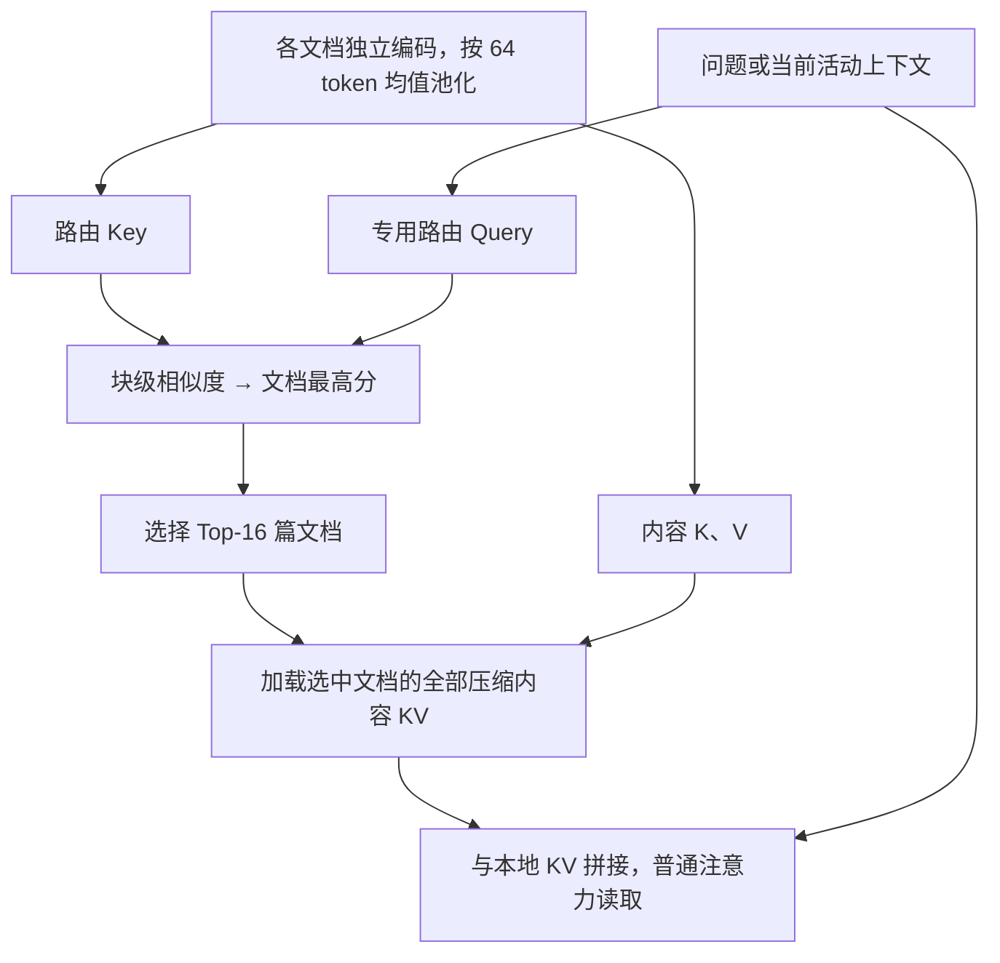
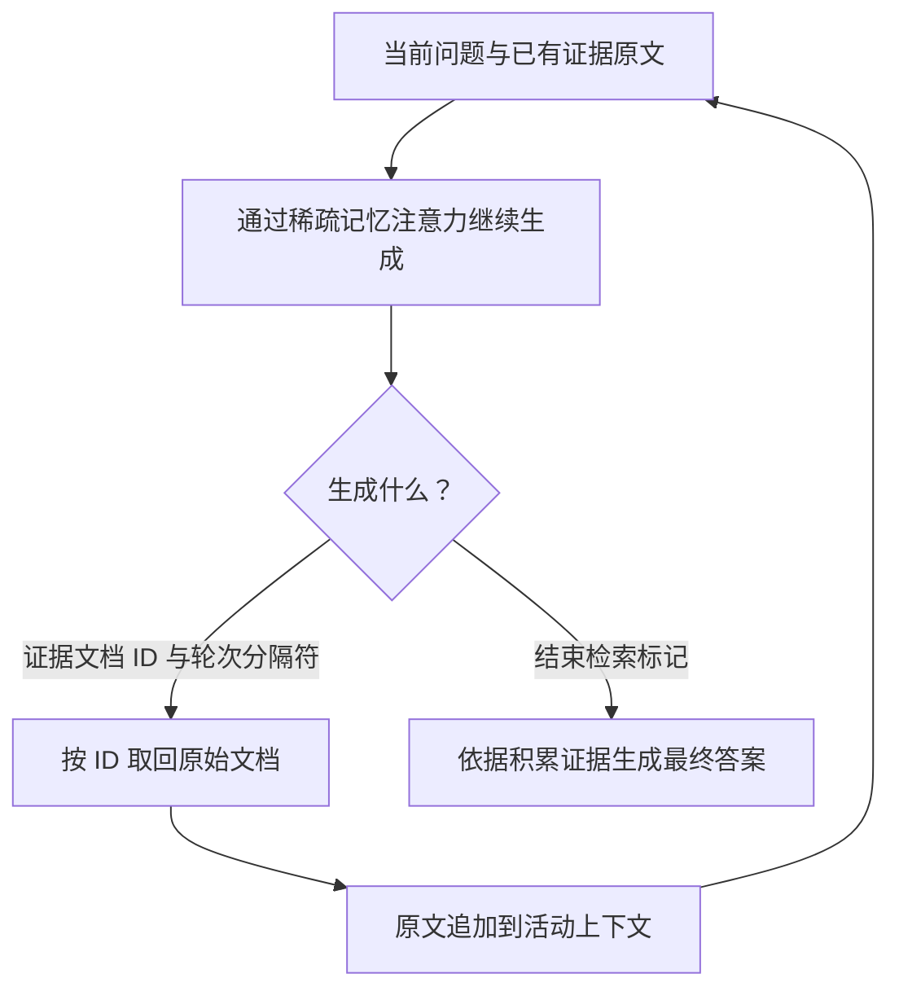
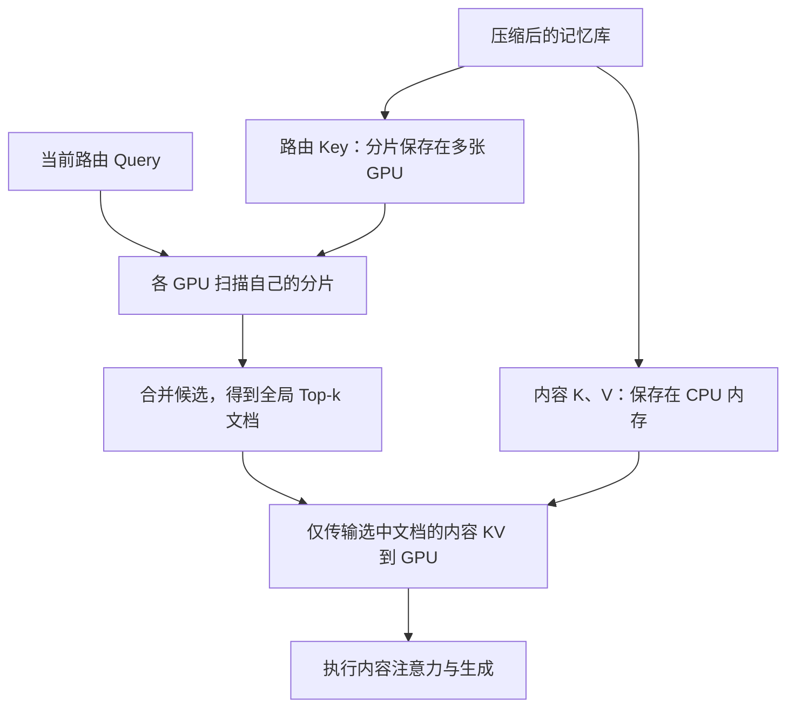

# MSA：用文档级稀疏注意力把可访问记忆扩展到 100M tokens

## 0.摘要翻译

长期记忆是人类智能的基石。让 AI 处理达到数亿 token 的终身尺度信息，一直是该领域追求的目标。受全注意力架构约束，大语言模型的有效上下文长度通常限于一百万 token。混合线性注意力、固定大小记忆状态（例如循环神经网络），以及 RAG 或智能体等外部存储方法，都试图突破这一限制。然而，这些方法往往面临以下问题：上下文增长时精度严重下降、延迟迅速增加、无法动态修改记忆内容，或缺乏端到端优化。这些瓶颈阻碍了大型语料摘要、维持稳定人格的数字孪生，以及长历史智能体推理等复杂场景，也限制了记忆容量和推理速度。

我们提出记忆稀疏注意力（MSA），一种可端到端训练、高效且可大规模扩展的记忆模型框架。通过可扩展稀疏注意力架构、文档级旋转位置编码等核心设计，MSA 在训练和推理中实现线性复杂度，并保持稳定精度：从 16K 扩展到 100M tokens 时，性能下降不到 9%。结合 KV 缓存压缩与推理阶段的记忆并行，MSA 可以在两张 A800 GPU 上支持 100M-token 推理。我们还提出记忆交错机制，有效支持跨分散记忆片段的复杂多跳推理。在长上下文基准上，MSA 显著超过前沿语言模型、先进 RAG 系统与领先记忆智能体。这些结果表明，通过将记忆容量与推理解耦，MSA 为通用模型提供内在的终身尺度记忆奠定了可扩展基础。

来源：[arXiv:2603.23516v2，摘要，p.1](https://arxiv.org/pdf/2603.23516v2#page=1)。本文按 2026-04-13 的 v2 正文及附录 A–B 解读，摘要中的广泛主张在后文结合实验条件判断。

## 1. 开篇讲清楚：论文做了什么，核心 idea 是什么

MSA 希望让模型访问非常大的文档集合，同时避免把全部文档拼成一条长序列、对所有 token 做完整注意力。核心做法是：先独立编码各篇文档，将每层的 Key、Value 压缩保存；回答问题时，用另外学习的路由向量挑选少数文档，只让当前问题对这些文档的压缩 KV 和自身上下文做注意力。这样，长期记忆的容量可以继续增长，而实际参与一次细读的内容保持较小。

完整回答流程还有第二层检索：模型先生成证据文档 ID，系统据此取回原文加入当前上下文，再继续寻找下一跳证据，直到生成答案。因此，MSA 将“模型内部选哪些记忆参与注意力”与“外部读回哪些原文支持多跳回答”结合起来；100M 指整个可访问记忆库的原始 token 规模，不表示一次完整注意力直接覆盖一亿个 token。[原文 §3.2–3.5，pp.5–9](https://arxiv.org/pdf/2603.23516v2#page=5)

## 2. 开始梳理详细的方法：先理清各项设计的逻辑关系，再逐步构建完整方法

设计的依赖关系是：**文档独立编码，允许离线缓存 → 分块压缩，降低 KV 规模 → 专用路由选择少数文档 → 在原注意力中读取其内容 → 重置文档位置以支持规模外推 → 联合训练路由和文档 ID 生成 → 交错读回原文完成多跳 → 分层存储、并行扫描支撑一亿 token。**

### 2.1 先把长期记忆从当前推理序列中分开

普通 Transformer 把所有历史组成同一序列，新增一个问题时需要处理庞大上下文。MSA 首先把记忆定义成文档集合 $\mathcal D=\{d_1,\ldots,d_N\}$，每篇文档在模型中独立计算，不对其他文档做完整跨文档注意力。

对第 i 篇文档，在某层、某个头 h，隐藏状态为 $H_i$，产生三种表示：

$$
K_{i,h}=H_iW^{K,h},\qquad
V_{i,h}=H_iW^{V,h},\qquad
K^R_{i,h}=H_iW^{KR,h}.
$$

前两者是原模型用于注意力的内容 Key、Value；第三个由新增的路由 Key 投影生成，用来判断“是否值得读取”。两套 Key 分工不同：相似度筛选使用 $K^R$，真正读取内容使用 K、V。[原文式 (1)，p.5](https://arxiv.org/pdf/2603.23516v2#page=5)

文档独立处理使它不依赖具体问题，也不依赖其他文档的排列，因此可以预先计算、跨问题复用。固定模型后，增加或替换文档原则上只需编码相应文档；但模型参数变化会影响缓存表示，需要重新考虑缓存一致性。独立编码也付出代价：文档之间的联系不能在离线阶段通过完整注意力提前融合，后面的检索和多跳机制必须补上这一能力。

### 2.2 KV 仍然太大：每 64 个位置压成一个向量

即便独立编码，一亿 token 的逐层 KV 也无法直接驻留在两张 GPU 上。作者把文档按固定长度 P 分块，对三种表示分别求均值：

$$
\bar K_{i,h}=\phi_P(K_{i,h}),\quad
\bar V_{i,h}=\phi_P(V_{i,h}),\quad
\bar K^R_{i,h}=\phi_P(K^R_{i,h}),
$$

其中 $\phi_P$ 是分块均值池化（把一块里的 P 个向量逐维取平均），默认 P=64。长度为 G 的文档因此约剩 $G/P$ 个记忆位置。这里减少的是缓存中的位置数，不是把整个文档压成一个向量，也不是对浮点数做低比特量化。[原文 §3.2.1、§4.1](https://arxiv.org/pdf/2603.23516v2#page=5)

均值无法保证保留每个词的精确信息，所以不能将它当成无损压缩。MSA 后面读回原文的路径，也是理解它为何仍能完成细粒度回答的重要部分。

### 2.3 怎样选文档：先比路由向量，再读内容 KV

当前问题或活动上下文的隐藏状态为 $H_q$，除普通 Q、K、V 外，再生成专用路由 Query：

$$
Q^R_{q,h}=H_qW^{QR,h}.
$$

计算第 i 篇文档、第 j 块与问题的相关度时，先对头取平均，再对问题位置取最大值：

$$
S_{ij}
=\max_t\frac{1}{n_h}\sum_h
\operatorname{cos}\bigl((Q^R_{q,h})_t,\bar K^R_{ij,h}\bigr).
$$

$\operatorname{cos}$ 是余弦相似度。随后对文档内部所有块再次取最大值：

$$
s_i=\max_j S_{ij},\qquad
\mathcal I=\operatorname{TopK}(\{s_i\}_{i=1}^{N}).
$$

这两次最大值让一个关键问题位置与一个关键文档片段的匹配，有机会把整篇文档选进来；它不是把全部位置的相关度平均成一个容易被无关内容稀释的分数。这是对计算作用的解释，不是论文给出的理论保证。

**最终选的是文档。** 命中文档后，组装它们的压缩内容 KV，而不只是保留得分最高的那个块：

$$
K_{\mathrm{ctx}}=[\{\bar K_i\}_{i\in\mathcal I};K_q],
\quad
V_{\mathrm{ctx}}=[\{\bar V_i\}_{i\in\mathcal I};V_q],
$$

$$
O_q=\operatorname{softmax}
\left(\frac{Q_qK_{\mathrm{ctx}}^\top}{\sqrt{d_h}}+\text{因果掩码}\right)
V_{\mathrm{ctx}}.
$$

默认每个采用 MSA 的层选择 Top-16 篇文档。路由负责粗筛，普通注意力负责在入选内容和当前上下文中细读。[原文式 (2)–(4)、§4.1，pp.6、10](https://arxiv.org/pdf/2603.23516v2#page=6)

原文图 2。黄色的路由表示用于选择文档，入选文档的内容 K、V 才交给右侧注意力。[来源：p.6](https://arxiv.org/pdf/2603.23516v2#page=6)

路由仅放在模型后半层。前半层仍独立处理文档，但问题只使用本地上下文，不读取记忆 KV。作者认为较浅层的语义表示不足以有效路由；这个安排也减少了路由层数。它不等于在前半层把文档和问题拼起来做全局注意力。

**层内路由：先选文档，再读选中文档的内容**

解读图：路由 Key 负责选择，内容 KV 负责提供信息；Top-16 的单位是文档，不是 16 个压缩块。此通路只在采用 MSA 的后半层启用。对应 §2.1–2.3。

### 2.4 为什么 64K 训练能服务更大的库：文档位置不能随库大小漂移

如果把 N 篇文档统一编号，问题的位置会随 N 不断后移。模型训练时只见过较小位置，部署时却遇到巨大位置差，可能失效。因此 MSA 使用文档级 RoPE（对 Q、K 按位置旋转，使内积体现相对位置）：每篇文档内部的位置都从 0 开始，文档数量增加不改变已有文档的内部位置。

活动上下文则采用 Global RoPE，保持问题、补入原文和生成内容的连续位置关系。原文明确写问题位置从 k 开始，其中 k 对应检索文档数；不能自行把它改成从整个库长度 L 或全部原始文档 token 数开始。[原文 §3.2.2，pp.6–7](https://arxiv.org/pdf/2603.23516v2#page=6)

这种设计解决的是位置范围与记忆库规模的耦合，不会自动解决“候选文档越多，相关证据越难找”的问题，也不恢复离线编码时缺失的跨文档顺序信息。位置外推是否成功，仍需后续实验验证。

### 2.5 如何训练路由与读取：文档 ID 监督加辅助对比损失

模型以 Qwen3-4B-Instruct-2507 初始化，新路由投影随机初始化。继续预训练首先学习生成式检索（把相关文档的唯一 ID 当作输出序列，由语言模型生成），而非一上来只训练最终答案。训练语料报告为 17,852,825 个查询、158.95B tokens，来自问答、学术文本、新闻、代码等；这不是训练上下文一次长达 158.95B。[原文 §3.3.1、§4.1；附录 B，pp.7、10、19–20](https://arxiv.org/pdf/2603.23516v2#page=7)

生成损失可以写为：

$$
\mathcal L_{\mathrm{LLM}}
=-\sum_t\log p_\theta(y_t\mid q,y_{<t},\mathcal D),
$$

此阶段 $y$ 主要是证据文档 ID 序列。为了让各层路由也找到正确证据，额外使用正、负文档标签。设正例集合为 $\mathcal P$，负例集合为 $\mathcal N$，相似度分别为 $s_i^+$、$s_{i,j}^-$：

$$
\mathcal L_{\mathrm{aux}}
=-\frac{1}{|\mathcal P|}
\sum_{i=1}^{|\mathcal P|}
\log
\frac{\exp(s_i^+/\tau)}
{\exp(s_i^+/\tau)+
\sum_{j=1}^{|\mathcal N|}\exp(s_{i,j}^-/\tau)}.
$$

这是对比损失（提高正确匹配相对错误匹配的得分），$\tau$ 控制区分强度。它直接约束中间层路由，而不只等待最终 ID 生成正确。[原文式 (5)，p.7](https://arxiv.org/pdf/2603.23516v2#page=7)

| 阶段 | 总损失 | 学习率 | 目的 |
|---|---|---:|---|
| 路由预热 | $0.1\mathcal L_{\mathrm{LLM}}+\mathcal L_{\mathrm{aux}}$ | $10^{-4}$ | 先建立可用的证据选择 |
| 主继续预训练 | $\mathcal L_{\mathrm{LLM}}+0.1\mathcal L_{\mathrm{aux}}$ | 降至 $6\times10^{-6}$ | 优先提高 ID 生成，同时保留路由约束 |
| 第一阶段问答微调 | 问答监督，8K 上下文 | 原文未完整列出 | 获得指令跟随与回答能力，得到 MSA-S1 |
| 第二阶段问答微调 | 清洗数据，扩到 64K | 原文未完整列出 | 学习更长记忆条件，得到 MSA-S2 |

SFT（监督微调：以给定目标输出计算下一 token 损失）的两个阶段还同时改变数据质量和长度，因此不能把 S2 的所有收益单独归因于长度。

**“端到端”要准确理解。** 内容注意力、投影、池化对已参与计算的表示可求梯度，路由分数通过辅助损失得到训练；但硬 Top-k 的离散索引不是处处可微。论文未在上述公式中给出让索引本身可导的连续松弛或梯度估计器。能确认的是在一个模型和训练目标中优化记忆表示、路由和生成，不能理解为仅靠最终答案损失就自动对所有落选文档的选择决定求导。

### 2.6 为什么还需要 Memory Interleave：从证据 ID 回到原文，再找下一跳

当前层的 Top-16 解决“让哪些记忆参与计算”，不等于最终只检索 16 篇原文。对复杂问题，MSA 使用另一层循环：

1. 模型通过稀疏记忆注意力生成证据文档 ID，以专用分隔符结束一轮。
2. 系统按 ID 取回原始文档，加入当前问题上下文。
3. 根据扩展后的上下文继续计算路由，生成下一轮 ID。
4. 证据足够时，输出结束检索标记，转而生成最终答案。

每轮生成的文档 ID 数量由模型决定；它与层内固定的路由 Top-16 是不同控制量。[原文 §3.5，p.9](https://arxiv.org/pdf/2603.23516v2#page=9)

原文图 3。示例先找到人物关系，再用新发现的人名寻找出生日期；黄色原文被补入活动上下文。[来源：p.8](https://arxiv.org/pdf/2603.23516v2#page=8)

这意味着压缩 KV 在完整系统中承担了很强的证据定位功能，细节理解还依赖原文。不能把主结果解释为“只从 64 倍压缩记忆直接恢复全部答案”。

训练时，多跳检索链拆成单步样本：有的输入只有问题，有的输入包含前面已经取得的文档，目标是下一步证据 ID。推理时则用模型自己生成的 ID 和真实取回的文档连续运行。前一步选错会改变后续输入，因此单步监督并不消除多轮误差累积。

**多跳循环：生成文档 ID 后，还要读回原文**

解读图：这是一层生成控制循环，和各层固定 Top-16 的路由不同；每轮输出多少文档 ID 由模型决定。压缩记忆帮助定位，读回原文提供细节。对应 §2.6。

### 2.7 两张 A800 如何装下：路由 Key 留在 GPU，内容 KV 放 CPU

按原文配置估算，100M tokens 经 P=64 压缩后，8 个头、每头 128 维、18 层的三份 BF16 缓存约为 169GB，已超过两张 80GB A800 的合计显存，还没算权重和运行开销。BF16 是每元素占 2 字节的浮点格式。

Memory Parallel（把记忆条目分片、在多张 GPU 上并行打分）将两类数据分开：

- 约 56GB 的路由 Key 分布在 GPU 中，便于扫描。
- 更大的内容 K、V 留在 CPU 内存，选中文档后才异步传到 GPU。
- 每张 GPU 复制完整 4B 模型，问题表示发往各分片，本地打分后全局合并 Top-k；打分矩阵分块计算，控制临时显存。

因此“2×A800”表示结合主机内存和传输的系统可运行，不表示全部一亿 token 的缓存都驻留在 160GB 显存，也不表示不用离线编码。[原文 §3.4，pp.7–9](https://arxiv.org/pdf/2603.23516v2#page=8)

**大库存储：GPU 扫描路由，CPU 提供被选中的内容**

解读图：每张 GPU 复制完整模型，图中分片的是记忆；扩大记忆库仍增加路由扫描量。两张卡可运行不等于全部 KV 驻留显存。对应 §2.7。

### 2.8 用同一个例子走完训练、离线建库和在线回答

假设问题是“Erik Watts 的父亲何时出生？”，文档 d4 说明父亲是 Bill Watts，文档 d3 给出 Bill Watts 的出生日期。下面沿用原文图 3 的信息流说明计算。

**训练：** 独立处理候选文档，生成并压缩逐层 K、V、路由 Key。输入问题时，以 d4 为当前正例训练路由，并监督模型输出 d4 的 ID；另一个样本输入“问题+d4 原文”，以 d3 为正例和下一步 ID。问答微调阶段再学习在所需证据条件下生成答案。生成损失更新参与计算的模型参数，辅助损失显式训练路由；这里没有 LatentMem 那种按任务奖励进行的策略优化。

**离线建库：** 模型训练完成后，对实际部署文档逐篇编码，缓存压缩表示。此时不需要具体用户问题，模型权重固定。

**单跳推理：** 若问题直接问 Bill Watts 的出生日期，模型可生成 d3 的 ID，读回 d3 后结束检索并作答。

**多跳推理：** 对原问题先路由、生成 d4 ID，读回“父亲是 Bill Watts”；扩展上下文后重新路由，生成 d3 ID，读回出生日期，最终回答“1939 年 5 月 5 日”。这一过程不更新模型权重；新文档写入记忆是增加缓存条目，不是重新训练参数。两种推理使用相同底层注意力，区别在证据轮数和活动上下文是否继续扩展。

## 3. 围绕问题解释实验：为什么做，结果怎样，得到什么回答

### 3.1 在相同骨干下，联合学习记忆系统是否比常规 RAG 更好？

作者在九个问答数据集上比较，记忆库从 277K 到 10M tokens，覆盖单跳、多跳与长文档阅读。对照使用同一个 Qwen3-4B-Instruct-2507 生成器，分别配置普通向量检索、增加重排和 HippoRAG2。重排指先检索 100 篇候选，再用第二个模型重新评分，留下前 1、5、10 篇供生成器阅读。

指标是 LLM judge（由语言模型比较预测和参考答案，按准确、完整、相关程度给 0–5 分），不是精确匹配准确率。R@1、R@5、R@10 在这张表中表示给生成器的文档数量，不能误读为“检索召回率”。MSA 使用自适应的原文检索流程。

| 方法 | 九任务平均分 | 对照配置 |
|---|---:|---|
| 普通 RAG | 3.242 | 三种固定深度中，平均分最高的 R@10 |
| RAG + 重排 | 3.372 | R@10 |
| HippoRAG2 | 3.275 | R@10 |
| MSA | 3.760 | 自适应原文检索 |

MSA 相对提高约 16.0%、11.5%、14.8%。主要增益包括 MS MARCO 的 4.141、多跳 2Wiki 的 4.280；但 NarrativeQA 只有 3.395，低于同骨干重排 RAG 的最佳 3.638，说明没有全面胜出。[原文表 2，p.10；评分提示见附录 A，p.19](https://arxiv.org/pdf/2603.23516v2#page=10)

这组实验控制了初始化骨干，却没有控制总训练预算：MSA 额外使用了大规模继续预训练与问答微调。因此结果支持整套系统的效果，不能把差距全部归因于稀疏注意力结构。固定检索深度与自适应多轮读取的成本也没有在主表中严格对齐。

### 3.2 4B 模型是否真的超过更大的 RAG 系统？

为检验是否只赢了较弱基线，作者再用 KaLMv2-Embedding-Gemma3-12B-2511 检索，搭配 Qwen3-235B 或 Llama-3.3-70B，部分配置加入 Qwen3-8B 重排。

最强 Qwen3-235B 重排配置平均为 3.580，MSA 为 3.760，相对约高 5.0%。MSA 在九项中的四项最高，但在 NQ、TriviaQA、NarrativeQA、HotpotQA、MuSiQue 上仍有更强配置。例如 MuSiQue 为 2.211，对照最高 2.647，约低 16.5%。[原文表 3，p.11](https://arxiv.org/pdf/2603.23516v2#page=11)

可靠结论是专门训练的 4B 记忆系统取得了更好的平均分，而非 4B 的通用推理能力超过 235B。检索、训练数据与适配目标的差别也会影响结果；复杂证据组合仍是明显短板。主文没有给出足够的裁判一致性、多次重复或人工核对结果，小幅分差需谨慎解释。

### 3.3 “扩展到 100M、下降不到 9%”具体测了什么？

原文图 1，纵轴是问答质量分数，部分对照曲线因上下文上限提前结束。[来源：p.2](https://arxiv.org/pdf/2603.23516v2#page=2)

作者把 MS MARCO 记忆上下文从 16K 扩至 100M tokens，MSA 的 LLM 评分从 4.023 降至 3.669：

$$
\frac{4.023-3.669}{4.023}\approx8.8\%.
$$

这是**0–5 分指标的相对下降**，不是准确率下降 8.8 个百分点，也不是在一亿 token 上所有任务都保留了 91.2% 的能力。它说明在该问答设置下，增加大量候选记忆后，质量衰减较小。[原文 §5.2，p.14](https://arxiv.org/pdf/2603.23516v2#page=14)

还需保留三个条件：图中并非每个对照都真的运行到 100M；原文对不同规模样本、噪声构造及重复统计的交代不足以完成全面审计；这是一种文档库访问能力，没有验证真实用户多年交互中的持续写入、冲突知识、遗忘和人格稳定性。“终身记忆”在本文中主要是容量定位。

### 3.4 精确找针能力能否跨更长距离保持？

RULER 的八个找针子任务，把已知信息埋入大量干扰文本，考察单针、多 key、多 value、多 query 的检索。它不同于上面的问答评分，报告的是平均准确率。

原文图 4；格内数值经过四舍五入，精确值以下文正文报告为准。[来源：p.11](https://arxiv.org/pdf/2603.23516v2#page=11)

MSA 从 32K 的 98.77% 到 1M 的 94.84%，下降 3.93 个百分点。原骨干在 1M 为 24.69%，Qwen3-Next-80B-A3B 为 80.78%，RL-MemoryAgent-14B 为 92.66%。这支持较强的长距离信息定位能力。[原文 §4.2.2，pp.11–12](https://arxiv.org/pdf/2603.23516v2#page=11)

但 NIAH 本身最高只测到 1M，不能称为“一亿 token 找针准确率 94.84%”。部分长度下两者已接近满分，图中又有四舍五入，因此判断差距应优先使用精确值和重复实验，而非只看热力图颜色。

### 3.5 哪些设计真正带来收益？

作者对四个问答任务做消融。除 S2 外，其余删减项以完整 S1 为基准：

| 配置 | 四任务平均 | MS MARCO | NQ | DuReader | HotpotQA |
|---|---:|---:|---:|---:|---:|
| MSA-S2 完整 | 3.976 | 4.141 | 3.545 | 4.155 | 4.061 |
| MSA-S1 完整 | 3.694 | 3.197 | 3.493 | 4.064 | 4.020 |
| S1 去掉多轮交错 | 3.497 | 3.175 | 3.485 | 4.076 | 3.250 |
| S1 去掉继续预训练 | 2.537 | 2.267 | 2.448 | 3.144 | 2.289 |
| S1 不读回原文 | 2.325 | 2.625 | 2.190 | 2.186 | 2.297 |

来源：[原文表 4，p.12](https://arxiv.org/pdf/2603.23516v2#page=12)。

**较长、高质量微调是否有用？** S2 比 S1 平均相对高 7.6%，MS MARCO 从 3.197 到 4.141。支持第二阶段训练的重要性，但同时改变长度、数据质量和训练量，无法单独确认是哪项贡献。

**多跳是否需要多轮？** 去掉交错后，HotpotQA 从 4.020 到 3.250，下降约 19.2%；单跳任务变化较小，DuReader 甚至略升。结果与“新证据改变下一轮检索条件”的设计理由一致。

**路由能否直接学会？** 去掉继续预训练，平均相对下降 31.3%。但这一消融同时去掉大量训练与路由监督，尚不能分别衡量辅助损失和训练规模的贡献。

**压缩记忆是否足以直接回答？** 不读原文时，平均相对下降 37.1%，DuReader 从 4.064 到 2.186，下降约 46.2%。这是理解全文最重要的消融之一：主结果依靠压缩 KV 定位和原文细读的合作，不能只归功于连续记忆的信息保真。

论文没有提供足够独立的消融来量化文档级 RoPE、P=64、Top-16、路由层数各自的影响，因此这些设计的合理性不能全部当作已被单独验证。

### 3.6 线性复杂度、两张卡与“高效”之间是什么关系？

设记忆原始长度为 L，平均文档长度 G，问题长度 M，池化长度 P，选择文档数 k。独立文档注意力总成本约为：

$$
\frac{L}{G}\cdot O(G^2)=O(LG).
$$

路由需要扫描约 $L/P$ 个压缩位置，成本为 $O(ML/P)$；选中部分的注意力则仅依赖 $M+kG/P$。作者将训练成本写为：

$$
O_{\mathrm{train}}
=O(LG)+O(ML/P)+O((M+kG/P)^2).
$$

当 G、M、P、k 固定时，它随 L 线性增长。不是只把“总 token 数固定”就能得到该结论：若把全部资料当成一个越来越长的文档，G 也增长，文档内部注意力仍会变贵。[原文 §5.1，式 (6)，p.13](https://arxiv.org/pdf/2603.23516v2#page=13)

部署把 $O(LG)$ 编码成本分摊给多次查询，每个问题仍需约 $O(ML/P)$ 扫描。多轮交错会反复路由，并增长活动上下文，因此每轮都要支付成本。作者式 (7) 用生成长度 T 给出了一个随 L 线性的总体估计，它不是关于缓存解码每一步的最紧复杂度，也不能直接换算为实际延迟。[原文 §5.1.2，pp.13–14](https://arxiv.org/pdf/2603.23516v2#page=14)

原文给出了分层内存方案和两张 A800 的容量可行性，但未提供充分的 100M 实测首 token 延迟、吞吐、CPU 内存占用、传输带宽与并发曲线。因此目前较强的效率证据是复杂度分析及可运行的实现设计，不能推导出“100M 查询与短上下文一样快”。模型还有约 159B-token 继续预训练语料所代表的适配投入，比较收益时应一并考虑。

## 4. 围绕同一个问题，解释已有方法及其特点

### 4.1 把资料直接放进上下文，或压进固定状态

直接扩展上下文窗口，让问题对全部历史做注意力，能够细粒度读取信息，但逐文档缓存复用较困难，完整注意力的开销随序列长度快速增长。稀疏注意力通过只读取部分位置降低成本，仍需解决哪些位置值得读。

另一条路线把历史不断汇总进固定大小的状态。RWKV、DeltaNet 等使用递推更新，不必保留所有逐 token KV，长序列处理较省；代价是越来越多信息竞争固定容量，单条历史也不容易按文档独立删除或替换。它们有压缩与干扰的取舍，但不能仅凭“固定状态”就认定所有任务必然失效。[MSA §2，pp.4–5](https://arxiv.org/pdf/2603.23516v2#page=4)

MSA 选择让记忆容量随文档库增长，而非把所有历史挤进固定状态；通过独立编码和稀疏读取限制单次计算。这种做法仍消耗随 L 增长的存储与扫描成本。

### 4.2 检索文字，再交给模型读：RAG 与多轮证据搜集

常规 RAG 把文档切块、建立语义索引，收到问题后检索文字，必要时重排，再将少数片段加入提示。多轮方法利用已经找到的线索继续查找。知识以原文形式保存，更新和追溯比较直接；检索目标与下游回答可能不一致。

MSA 将检索表示的一部分移进骨干每层的隐藏空间，并用相关文档监督训练路由，减少“外部语义相似度与模型实际用途”的差距。但其完整流程也读回原文、继续检索，因此与多轮 RAG 有明确共同点。新意不在于“完全取消外部文档读取”。[MSA §2、§3.5](https://arxiv.org/pdf/2603.23516v2#page=9)

还要限定作者对 RAG 的批评。RETRO 已将冻结检索器、可训练文档编码器和分块交叉注意力连接起来，通过下一 token 目标训练生成模型。故“检索与生成一起训练”并非本文首次实现；硬检索选择与其后可微的阅读部分也应分开讨论。[RETRO 原论文](https://arxiv.org/abs/2112.04426)

### 4.3 保存模型内部 KV：Memory³ 与可学习稀疏选择

一种与本文更接近的路线是将文档预编码成可直接供注意力读取的 Key、Value。Memory³ 已采用这种显式记忆；按 MSA 的对比，其证据选择仍依赖外部语义向量。MSA 则新增骨干条件下的路由 Q、K，并显式训练其选择相关文档，使“找到内容”和“使用内容”的表示空间联系更紧。[MSA §2 对 Memory³ 的讨论，pp.4–5](https://arxiv.org/pdf/2603.23516v2#page=4)

DeepSeek Sparse Attention 等已使用学习到的筛选机制减少实际参与注意力的内容。MSA 将类似思路组织为文档级长期库，加入池化、文档位置重置、离线缓存与分层存储。它的贡献因此更接近一组针对超大记忆库协同设计的系统方案，而非首次提出 Top-k 稀疏注意力。[DeepSeek-V3.2 原论文](https://arxiv.org/abs/2512.02556)；[MSA §3](https://arxiv.org/pdf/2603.23516v2#page=5)。

### 4.4 把知识写进参数：与 MLP Memory 的直接区别

MLP Memory 用检索产生的下一 token 分布训练独立 MLP，部署时由参数直接输出记忆分布，再与主模型插值；不需要保留逐条文档缓存。MSA 保存文档对应的逐层状态，部署时扫描并选取这些状态，必要时还读原文。前者主要以训练更新知识，后者在固定模型下可通过增删文档条目管理知识。[MLP Memory](https://arxiv.org/abs/2508.01832)；[MSA §2](https://arxiv.org/pdf/2603.23516v2#page=4)。

两者“潜在记忆”的载体并不相同：一边是固定参数中的映射，一边是随语料增长的显式状态库。MSA 的优势是可寻址、可扩容，代价是存储、搜索和传输；参数记忆减少这些在线操作，但容量、精确更新和来源定位更难控制。

## 5. 说明论文继承了什么，真正贡献了什么

**继承稀疏读取，改变长期记忆的组织单位。** 学习选择少量内容参与注意力已有基础。本文将文档独立编码、块均值压缩、专用路由投影和文档级 Top-k 组合起来，形成可离线缓存的逐层记忆库。它减少反复处理整个语料的成本，也保留按文档扩容的能力；主问答结果支持整套方案有效，但缺少逐项消融，不能将收益全部归给某个模块。[原文 §3.2、表 2](https://arxiv.org/pdf/2603.23516v2#page=5)

**继承位置编码，切断位置编号对库规模的依赖。** RoPE 本身是已有组件，本文的选择是文档内重置、活动上下文保持连续位置。它为训练短库、部署大库提供合理结构条件；100M 的问答外推是支持证据，但没有独立位置编码对照来确定其贡献比例，也不证明跨文档关系已被完整保留。[原文 §3.2.2、§5.2](https://arxiv.org/pdf/2603.23516v2#page=6)

**继承检索监督与迭代阅读，将二者接入同一模型。** 生成文档 ID、对比损失、多轮读证据并非新工具。MSA 用路由辅助目标约束中间选择，再让新读入的原文改变下一轮路由。继续预训练、多轮交错和原文消融都支持这一连接的重要性，尤其“不读原文”大幅下降，明确限定了模型仅靠压缩 KV 的能力边界。[原文 §3.3、§3.5、表 4](https://arxiv.org/pdf/2603.23516v2#page=7)

**系统贡献是把大库读取落实到可部署的存储层级。** GPU 路由 Key、CPU 内容 KV、分布式打分和按需传输使一亿 token 的库不必全部驻留显存。两张 A800 是这一系统条件下的容量结论，详细延迟和吞吐证据仍不足。对“不会灾难性遗忘”“终身记忆”的表述，也应限定为文档状态不必反复写入模型参数，并非完成了长期冲突、更新与遗忘实验。[原文 §3.4、§7](https://arxiv.org/pdf/2603.23516v2#page=8)

MSA 最值得保留的想法，是把**大规模记忆存储与当前问题的细粒度注意力分开**：文档状态可增长、可复用，当前计算只读少量内容，再用原文交错补足多跳证据。现有结果支持这一组合在大文档库中的实用潜力。接下来更需要独立衡量路由与压缩的信息损失、严格控制额外训练和读取预算，并报告真实 100M 服务延迟及长期更新表现，才能判断它离通用“终身记忆”还有多远。

