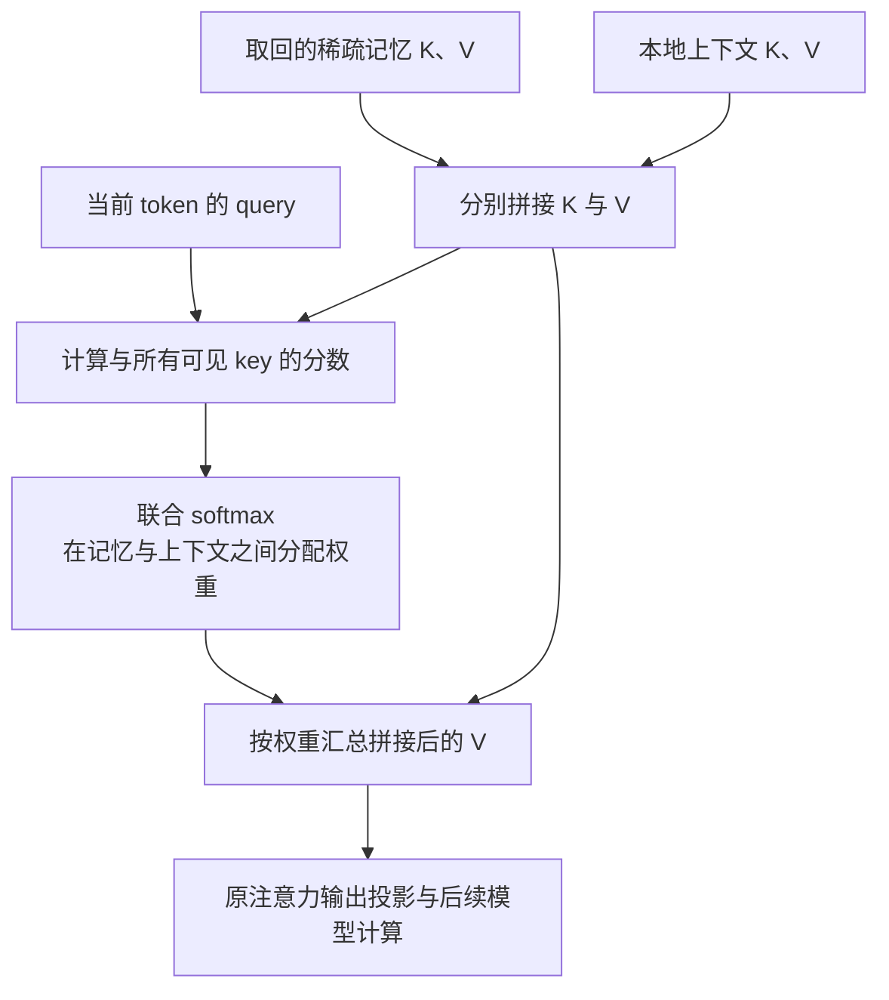
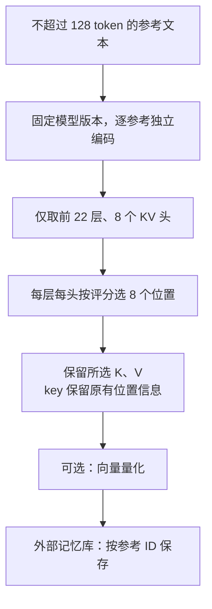
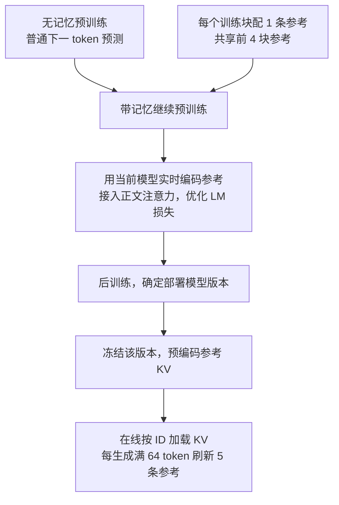

# Memory³: Language Modeling with Explicit Memory

Hongkang Yang 等，2024。以下依据 [arXiv v1 原文及附录 A–C](https://arxiv.org/pdf/2407.01178v1)；该论文后发表于 Journal of Machine Learning。文中页码均指这份 37 页 PDF。

## 0.摘要翻译

大语言模型的训练与推理合起来，是一个将知识从原始数据转化为有意义计算的昂贵过程。受人脑记忆层级的启发，我们为大语言模型配备显式记忆，以降低这一成本。这种记忆格式比模型参数和基于文本的检索增强生成（RAG）更便宜。从概念上说，当大部分知识被外置到显式记忆后，模型可以使用更少的参数，并降低训练和推理成本；这些开销都与留在模型中的“抽象知识”数量成比例。作为初步的概念验证，我们从头训练了一个 2.4B 模型，其表现优于一些大得多的语言模型以及 RAG 模型，解码速度也高于 RAG。我们将它命名为 Memory³，因为显式记忆是继隐式记忆（模型参数）和工作记忆（上下文的 key-value）之后，大语言模型的第三种记忆形式。我们提出记忆回路理论，为知识外置提供依据，并介绍使存储规模可控的记忆稀疏化机制，以及促进记忆形成的两阶段预训练方案。[原文摘要，p.1](https://arxiv.org/pdf/2407.01178v1#page=1)

## 1. 开篇讲清楚：论文做了什么，核心 idea 是什么

Memory³ 希望减少模型为记住大量具体事实所付出的参数和计算成本。核心做法是：提前用模型自身编码参考文本，只保存其中少量层、少量 token 的注意力 KV；生成时检索相关参考，直接把这些 KV 接入模型的自注意力。这样，一段资料可以编码一次、反复使用，在线调用时也不必重新把整段原文跑过模型。

它希望形成一种分工：模型参数保留语言理解、推理以及常用知识，外部显式记忆保存可按需调用的具体内容。这里的记忆是从资料中计算出的 KV 张量，仍需要在线检索；“知识外置”也不是已经实现的自动知识分类，而是架构和训练方案所追求的方向。[§1、§3，pp.2–4、12–18](https://arxiv.org/pdf/2407.01178v1#page=12)

## 2. 开始梳理详细的方法：先理清各项设计的逻辑关系，再逐步构建完整方法

### 2.1 为什么选择“提前算好的中间表示”

如果所有知识都存在模型参数里，学习一条事实需要训练；生成每个 token 时，又会执行整个稠密模型。如果保留原文、需要时检索，更新资料很方便，但读取一次就要重新编码一次。作者因此把目标写成：

$$
\sum_k\min_m\left[C_{\mathrm{write}}(k,m)+n_k C_{\mathrm{read}}(k,m)\right].
$$

其中 $k$ 是一条知识，$m$ 是存储格式，$n_k$ 是预计调用次数。频繁使用的内容值得付出较高写入成本，换取较低读取成本；很少使用的内容保留原文即可。显式 KV 试图填补两者之间的位置：一次前向计算完成写入，之后用注意力读取。[式(1)、图4，pp.2–3](https://arxiv.org/pdf/2407.01178v1#page=2)

为什么具体事实有机会被这样外置？作者用“知识回路”（完成某类输入到输出映射的一组内部计算）来区分两种知识：“中国的首都是北京”的输出基本固定，属于具体知识；“在前文找到匹配内容并复制后续答案”的输出随输入变化，属于抽象知识。假如模型保留后一种能力，就可能通过读取一段写着“北京”的参考，完成前一种任务。

§2 的 Claim 1 用非形式化论证说明具体知识可以通过实例模仿，从而被分离出去。这里没有先找出每条事实对应的神经元再删除它，也没有训练一个具体/抽象知识分类器。理论给出的主要设计启发是：参考可以独立编码，读取可能只需要少量注意力连接和 token。它不保证任意事实都能在实际检索、稀疏化后无损恢复。[§2.1–2.3、Claim 1、Remark 1，pp.6–11](https://arxiv.org/pdf/2407.01178v1#page=10)

### 2.2 先把资料变成模型能直接读取的 KV

要省掉在线文本编码，保存的表示必须能直接进入模型计算。Memory³ 不另训一个记忆编码器，而是让主模型自己编码参考。知识库由约 $1.1\times10^8$ 个不超过 128 token 的文本块组成，来源包括百科、书籍、新闻、合成数据和代码，总量约 14.3B token。[§3.1、§4.4、表17，pp.13、20、23](https://arxiv.org/pdf/2407.01178v1#page=13)

对参考 $r$，在指定层 $l$、KV 头 $h$ 上计算：

$$
K_r^{l,h}=X_r^lW_K^{l,h},\qquad V_r^{l,h}=X_r^lW_V^{l,h}.
$$

其中 $X_r^l$ 来自参考自身的正常前向计算。每条参考独立处理，不读取查询，也不读取其他参考，因此同一份 KV 可以服务不同问题。编码到最深的记忆层即可，后面的层和最终词表预测并非写入记忆所必需。

*原文图1，p.1。底部是原始资料，中间是外置 KV，顶部是读取过程。*

这还没有解决存储问题：完整 KV 会非常大。不过在压缩之前，需要先确定它究竟怎样被读取，才能判断哪些部分可以删去。

### 2.3 读取方式：让上下文和记忆竞争同一个注意力分布

设当前位置的 query 为 $q_i^{l,h}$，已有上下文 KV 为 $K_{\le i}^{l,h},V_{\le i}^{l,h}$，检索到的参考为 $r_1,\dots,r_5$。在记忆头上，把参考 KV 与上下文 KV 拼接：

$$
\bar K=[K_{r_1};\cdots;K_{r_5};K_{\le i}],\qquad
\bar V=[V_{r_1};\cdots;V_{r_5};V_{\le i}],
$$

$$
y_i=\operatorname{softmax}\!\left(\frac{q_i\bar K^\top}{\sqrt{d_h}}\right)\bar V W_O.
$$

层、头下标在后两式中省略。模型依据当前位置的 query，决定把多少权重分给上下文、多少分给外部参考。记忆和上下文共用一次 softmax；没有先得到两份词表概率再插值，也没有新增独立的记忆交叉注意力分支。未选为记忆层的部分维持普通自注意力。[§3.2、式(4)，p.14](https://arxiv.org/pdf/2407.01178v1#page=14)

这种连接复用了已有的 $W_Q,W_K,W_V,W_O$，因此不需要为记忆读写新增可训练的神经模块。但系统仍有外部检索模型、索引和可选的量化器；“不增加参数”说的是主模型的记忆接入方式。

**读取：外部记忆与本地上下文共用一次 softmax**

解读图：这是选定记忆层内的读取路径，不是独立交叉注意力分支。query、key、value 仍使用模型原有投影。对应 §2.3、原文式(4)。

### 2.4 读取路径确定后，沿四个维度压缩记忆

完整参考 KV 的维度是“层 × K/V × KV 头 × token × 头维度”。作者依次压缩其中四个可变维度：[§3.3，pp.14–15；附录B，p.36](https://arxiv.org/pdf/2407.01178v1#page=14)

| 维度           | 实际配置                                             | 为什么这样做                                             |
| -------------- | ---------------------------------------------------- | -------------------------------------------------------- |
| 层             | 44 层中只使用前 22 层读写记忆                        | 保存更少层的 KV；后半部分继续加工融合后的表示            |
| 头             | 40 个 query 头共用 8 个 KV 头                        | 使用 GQA（多组 query 头共享 KV），减少 KV 存储           |
| token          | 每条参考、每层、每个 KV 头从最多 128 个位置中选 8 个 | 少量位置承载可被后续上下文调用的信息                     |
| 向量维度的存储 | 可选地把一个 80 维 BF16 向量编码为 14 字节           | 使用向量量化（用少量离散编号近似表示原向量）降低磁盘占用 |

关键在于第三步：一个 token 值不值得保存，要在不知道未来问题的条件下判断。作者让参考中的 token 彼此计算相关性，按某个位置收到的总关注程度评分：

$$
w_j^{l,h}=\sum_i\operatorname{softmax}_j\!\left(\frac{q_i^{l,h}(k_j^{l,h})^\top}{\sqrt{d_h}}\right),
\qquad I^{l,h}=\operatorname{Top8}_j(w_j^{l,h}).
$$

评分时去掉位置编码和因果掩码，排除 BOS、padding，让前后位置都有机会被其他 token 关注。实际实现还用去掉 softmax 归一化的近似：$w_j=\sum_i\exp(q_i k_j^\top/\sqrt{d_h})$。这一步只是选择保存位置的额外计算；并不意味着主模型编码参考时改成了双向 Transformer。

选中的 key 本身仍保存正常 RoPE（通过旋转 query/key 编入相对位置信息）处理后的数值，保留它在参考中的位置。不同头可选择不同的 8 个 token，因此不会把一段参考统一截成相同的 8 个字。离散 Top-8 选择也不是一个可对位置编号直接求导的操作。

每条记忆最终为：

$$
(22,2,8,8,80).
$$

相对保存全部 44 层、40 头、128 token 的 KV，结构压缩为 $2\times5\times16=160$ 倍；量化再压缩约 11.4 倍。量化器用随机采样参考、经固定模型编码得到的 KV 训练，采用残差量化（逐级编码上一步的重建误差，读取时将对应码向量相加，近似还原原向量）。按论文的容量估算，全库从约 7.17PB 降至 45.9TB，量化后约 4.02TB。压缩让大库可部署，但并未使它小到适合整库常驻单张 GPU。量化记忆取回后需要解码为向量，供注意力使用。

作者也讨论按参考动态选择少量头、只用中间层等更稀疏方案，但它们是建议；实际主配置是前半层、全部 8 个 KV 头，不能与建议混写。

**写入：一次参考编码得到可复用的稀疏 KV**

解读图：不同层、不同头可选不同位置。这里是部署时的预编码写入，不执行参数更新；模型版本变化后需重建相应 KV。对应 §2.2、2.4。

### 2.5 大库怎样调用：独立检索、分块刷新和位置对齐

KV 已经很稀疏，但每步仍不能遍历全部记忆。论文另用 BGE-M3（把文本编码成检索向量的模型）分别表示查询块和参考，以余弦相似度搜索 FAISS 索引，取回 5 个参考 ID，再按 ID 加载它们的 KV。**寻找参考的向量检索，与取回后 query 对 KV 的注意力，是两次不同的运算。** 直接用主模型注意力 query 检索记忆，在原文 Remark 2 中仍是未来方向。[§3.1，p.13](https://arxiv.org/pdf/2407.01178v1#page=13)

生成过程中，每完成 64 token，就以这段已生成文本为查询，换一批记忆供后续生成使用；处理 prompt 时也按 64-token 块组织检索和记忆可见范围。每块只读取分配给自己的参考，不会把历次取回的记忆无限累加。相邻块可能命中相同参考，RAM 缓存因此能减少重复磁盘读取。

*原文图9，p.13。绿色块是上下文，左侧蓝色记忆共同占用一个 128-token 的位置跨度。*

参考是独立编码的，还要解决位置如何接入同一注意力的问题。作者采用并行位置：5 条参考的 key 都使用同一个长度为 128 的位置区间，而非前后排成 640 个位置。稀疏化后保留原位置，当前上下文接在这段记忆位置之后。作者希望避免中间参考因距离和位置而被忽略，但没有提供单独的位置方案消融来确定其贡献。[§3.2，p.14](https://arxiv.org/pdf/2407.01178v1#page=14)

此外，参考以 `⟨s⟩Reference:` 开头。读取时也在整体开头保留这个标记，普通上下文的 BOS 则充当参考与上下文的分隔符。原因是上下文 BOS 现在能读取记忆，其表示不再恒定，需要另一个固定起始锚点。这个额外起始标记出现在所有层、所有头，不只出现在稀疏记忆头。

### 2.6 主干形状与两阶段学习：模型先有能力读，才有机会学会用记忆

有了可运行的记忆通路，还要避免主模型把它忽略。作者先从参数预算出发，选择较深、较窄的模型：44 层、40 个 query 头、8 个 KV 头、头维度 80、隐藏维度及门控 MLP 的中间宽度均为 3200，非 embedding 参数约 2.4B。理由是把更多预算给计算深度与头数，保留处理复杂模式的能力；具体事实则希望更多依靠外部记忆。这是受小规模研究启发的架构选择，不是已经证明的“抽象能力只由层数和头数决定”。[§3.4、图10，pp.15–17](https://arxiv.org/pdf/2407.01178v1#page=16)

训练采用两个阶段：

1. **无记忆预训练。** 普通下一 token 预测，让模型先学会语言和基本处理能力。
2. **带记忆继续预训练。** 给训练文本配置参考，在线用当前主模型编码为稀疏 KV，接入前述注意力，再预测训练文本的下一个 token。

两阶段的核心学习目标仍是：

$$
\mathcal L_{\mathrm{LM}}=-\sum_t\log p_\theta(x_{t+1}\mid x_{\le t},\mathcal M_t).
$$

第一阶段没有 $\mathcal M_t$。第二阶段的监督仍来自真实后续文本，没有“应该记住哪条事实”的人工标签，也没有另设检索对比损失。主模型参数继续更新；它同时承担参考编码和正文预测。被选中的 KV 参与可微的注意力计算，但检索 ID 和 Top-8 索引本身不是连续可微变量。训练时必须使用当前模型实时编码参考，不能拿一份长期固定的旧 KV 库代替。[§3.6、§5，pp.17–21](https://arxiv.org/pdf/2407.01178v1#page=17)

训练和推理还有一个明确差别。推理每 64 token 取 5 条参考，若训练照做，参考 token 数将是正文的 10 倍。作者让训练序列的每个块只配置 1 条参考，并共享前 4 个块的参考，以凑成最多 5 条。于是 2048-token 正文分成 32 块，只需编码 $32\times128=4096$ 个参考 token。参考到第 22 层之后不再继续传播，进一步节省计算；但一个带记忆训练步仍比普通训练步慢两倍多。[§3.6，p.18](https://arxiv.org/pdf/2407.01178v1#page=18)

为了防止检索到近乎相同的训练片段而直接复制答案，作者过滤与训练序列重叠超过 90% 的参考。重叠用最长公共子序列占参考长度的比例衡量，并限制匹配在训练文本中的跨度。评测采用更严格的 $2/3$ 阈值。这能抑制检索重复带来的泄漏，但不能证明整个预训练数据与评测集完全无重叠。[式(6)、§4.4，pp.18、20](https://arxiv.org/pdf/2407.01178v1#page=18)

实际预训练使用约 4T-token 的候选语料，完成无记忆阶段约 3.1T token、带记忆阶段约 120B 正文 token；两阶段都因训练发散提前结束。配置包括 2048 序列长度、约 4M 正文 token/批、AdamW、权重衰减 0.1、BF16。§3.5 提议的抽象知识专用数据、小初始化和更强权重衰减均未在本版落实，不能当成已用技巧。[§3.5、§5，pp.17、20–21](https://arxiv.org/pdf/2407.01178v1#page=20)

最后进行常规后训练：SFT（用示范问答训练）3 个 epoch，最大学习率 $5\times10^{-5}$；再可选 DPO（用偏好答案与不偏好答案的比较调整生成概率），最大学习率 $4\times10^{-6}$、$\beta=0.01$。它们用于指令和对话能力，并非显式记忆的新学习目标；§6 没有逐项重新交代这两个阶段的参考配置，不宜补造更具体流程。[§6，pp.21–22](https://arxiv.org/pdf/2407.01178v1#page=22)

**训练顺序与部署：同一模型承担写入和读取**

解读图：带记忆续训更新主模型，所以参考要实时编码；部署后参数固定，才可长期复用预编码 KV。图中 1 条参考及前 4 块共享是训练节省方案，不能当作推理检索策略。对应 §2.5–2.7。

### 2.7 用一个例子串起训练、预编码与在线生成

以下用“某法条规定了申请期限”作说明，不是论文中的额外实验。

**训练时：**先做无记忆预训练；进入带记忆阶段后，把一条 2048-token 法律讨论分为 32 块，每块配 1 条去重后的参考。当前模型独立编码参考，前 22 层分别选择各头的 8 个位置。正文某块读取自己的参考及前 4 块的参考，在真实后续文本上计算语言模型损失，更新主模型参数。下一次更新后重新计算参考 KV，而不是把上一轮生成的缓存当成不变知识。

**部署前预编码：**冻结选定的模型版本，把法条等参考逐条编码成稀疏 KV，必要时量化，连同文本检索索引保存。此时写入新法条只需前向计算，不需要对这条法条再做梯度训练。

**热启动推理：**输入“根据某法条，申请最迟应何时提出？”后，检索模块找到相关参考 ID，加载预先保存的 KV。模型的 query 对这些记忆和当前上下文一起分配注意力，后续层形成答案；每生成满 64 token，依据刚生成的文本重新检索并替换记忆。

**冷启动推理：**如果某条被检索到的法条还没有 KV，首次调用时先用模型编码并缓存，再供当前计算读取；以后命中即可复用。因此冷启动会多一次编码开销，论文的主要吞吐比较采用热启动。[§3.1、§7.5，pp.13、25](https://arxiv.org/pdf/2407.01178v1#page=25)

**资料与模型更新要分开看。** 固定模型下，增删参考及其 KV、同步检索索引即可改变外部知识；但模型参数更新后，旧 KV 可能不再适配，原文要求重建。模型同源 KV 也不意味着能直接交给另一个模型使用。长期维护成本因此取决于资料更新频率和模型版本更新频率。[附录A，Remark 9，p.36](https://arxiv.org/pdf/2407.01178v1#page=36)

## 3. 围绕问题解释实验：为什么做，结果怎样，得到什么回答

### 3.1 同一个模型打开记忆，究竟有多少收益？

最直接的比较是固定 Memory³-SFT，仅切换推理时是否读取记忆。七个任务包括英文常识、知识、数学以及中文知识测试，使用各任务约定的 few-shot 设置（在问题前放少量示例），汇报得分的简单平均。[表16、22，pp.23、37](https://arxiv.org/pdf/2407.01178v1#page=23)

| 配置         | 七任务均值 | HellaSwag |  MMLU | GSM8k |
| ------------ | ---------: | --------: | ----: | ----: |
| 不读记忆     |      60.80 |     73.14 | 57.29 | 51.33 |
| 读取记忆     |      63.31 |     80.51 | 59.68 | 52.84 |
| 读取量化记忆 |      63.33 |     80.65 | 59.66 | 52.24 |

记忆带来 **2.51 个百分点**的平均提升，其中 HellaSwag 提升 7.37 点，GSM8k 仅提升 1.51 点。它确实在使用外部信息，但收益不平均，也不等于直接获得更强的通用推理。量化后均值没有明显下降，支持该存储压缩配置在这组任务上可用；没有置信区间，不能把 0.02 点当成量化提升能力。

不同阶段的均值从无记忆预训练的 42.13，到带记忆续训的 45.12，再到 SFT 的 63.31。SFT 后即使关闭记忆仍有 60.80，说明最终能力很大一部分来自主干学习和后训练；不能把从 42.13 到 63.31 的全部变化归因于外部记忆。[表22，p.37](https://arxiv.org/pdf/2407.01178v1#page=37)

### 3.2 是否证明小模型可以替代更大模型？

表16 中 Memory³ 的 63.31 高于 Llama2-13B-Chat 的 51.78、Falcon-40B 的 55.75、Mistral-7B-v0.1 的 59.15，但低于 Llama3-8B-it 的 65.77 和 Qwen1.5-7B-Chat 的 64.80。与检索预训练模型 Retro++ XXL 比较，八项零样本任务均值为 64.7 对 61.0；但 Memory³ 在 Lambada、PiQA 上更低。[表16–17，p.23](https://arxiv.org/pdf/2407.01178v1#page=23)

这些结果支持“小主干配外部记忆能有较好的能力/参数比”。它们没有统一预训练语料、训练 token 数、后训练方式和总计算预算，也没有把 TB 级记忆库计入主干参数量。因此不能据此认定显式记忆在同等总成本下必然胜过扩大模型。

作者用不同规模 Llama2 的均值差，折算出约 51% 的“有效模型规模”增长。这只是沿特定对照分数做线性换算，不是多尺度训练得到的 scaling law（模型能力随参数和数据规模变化的规律）。论文也没有用完整同预算训练来验证其最终希望实现的预训练成本下降。[§7.1，p.22](https://arxiv.org/pdf/2407.01178v1#page=22)

### 3.3 为什么必须先无记忆训练？

作者用 0.92B 模型做控制实验：从零训练 60B token，随后继续训练 22B token。从一开始带记忆和完全不带记忆的训练损失几乎重合；从普通预训练检查点出发，再接入记忆，损失才明显降低。[图11、§3.6，pp.17–18](https://arxiv.org/pdf/2407.01178v1#page=18)

*原文图11，p.18。右图红线表示先无记忆、后有记忆的方案。*

这支持“两阶段有助于这套方案学会利用记忆”。作者认为早期模型尚不能理解自己写出的 KV，容易学成忽略记忆；这是解释，而非机制已被直接测量。实验也不能证明所有记忆架构都必须经过这样的预训练。最终 2.4B 模型续训仅完成 120B token，训练稳定性仍是实际限制。

### 3.4 新资料能否通过更新知识库发挥作用？

作者向原有知识库加入法律或医学资料，不为新任务微调主模型；与从同一索引取原文的 RAG 比较。法律使用 JEC-QA，医学使用 C-Eval、MMLU、CMMLU 的相关子集，均为 5-shot。RAG 每题检索一次，尝试 3、5、7 条参考；Memory³ 则按自身分块机制调用记忆。[§7.4、表20，pp.24–25](https://arxiv.org/pdf/2407.01178v1#page=25)

| 方法                              | JEC-QA |  医学 |
| --------------------------------- | -----: | ----: |
| Memory³                          |  39.38 | 56.22 |
| MiniCPM-2B-SFT + RAG，5 条参考    |  37.65 | 53.29 |
| Qwen1.5-1.8B-Chat + RAG，5 条参考 |  43.87 | 52.50 |
| Qwen1.5-4B-Chat + RAG，5 条参考   |  50.49 | 61.02 |

这说明固定主模型、扩充参考库的路径能取得可用结果；但 Memory³ 并非所有任务都胜过 RAG。实验没有列出同一 Memory³ 在加入专业资料前后的严格增量对照，也没有统一各主干和检索频率，无法单独确定“显式 KV 格式”贡献了多少。

### 3.5 是否减少幻觉、改善对话？

Memory³-SFT 在五项幻觉/真实性指标上的均值为 48.60，较高分的对照 ChatGLM3-6B 为 40.96；但 HaluEval-QA 上 Memory³ 为 56.61，低于 Baichuan2-7B 的 62.33。TruthfulQA 的 MC1/MC2 是选择题指标，不能直接理解为自由生成时的真实率。[表19，p.24](https://arxiv.org/pdf/2407.01178v1#page=24)

这些跨模型结果说明事实性表现有竞争力，但缺少同模型关闭记忆的事实性消融，尚不能把差异全归因于记忆。MT-Bench 的 GPT-4 评分从 SFT 的 5.31 提高到 DPO 的 5.80，则支持偏好后训练改善对话；该结果仍低于 MiniCPM-2B-DPO 的 6.89。[表18，p.24](https://arxiv.org/pdf/2407.01178v1#page=24)

评测去重也影响结果：不做参考过滤时七任务均值为 63.71，阈值 $2/3$ 时为 63.31，主要变化在 HellaSwag。这表明部分收益受参考重叠影响，过滤后仍保留明显提升；不能据此排除所有形式的数据污染。[表23，p.37](https://arxiv.org/pdf/2407.01178v1#page=37)

### 3.6 读取计算很小，实际运行是否也很快？

附录A 在固定 2.4B 架构、128-token 参考、64-token 读取块下估算三种格式的 FLOPs（浮点运算次数）。把一条参考视为一条知识，预计读取 $n$ 次：

$$
C_{\mathrm{implicit}}\ge2.24,\qquad
C_{\mathrm{explicit}}\approx0.308+0.000144n,\qquad
C_{\mathrm{text}}\ge0.624n.
$$

单位为 TFLOPs。由这些假设得到显式记忆的优势区间约 $0.494<n<13400$。[附录A、图4，pp.35–36](https://arxiv.org/pdf/2407.01178v1#page=35)

*原文图4，p.3。横轴为预计调用次数，纵轴是估算运算量。*

这解释了为什么重复使用预编码 KV 可能有利，但不是实际价格或延迟曲线。它假设一次训练就可写入该知识，将参数读取成本保守设为零，也未完整计入向量索引、磁盘传输和模型更新后的重编码成本；优势区间不能作为跨硬件通用阈值。

实际测试在一张 A800 上，以批量 32、输入 128 token、输出 128 token 计算总体吞吐，包含该设置下的输入处理和检索时间。使用热启动，但关闭 RAM 缓存并强制参考 ID 不重复，以测量较差的存储读取情况。[§7.5、表21、Remark 8，pp.25–26](https://arxiv.org/pdf/2407.01178v1#page=25)

| 方法            | 有检索，token/s | 无检索，token/s |
| --------------- | --------------: | --------------: |
| Memory³        |           733.0 |            1131 |
| MiniCPM-2B      |           501.5 |           974.0 |
| Gemma-2B-it     |            1581 |            2056 |
| Qwen1.5-4B-Chat |           460.7 |            1002 |

Memory³ 快于多组 RAG 对照，但并非最快；相对自身关闭记忆时，吞吐下降约 **35.2%**。原文把主要开销归因于磁盘到 GPU 的 KV 搬运，以及用 Python 循环实现的分块注意力。不能用约 0.228% 的额外注意力运算量，推导出约 0.228% 的实际延迟增长。

端侧 Jetson AGX Orin、批量 1、远程知识库的测试中，Memory³ 为 27.6 token/s，高于所列有检索对照，但关闭记忆时为 44.36 token/s。其结论限于这些短输入、短输出配置；长对话、不同并发量、冷启动和不同网络条件仍需实测。[表21，p.26](https://arxiv.org/pdf/2407.01178v1#page=26)

## 4. 围绕同一个问题，解释已有方法及其特点

### 4.1 把事实写进参数：读取方便，更新需要学习

普通预训练或继续预训练直接用资料做下一 token 预测，把知识混合写入模型权重。推理时没有外部检索，知识通过网络计算参与生成；更新知识通常需要再次训练，也难精确删除一条事实。MoE（每个 token 只经过少数专家子网络）减少部分参数的激活，但知识仍保存在学习到的参数中，并不自然对应可独立替换的资料条目。[§1、§1.1.2–1.1.3，pp.2–5](https://arxiv.org/pdf/2407.01178v1#page=5)

Memory³ 仍使用这样的主干，只把部分内容的存储压力转向外部 KV。它不会因此免掉全部参数训练，也没有真正消除每个 token 执行主干网络的开销。

### 4.2 检索原文再读取：更新灵活，在线编码有成本

RAG 先把资料切块并建立检索索引，回答问题时取回原文、拼入 prompt，再让模型编码和生成。每条资料容易查看、修订和删除，也可以供不同模型读取；代价是在线检索，以及重复处理参考文本。检索索引通常仍需离线构建，“原文写入成本为零”只是作者成本模型中的简化。

更接近本文的是 RETRO：用前一文本块检索相关块，通过额外编码器和解码器内的交叉注意力接入证据，训练时学习利用这种通路。它已做到分块多次检索和内部融合；区别在于仍需在线编码取回的文本。Memory³ 将主模型同源 KV 预先保存，并直接并入原有自注意力，以压缩重复读取开销。[§1.1.1，p.5；RETRO原论文](https://arxiv.org/abs/2112.04426)

### 4.3 缓存过去的 KV：最接近显式记忆的表示基础

Memorizing Transformer 把过去文本产生的注意力 KV 存入外部缓存，再用当前 query 做近邻查找，把相关过去信息纳入生成。它已证明“检索模型内部表示”可扩展可用信息范围，缓存本身通常不作为可训练参数。LONGMEM 进一步分离固定的记忆编码与可训练读取部分，缓解模型更新造成的表示过期问题。[§1.1.1，p.5](https://arxiv.org/pdf/2407.01178v1#page=5)

因此，KV 外置并非 Memory³ 首创。Memory³ 的重点是把它扩展为覆盖大规模资料库的预编码记忆，并沿层、头、token、向量编码共同压缩。代价依然包括 TB 级存储和读写带宽；它也没有像解耦编码器那样解决主模型更新后的 KV 失配。

| 路线         | 长期保存什么              | 读取时做什么                   | 更新与复用                                 |
| ------------ | ------------------------- | ------------------------------ | ------------------------------------------ |
| 参数知识     | 学习到的权重              | 执行模型                       | 更新需训练；复用依赖模型                   |
| 文本 RAG     | 原文与检索索引            | 检索、编码原文、生成           | 资料易替换；不同主模型可读同一原文         |
| RETRO        | 原文与索引，另有读取模块  | 分块检索、在线编码、交叉注意力 | 仍需适配其架构与训练                       |
| 过去 KV 缓存 | 历史文本的内部表示        | 检索并融合相关 KV              | 表示依赖编码模型；容量与过期需处理         |
| Memory³     | 资料对应的稀疏、可量化 KV | 检索 ID、加载 KV、联合自注意力 | 固定主模型时易增删资料；主模型更新后需重建 |

## 5. 说明论文继承了什么，真正贡献了什么

**第一，把“写入一次、调用多次”明确组织成知识存储问题。** 前人已有参数知识、文本检索和 KV 缓存；本文用写入成本、读取成本、使用次数解释它们的分工，并用具体/抽象知识与可分离性的框架讨论外置条件。价值是给架构选择提供统一理由。其论证和成本估计仍依赖启发式定义、简化假设，不能当成知识已被严格拆解的证明。[§1–2、附录A](https://arxiv.org/pdf/2407.01178v1#page=6)

**第二，组合出面向大库的稀疏显式记忆。** 检索 KV、GQA、注意力选 token、向量量化和位置编码各有前例；本文将这些组件联合用于参考库，形成同源编码、预先保存、联合注意力读取的完整方案。压缩到约 4.02TB 且七任务均值基本不变，是最具体的工程证据。论文没有逐一消融层数、选 token 规则和并行位置，尚不能确定每项设计的必要性。[§3.1–3.3、表16、附录B](https://arxiv.org/pdf/2407.01178v1#page=14)

**第三，给出学会使用自生成记忆的训练顺序。** 下一 token 预测本身是标准目标；新意在于发现直接从零带记忆未产生收益，转而先无记忆预训练，再加入实时编码的记忆通路，并让邻近块共享参考来控制成本。0.92B 控制实验支持这个顺序，但 2.4B 训练发散、缺乏完整同预算对照，使“显著降低总预训练成本”仍未得到充分验证。[§3.6、§5、图11](https://arxiv.org/pdf/2407.01178v1#page=18)

**第四，验证小主干借助外部资料有实际收益，同时保留了系统代价。** 同模型开关记忆带来的 2.51 点提升，比跨模型胜负更能支持记忆有用；专业任务展示固定模型调用新资料的可行性。更深更窄的主干、训练数据和常规 SFT/DPO 也共同影响结果，不能全部算成记忆机制的功劳。无限上下文、记忆巩固、自动选择知识存储层级等，在本文中主要仍是研究方向。[§7、§8、附录C](https://arxiv.org/pdf/2407.01178v1#page=26)

这篇论文最值得保留的想法，是把可复用的知识表示放在原文和模型参数之间：提前完成文本理解中可复用的计算，只在需要时读取少量 KV。真正使它落地的是压缩、读取连接和训练顺序的配合。接下来最关键的问题是：怎样在同等总训练与存储成本下验证优势，怎样降低实际搬运开销，以及怎样让记忆在模型更新后继续可读。
