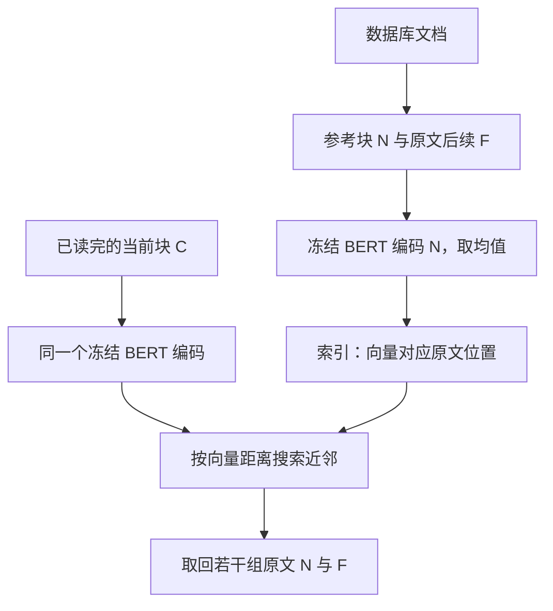
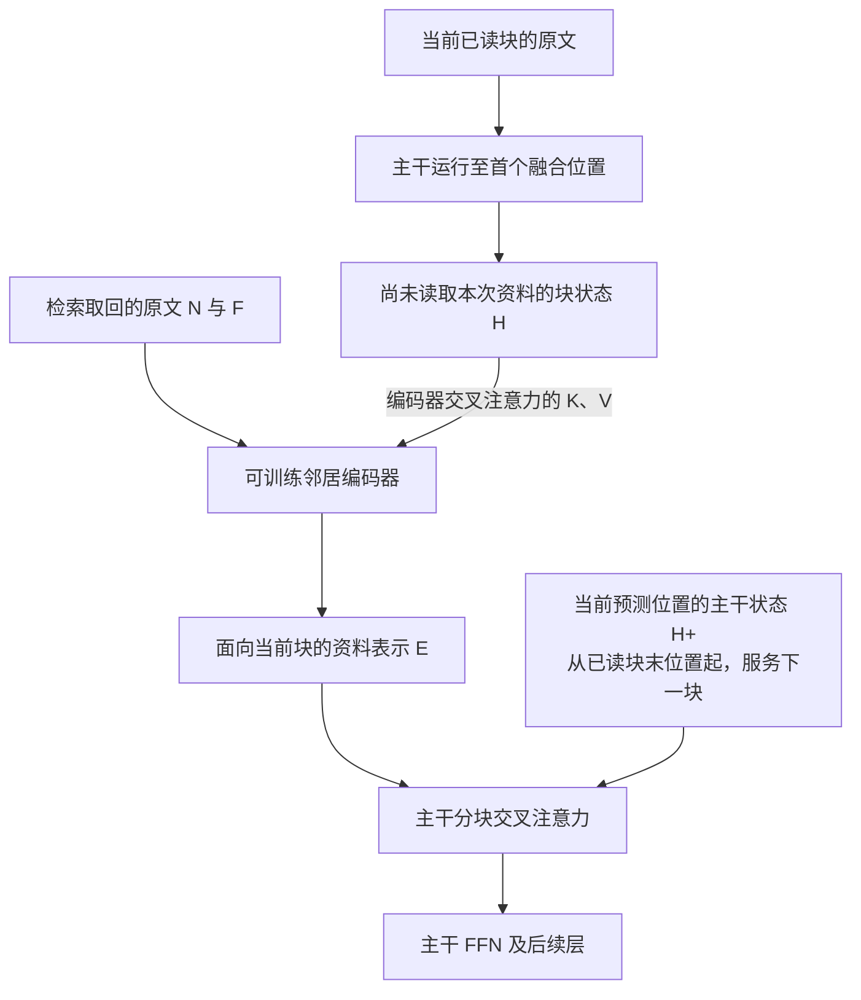
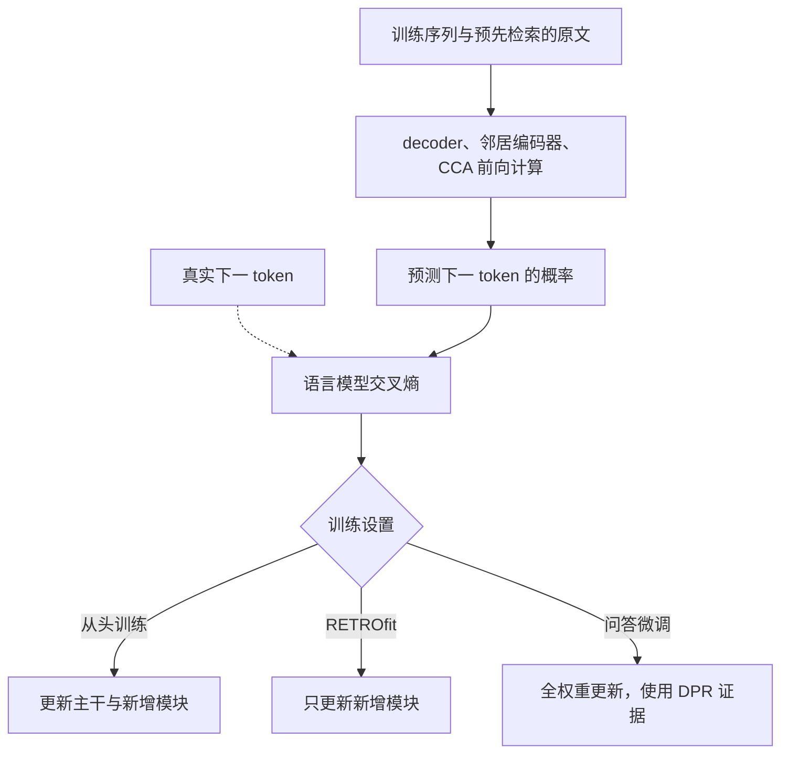

# RETRO：Improving Language Models by Retrieving from Trillions of Tokens

Sebastian Borgeaud、Arthur Mensch、Jordan Hoffmann 等，DeepMind，ICML 2022。以下依据[会议正式版正文及附录 A–G](https://proceedings.mlr.press/v162/borgeaud22a/borgeaud22a.pdf)，页码指这份 35 页 PDF。RETRO 全称为 Retrieval-Enhanced Transformer，即检索增强 Transformer。

## 0.摘要翻译

我们根据前文的局部相似性，从大规模语料库检索文档片段，用它们作为条件增强自回归语言模型。在拥有 2 万亿 token 的数据库时，我们的检索增强 Transformer（RETRO）在 Pile 上取得与 GPT-3、Jurassic-1 相当的表现，而参数量只有它们的约 1/25。经过微调，RETRO 的能力也能转化为问答等知识密集型下游任务的表现。RETRO 将冻结的 BERT 检索器、可微的编码器和分块交叉注意力机制结合起来，利用比通常训练所消耗的数据大一个数量级的资料预测 token。我们通常从头训练 RETRO，但也能快速为预训练 Transformer 加入检索功能，仍取得良好表现。我们的工作为通过前所未有规模的显式记忆改进语言模型开辟了新方向。[摘要，p.1](https://proceedings.mlr.press/v162/borgeaud22a/borgeaud22a.pdf#page=1)

## 1. 开篇讲清楚：论文做了什么，核心 idea 是什么

RETRO 希望增加模型可利用的知识，而不必同步扩大主模型参数。它把大量原文保存在外部数据库中：每读完一小块上下文，就寻找相似片段，连同这些片段在原文中的后续内容一起取回，再通过模型中间层的注意力帮助预测下一块文本。参数负责处理语言和利用证据，数据库负责提供具体内容。

它的核心改变，是把检索纳入普通语言模型的预训练与逐块生成过程，而不是只在回答一个问题前查一次资料。数据库长期保存的是文本与检索向量，生成时仍需搜索、编码取回的原文；因此这里的“记忆”是可读取的外部资料，不是另一个直接预测答案分布的参数化小模型。[§2，pp.2–4](https://proceedings.mlr.press/v162/borgeaud22a/borgeaud22a.pdf#page=2)

## 2. 开始梳理详细的方法：先理清各项设计的逻辑关系，再逐步构建完整方法

### 2.1 先确定记忆的单位：用相似片段寻找可借鉴的后续文本

若每预测一个 token 都检索一次，数据库要保存大量逐位置向量，搜索也过于频繁。RETRO 将长度 $n=2048$ 的训练序列分成长度 $m=64$ 的连续非重叠块：

$$
X=(C_1,\ldots,C_l),\qquad l=n/m=32.
$$

外部资料也按块组织。一个数据库条目的 key 是参考块 $N$ 的 BERT 表示，value 是 $N$ 与它在同一原文中的后续块 $F$：

$$
\mathcal D=\{(e(N),[N,F])\},\qquad
e(N)=\operatorname{MeanPool}(\operatorname{BERT}(N)).
$$

$N$、$F$ 各 64 token，所以每条返回资料通常有 128 token。均值池化指对各 token 的 BERT 输出逐维取平均。相似块告诉模型“过去遇到过什么相近表达”，后续块则提供“这种表达后面可能接什么”；后者对下一 token 预测尤其有用，但模型也需要 $N$ 来理解 $F$ 的语境。[§2.2–2.3，pp.2–3](https://proceedings.mlr.press/v162/borgeaud22a/borgeaud22a.pdf#page=3)

例如，当前块讨论某座桥的建造背景，命中片段 $N$ 也介绍这座桥，其后续 $F$ 给出竣工年份。模型不用把这个年份事先完全学进主干参数，就有机会在接下来的描述中使用它。这里 $F$ 是数据库文档的后续，不能混同为当前待生成序列的真实未来。

*解读图：BERT 向量用于找资料，取回给模型阅读的仍是原文 token。*

### 2.2 如何把数据库做到万亿规模：固定搜索表示，将训练检索移到离线

有了条目定义，当前块 $C_u$ 的检索规则为：

$$
\mathcal N_k(C_u)=\operatorname{ApproxTopK}_{N\in\mathcal D}
\left[-\|e(C_u)-e(N)\|_2^2\right],
$$

$$
\operatorname{RET}(C_u)=\{[N_u^j,F_u^j]\}_{j=1}^{k}.
$$

近似近邻搜索是在不遍历全部条目的情况下寻找足够相近的向量，未必等于精确 Top-k。论文使用 SCaNN，通过树形分组与向量压缩减少搜索成本。训练通常取 $k=2$，因此每个当前块对应两条 128-token 资料。[§2.3，p.3](https://proceedings.mlr.press/v162/borgeaud22a/borgeaud22a.pdf#page=3)

若检索编码器随主模型不断更新，全库向量会过期，重建万亿规模索引成本太高。因此作者先在相同数据分布与 tokenizer 上训练 BERT-Base，再在 RETRO 训练期间冻结它。固定表示也使训练序列的邻居能预先检索、作为训练数据保存；语言模型训练时读取这些已确定的资料，不必同步运行全库搜索。生成新文本时没有预先知道的查询，才在线调用 BERT 与搜索。[§2.3、§2.5，pp.3、5](https://proceedings.mlr.press/v162/borgeaud22a/borgeaud22a.pdf#page=5)

训练查询与数据库可能来自同一批文档。若当前块直接检索到本篇文档，返回的 $F$ 可能正好就是训练答案。作者排除与训练序列同文档的邻居，避免这种捷径；跨文档近重复仍可能残留，后面的实验会专门检查它。

这里要分清三种规模：原始 MassiveText 约 **5.03T token**；模型实际预训练消耗约 **419.43B token**；训练检索库约 **600B token**，评测扩到约 **1.75T token**，摘要将其约称为 2T。训练采样比例也不等于资料的自然占比，例如书籍占训练采样的 25%，构造评测库时却仅取书籍集合的 4%。因此“万亿记忆”指外部数据库容量，不是一次将万亿 token 放进上下文。[§2.1、表1、附录B.1、D.1，pp.2、14、17](https://proceedings.mlr.press/v162/borgeaud22a/borgeaud22a.pdf#page=14)

### 2.3 找到原文以后，为什么还需要第二个编码器？

搜索表示只适合判断相似度，不足以供生成器逐词读取证据。RETRO 另加一个**可训练的邻居编码器**，把取回的每条 $[N,F]$ 编成 token 级向量：

$$
E_u^j=\operatorname{Encoder}_\psi([N_u^j,F_u^j],H_u)
\in\mathbb R^{128\times d_e}.
$$

默认编码器为两层双向 Transformer，宽度 $d_e=896$。它与负责搜索的冻结 BERT 是不同网络，参数也不同。双向意味着资料内部每个位置可以读取前后文；资料来自已取回的外部文本，所以不需要按生成方向遮挡它。[§2.4–2.5，pp.3–5](https://proceedings.mlr.press/v162/borgeaud22a/borgeaud22a.pdf#page=3)

为什么还把 $H_u$ 作为条件？同一片段对不同上下文可能有不同用途。$H_u$ 是主模型在**第一个分块交叉注意力之前**算出的当前块隐藏状态。邻居编码器先做自己的双向自注意力，再在指定层以邻居状态为 query、$H_u$ 为 key/value 做交叉注意力，最后经过 FFN。因此资料表示可以依据当前问题或上下文调整。

计算顺序必须是：主干先运行至首个融合位置、得到尚未读取本次资料的 $H_u$；邻居编码器读取它并得到 $E_u$；主干随后读取 $E_u$。这避免了“主干等资料表示、资料表示又等融合后的主干”的循环依赖。每个邻居独立编码，但所有块和邻居可并行处理；$E_u$ 只计算一次，供后续多个融合层复用。[附录C.2.1、算法1，pp.14、17](https://proceedings.mlr.press/v162/borgeaud22a/borgeaud22a.pdf#page=17)

*解读图：搜索用的 BERT 已在前一步完成工作；此图展示在线阅读与融合。用于条件化编码器的 H 与用于读取资料的 H+ 区间不同，具体偏移见下一节。E 可在本次生成块的多个融合层之间复用，但不能视为与查询无关、可永久预编码的资料 KV。*

### 2.4 因果对齐：完整当前块只能帮助预测它之后的 token

最容易出错的一步是：检索使用完整 $C_u$，若用结果反过来预测 $C_u$ 内部 token，就可能间接看到尚未出现的内容。RETRO 的分块交叉注意力 CCA 因而错开一个预测区间。

采用从 1 开始的 token 编号，主干状态 $h_t$ 用于预测 $x_{t+1}$。第 $u$ 个块结束于 $um$；只有这时才完整知道 $C_u$，因此 $E_u$ 服务的状态区间为：

$$
H_u^+=(h_{um},h_{um+1},\ldots,h_{um+m-1}).
$$

这段状态恰好预测下一块的 $m$ 个 token：$x_{um+1},\ldots,x_{um+m}$。所以“用前一块检索，帮助下一块”在隐藏状态上表现为：**前一块最后一个位置，加下一块前 63 个位置，共享同一批资料。** 第一块前 63 个状态没有资料更新；最后一个状态则可以检索第一块，帮助预测第二块首 token。整条序列最后一个状态也可读取最后一块取回的资料，用于继续生成。[§2.4、式(3)、脚注1、Listing 1，pp.4、16](https://proceedings.mlr.press/v162/borgeaud22a/borgeaud22a.pdf#page=4)

将块长暂缩为 4，更容易看清边界：

| 已有状态                  | 预测对象                     | 直接读取哪批资料                               |
| ------------------------- | ---------------------------- | ---------------------------------------------- |
| $h_1,h_2,h_3$           | $x_2,x_3,x_4$              | 不使用检索资料                                 |
| $h_4,h_5,h_6,h_7$       | $x_5,x_6,x_7,x_8$          | 完整 $C_1=(x_1,\ldots,x_4)$ 检索出的 $E_1$ |
| $h_8,h_9,h_{10},h_{11}$ | $x_9,x_{10},x_{11},x_{12}$ | 完整 $C_2$ 检索出的 $E_2$                  |

实际生成时，得到 $x_4$ 后就可搜索并运行首个融合位置以后的计算来预测 $x_5$；不需要等到已经生成 $x_5$ 才允许读取资料。邻居编码器虽然双向读取完整外部资料，但用于条件化它的 $H_u$ 只来自已知文本，所以不破坏这个因果关系。

*原文图2，p.4。右侧 $H_u^+$ 从块末位置开始，是理解整套机制的关键；图中 token 数仅作示意。*

### 2.5 怎样融合：先做本地自注意力，再从所有邻居位置共同选信息

对某个融合层，将 $k$ 条邻居各 128 个状态展平成一组：

$$
Y_u=\operatorname{Flatten}(E_u)\in\mathbb R^{kr\times d_e},\qquad r=128.
$$

当前可读取区间的状态作为 query，资料表示提供 key/value。单头计算可概括为：

$$
Q=H_u^+W_Q,\quad K=Y_uW_K,\quad V=Y_uW_V,
$$

$$
\Delta H_u^+=\operatorname{softmax}
\left(\frac{QK^\top}{\sqrt{d_h}}+B_{\mathrm{rel}}\right)VW_O.
$$

一次 softmax 在**所有邻居的所有位置**之间分配权重；不是先为每条邻居生成一个答案，再混合答案概率。加上残差后，融合层的运算顺序为：

$$
\operatorname{RETROBlock}(H,E)
=\operatorname{FFW}(\operatorname{CCA}(\operatorname{ATTN}(H),E)).
$$

这里 ATTN、CCA、FFW 均按原文定义包含相应残差操作。它与 DFM 的“自注意力和记忆注意力并行相加”有区别：RETRO 的 CCA 接在当前层自注意力之后，FFN 和后续层还会继续处理融合结果。[式(2)–(4)、附录C.2，pp.3–4、15](https://proceedings.mlr.press/v162/borgeaud22a/borgeaud22a.pdf#page=4)

相对位置偏置 $B_{\mathrm{rel}}$ 利用了“当前块和匹配块大致对齐”的假设。把它们的起点视为相同；当前读取状态的局部索引 $a$ 从块末开始，参考索引为 $b$，则 decoder 读取时相对距离写为 $a-b+m-1$，邻居编码器读取 $H_u$ 时为 $b-a$。偏置由这些相对距离的三角函数表示线性变换得到，再加到注意力分数上。这样模型能区分参考中的匹配部分 $N$ 与续写部分 $F$。[附录C.2.2，式(6)–(7)，p.15](https://proceedings.mlr.press/v162/borgeaud22a/borgeaud22a.pdf#page=15)

无需每层都读取资料：论文使用间隔层的 CCA，让其余层维持普通 Transformer。正文及 RETROfit 配置说第 6 层起每 3 层加入，表7的大模型配置则写第 9 层起；原文记录并不完全一致，因此不宜将“第6层”当作所有规模的唯一精确配置。确定的设计是从非最浅层开始、隔层注入，编码器输出在这些层间共享。[§2.5、附录C.3、表7，pp.5、17–18](https://proceedings.mlr.press/v162/borgeaud22a/borgeaud22a.pdf#page=18)

每个 CCA 只直接读取本次匹配资料，早先资料的信息仍可经主干后续自注意力间接传播。因此不必让每个新 token 同时交叉注意全部历史检索结果。

### 2.6 如何学习：标准语言模型损失，分清三种参数更新范围

主任务没有专门的人工记忆标签，只需真实后续文本：

$$
\mathcal L_{\mathrm{LM}}
=-\sum_t\log p_{\theta,\psi}
(x_{t+1}\mid x_{\le t},\text{已完成块对应的资料}).
$$

预先检索的资料参与编码、融合和预测；生成错误的梯度更新模型，让它学会何时读什么。邻居编码器还通过对 $H_u$ 的注意力，把梯度传向主干。检索 BERT 及离散邻居 ID 不在这条优化路径中，也没有 LM 损失驱动的全库向量重建。[§2.2–2.5、算法1](https://proceedings.mlr.press/v162/borgeaud22a/borgeaud22a.pdf#page=17)

| 设置              | 主干 decoder | 邻居编码器与 CCA | 搜索模块                    |
| ----------------- | ------------ | ---------------- | --------------------------- |
| 从头预训练 RETRO  | 更新         | 更新             | BERT 固定，训练邻居离线确定 |
| RETROfit 已有模型 | 冻结原权重   | 新初始化并训练   | 同上                        |
| NQ 问答微调       | 更新         | 更新             | 改用预先取好的 DPR 资料     |

**从头训练。** 训练 419,430,400,000 token，序列长 2048，通常每块两条邻居，AdamW、权重衰减 0.1、750 步学习率预热、余弦衰减。小模型批量 256，大模型 1024。对照主干约 132M、368M、1.309B、6.982B 非 embedding 参数；加检索模块后约 172M、425M、1.451B、7.532B。因此主模型参数比较并非总参数完全匹配，但最大模型的增幅约 8%。[附录D.1、表7，pp.17–18](https://proceedings.mlr.press/v162/borgeaud22a/borgeaud22a.pdf#page=18)

**RETROfit。** 冻结已有主干，训练新编码器和 CCA，使用约 6M 个序列，即原预训练序列数的 3%，约 12.3B 正文 token。冻结主干不等于截断全部梯度：新增早期模块仍需要经后续冻结层获得输入梯度。关闭新增路径时可恢复原模型运算；这不等于启用资料后每个任务都一定更好。[§4.2、附录C.3、D.3，pp.7–8、17、19](https://proceedings.mlr.press/v162/borgeaud22a/borgeaud22a.pdf#page=19)

**问答微调。** NQ 使用 DPR（分别编码问题与段落、学习让相关问题—段落向量接近的检索器）取得的前 20 条 Wikipedia 段落及标题。模型输入格式为 `question: ... answer: ...`，左侧补齐，使 `answer:` 末尾位于第一块的边界，回答第一个 token 就能使用检索信息。训练 25,000 步、批量 128，学习率从 $10^{-6}$ 余弦降到 $10^{-7}$，更新全部 RETRO 权重。[§4.3、附录D.4，pp.8、19](https://proceedings.mlr.press/v162/borgeaud22a/borgeaud22a.pdf#page=19)

*解读图：冻结的 BERT 不接受这条损失的参数更新；问答微调与普通检索预训练的资料来源不同。*

### 2.7 用同一个例子走完训练、生成与问答

以下假设已有一块介绍桥梁的文本，相关邻居给出竣工年份，仅作计算示意。

**训练时：**离线使用完整已知块检索，过滤同文档候选，保存两组 $[N,F]$。批次中主干先算出各块的 $H_u$，邻居编码器据此生成 $E_u$；CCA 按前述偏移位置服务后续 token。用真实年份对应的 token 计算交叉熵，更新从头训练的主干及新增模块，或仅更新 RETROfit 的新增模块。虽然整个真实序列同时在批次里，各处的掩码和跨块位移仍限制其可见信息。

**自由生成时：**先生成或读完 64-token 块，再在线编码查询、搜索、取回两条或更多原文。用已算出的块状态条件化邻居编码器，然后在当前块末位置读取 $E_u$，预测下一块首 token；接下来逐 token 复用这批资料。下一块完成后，用模型自己生成的这段文本再搜索。训练检索依赖真实前文，生成检索依赖模型前文，因此生成跑偏也会影响后续资料选择；推理期间不更新模型参数。

**NQ 问答时：**将问题补齐到首块边界，把 DPR 取回的 20 条段落作为邻居输入，经问答微调后的模型生成答案。这里不应再画成每 64 token 用冻结 BERT 从 1.75T 库查一次的同一实验：问题的资料已由专门的问答检索器提供，报告的是微调后答案精确匹配率。

### 2.8 哪些计算被省下，哪些仍然存在？

对长度 $n$ 的序列，只执行约 $n/m$ 次搜索，而非每个 token 一次；每个交叉注意力位置只读取 $kr$ 个外部状态，所以资料注意力约为 $O(nkr)$，固定邻居数时随生成长度线性增长。独立编码邻居也避免把全部资料和正文拼成一条长序列后做全局自注意力。主干本身的普通自注意力仍有随上下文长度增长的成本，RETRO 不等于整个模型变为线性复杂度。[§2.3–2.4，pp.3–4](https://proceedings.mlr.press/v162/borgeaud22a/borgeaud22a.pdf#page=4)

固定 BERT 使换库、扩库无需重新训练主模型，但新资料仍需切块、编码和更新索引。取回原文还要在线运行可训练邻居编码器；因它依赖当前 $H_u$，不能把全库永久转换为一份通用的 $E_u$ 缓存。更换主干后，这些训练出的融合接口也不能自动跨模型复用。

## 3. 围绕问题解释实验：为什么做，结果怎样，得到什么回答

### 3.1 检索收益会不会随着主模型变大而消失？

作者对四档主干训练对应的 RETRO，在相同正文训练预算下比较语言建模。主要指标 bpb（每个原始文本字节的平均负对数概率，以 bit 计，越低越好）不依赖 tokenizer 的 token 粒度，比直接比较不同词表的 token 损失合适；同一数据集仍需保持清洗和编码规则一致。[§4.1、表11，pp.6、23](https://proceedings.mlr.press/v162/borgeaud22a/borgeaud22a.pdf#page=23)

| 非 embedding 参数档位，RETRO | 对应普通模型 C4 bpb | RETRO C4 bpb |
| ---------------------------- | ------------------: | -----------: |
| 172M                         |                0.98 |         0.82 |
| 425M                         |                0.92 |         0.77 |
| 1.451B                       |                0.84 |         0.71 |
| 7.532B                       |                0.78 |         0.66 |

最大模型 C4 bpb 下降 0.12，按表中舍入值约为 15.4% 相对下降。收益到 7B 主干仍明显，支持检索与扩大模型互补；但更大规模没有在本文验证，也不能把曲线中的“约等效十倍参数”当成所有任务上的通用换算。

其他任务收益不同：最大模型 LAMBADA 末词准确率约从 69% 到 73%，Curation Corpus 的摘要 bpb 仅从 0.52 到 0.50；2021 年新 Wikipedia 文本从 0.65 到 0.61。这说明检索对需要外部具体信息的预测更有用，对主要依赖已有源文章的摘要，收益较小。[表11，p.23](https://proceedings.mlr.press/v162/borgeaud22a/borgeaud22a.pdf#page=23)

### 3.2 参数固定后，只增加数据库或邻居是否有帮助？

固定训练好的模型，在评测阶段换用更大的资料库，能检验收益是否必须靠重新训练参数。最大模型在 C4 上用约 4B-token 的库时 bpb 为 0.78，用约 180B 时为 0.75，900B 时为 0.71，完整库时约 0.66。说明扩展外部资料本身可增加能力；但这些子库也改变资料覆盖和组成，不是纯粹控制语料质量后的容量定律。[图1、表11，pp.2、23](https://proceedings.mlr.press/v162/borgeaud22a/borgeaud22a.pdf#page=2)

*原文图1，p.2。中、右图均可在不重新训练主模型的条件下改变外部调用量。*

训练只取两条邻居，推理增加到 10 条通常还能改善；最大模型在约 40 条附近更好，再增大会恶化。表11 中 7.5B 的 $k=2/40/100$ 分别约为 0.67/0.65/0.67。更多资料并非必然更好，相关性下降和额外编码、注意力成本都要考虑。小模型也不一定能有效使用与大模型同样多的邻居。

### 3.3 “约 25 倍更少参数”具体支持什么结论？

Pile 比较的是逐领域的文本预测 bpb，而非对话、推理、指令遵循的综合能力。表12 中，7.5B RETRO 在所列 16 个子集里，分别有 9 个优于 Jurassic-1、9 个优于 Gopher；在 arXiv 等领域仍落后。[图4、表12，pp.7、24](https://proceedings.mlr.press/v162/borgeaud22a/borgeaud22a.pdf#page=24)

| Pile 子集  | 自家 7B 基线 |      Jurassic-1 |          Gopher |      RETRO 7.5B |
| ---------- | -----------: | --------------: | --------------: | --------------: |
| GitHub     |        0.420 |           0.358 |           0.367 | **0.199** |
| Books3     |        0.792 |           0.835 |           0.706 | **0.653** |
| arXiv      |        0.742 |           0.680 | **0.641** |           0.714 |
| Ubuntu IRC |        1.200 | **0.857** |           1.081 |           1.178 |

这支持“小参数主干加巨大外部库可在部分语言建模任务接近或超过大模型”。摘要的约 25 倍是与 GPT-3/Jurassic-1 的模型参数量级比较，不包含 TB 级文本、索引、检索 BERT 和在线证据处理的全部资源，更不是端到端服务成本降低 25 倍。不同模型训练语料及预算也未完全统一。

### 3.4 WikiText 的巨大收益，是否只是检索到了答案？

作者用两层去重检查这个问题。首先按文档的 13-gram Jaccard 相似度做近重复过滤，并移除 Wikipedia 中 WikiText 验证/测试原文章；但跨站转载和局部复用仍可能保留。[§2.1，p.2](https://proceedings.mlr.press/v162/borgeaud22a/borgeaud22a.pdf#page=2)

在表2 的专门 WikiText 实验里，先训练一个较小的 18 层基线，再 RETROfit；固定同一检查点，仅换检索库：

| 方法与数据库               | WikiText103 测试困惑度 |
| -------------------------- | ---------------------: |
| 普通模型，无检索           |                  22.96 |
| 自家 kNN-LM，Wikipedia 4B  |                  19.54 |
| RETRO，Wikipedia 4B        |                  18.97 |
| RETRO，MassiveText 约 1.8T |                   3.92 |

困惑度是下一 token 负对数概率平均后的指数，越低越好。这组结果表明仅用 Wikipedia 时 RETRO 与 kNN-LM 接近，大库收益非常大，但作者明确承认其中有片段级泄漏。这与大规模 7.5B 预训练模型在表11 中得到的测试设置、数值不同，不能把表2 的小模型对照与表11 的 WikiText 验证困惑度 2.22 混成一组。[表2、附录D.2，pp.7、18](https://proceedings.mlr.press/v162/borgeaud22a/borgeaud22a.pdf#page=18)

第二层检查按文本块计算重叠：为每个评测块另取 10 个近邻，计算最长共同**连续子串**长度占块长的比例 $r(C)$。只对 $r(C)\le\alpha$ 的块计算指标：

$$
\operatorname{bpb}(\alpha)=
\frac{-\sum_{C:r(C)\le\alpha}\sum_{i\in C}\log_2 p(x_i\mid x_{<i})}
{\sum_{C:r(C)\le\alpha}\operatorname{bytes}(C)}.
$$

这是对原文过滤指标的显式写法，概率仍按模型原有因果流程计算。它筛的是**计分的评测块**，并非把模型当前检索到的每条资料都按这个阈值删除。64-token 块在 $\alpha=12.5\%$ 时允许最长 8-token 的连续重合。[§2.6、式(5)，p.5](https://proceedings.mlr.press/v162/borgeaud22a/borgeaud22a.pdf#page=5)

*原文图9，p.24。横轴越靠左，参与计分的块与已检索近邻的连续重合越少。*

低重叠块上仍有收益，支持 RETRO 不只是在逐字复制；WikiText 的曲线又明显随允许重叠增加而改善，说明复制确实贡献不少。该指标基于近邻样本和连续文本匹配，不能证明所有训练污染、改写复用或语义重叠都已排除。2021 年新文章实验减少了整篇泄漏的机会，但新文章仍可能引用过去资料中的事实。

### 3.5 关键设计是否真的有用？

作者用 247M 模型、157B-token 训练计划做消融，主要比较 C4 bpb 与相对训练时间；这些结果不宜直接视为 7.5B 上已逐一验证的结论。[附录E、表10、图7，pp.19–21](https://proceedings.mlr.press/v162/borgeaud22a/borgeaud22a.pdf#page=20)

| 配置                   |          C4 bpb | 回答的问题                     |
| ---------------------- | --------------: | ------------------------------ |
| 完整 RETRO             | **0.822** | 基准                           |
| 无检索                 |           0.987 | 外部通路有实际收益             |
| 只提供匹配块 $N$     |           0.950 | 相似上下文本身不够             |
| 只提供后续 $F$       |           0.895 | 后续很有用，但失去原语境仍较差 |
| 编码器不读取当前块状态 |           0.829 | 查询条件化带来小幅收益         |
| CCA 无相对位置         |           0.826 | 对齐偏置有小幅帮助             |
| 6 层邻居编码器         |           0.821 | 比两层仅略好，训练时间约增 20% |
| 每层都加入 CCA         |           0.860 | 更密集融合未必更好             |

完整 $[N,F]$ 明显优于任一半，直接支持数据库 value 的设计；较浅编码器与间隔融合则体现质量和运行成本的折中。只取 1 条或 4 条训练邻居时分别为 0.858、0.847，均不如默认两条。这不是证明“两条”永远最优，尤其评测时增加邻居仍可获益。

*原文图7，p.21。横轴以默认 RETRO 训练时间为基准，不是相对普通无检索 Transformer 的统一端到端加速。*

### 3.6 能否低成本改装已有模型，并用于实际问答？

RETROfit 在约 3% 的原训练序列数上，就超过原基线，并接近从头训练的 RETRO。这说明新增资料通路可以学会配合已有主干，不必为接入检索从头重训。这个百分比不包含原模型预训练、BERT、索引和预检索成本，也不等于完整系统总训练 FLOPs 只花 3%。[§4.2、图3，pp.7–8](https://proceedings.mlr.press/v162/borgeaud22a/borgeaud22a.pdf#page=8)

NQ 微调后，闭卷 7B 基线精确匹配率为 30.4%，RETRO 7.5B 为 45.5%，提高 15.1 个百分点；RAG 为 44.5%，FiD 为 51.4%，FiD 加蒸馏为 54.7%。它验证了检索通路对问答有用，但并非当时最强 QA 系统，也不是原始冻结 BERT 检索方案的零样本问答结果。不同方法的检索与预训练方式还不完全相同。[表3、§4.3，p.8](https://proceedings.mlr.press/v162/borgeaud22a/borgeaud22a.pdf#page=8)

作者报告约 10ms 可从万亿规模库查询一次，且这次查询供一块 token 共享；但该时间不能代表一次完整回答的延迟，也没有完整说明并发服务下的资源配置。论文另给出 Wikipedia 索引约 215GB、MassiveText 约 93TB 的存储量级估计，明显小于逐 token 建 kNN 索引的开销，却仍需要大规模基础设施。搜索、取回、邻居编码和生成应合计评估，不能由参数少就直接推出部署更便宜。[§2.3、§4.1，pp.3、7](https://proceedings.mlr.press/v162/borgeaud22a/borgeaud22a.pdf#page=7)

案例中复制圆周率、续写已有戏剧，能展示取回原文如何影响生成；“减少幻觉”的讨论主要来自这种定性观察，缺少独立、系统的幻觉率测量，不能据此宣称可靠地解决事实错误。[§4.5、附录F、表17–20](https://proceedings.mlr.press/v162/borgeaud22a/borgeaud22a.pdf#page=22)

## 4. 围绕同一个问题，解释已有方法及其特点

### 4.1 全部知识写进参数：运行接口简单，容量和更新依赖训练

普通自回归 Transformer 用下一 token 预测将信息写进权重，生成时只运行模型。扩大参数和训练数据能提升能力，但增加存储及计算，改动知识通常也要训练。RETRO 保留这条参数路径，同时引入文本数据库，尝试把“记住更多内容”和“执行更大网络”分开。[原文§1、§3](https://proceedings.mlr.press/v162/borgeaud22a/borgeaud22a.pdf#page=1)

### 4.2 检索相似上下文，直接调整词概率：连续缓存与 kNN-LM

连续缓存保存最近历史状态及对应 token；kNN-LM 把范围扩大到外部语料。后者为许多语料位置保存“主模型上下文向量—后继 token”，生成时寻找与当前向量相近的条目，将其后继 token 按距离聚合成概率，再与主模型分布插值。它不必改变主模型就能提供罕见事实，但需要密集的逐 token 向量库，且资料主要在最后的概率端生效。[§3、附录表6](https://proceedings.mlr.press/v162/borgeaud22a/borgeaud22a.pdf#page=15)

RETRO 继承了“上下文相似性可补充预测”的思路，改成每块一个搜索向量、取回原文，并让后续层加工内容。它付出的新代价是训练专门的阅读与融合模块，以及在线编码原文。

### 4.3 先找问答证据，再生成答案：DPR、REALM、RAG 与 FiD

DPR 用问题与相关段落的配对训练检索向量，本身主要解决“找什么”。REALM 将检索候选作为隐变量，以语言任务信号学习检索，让证据和任务更匹配，但检索器变化时需要维护资料向量。RETRO 则选择固定搜索表示，换取万亿级库的稳定性。[§3，pp.5–6](https://proceedings.mlr.press/v162/borgeaud22a/borgeaud22a.pdf#page=6)

原始 RAG 检索多个段落，让生成模型条件于检索文档，并对文档候选的生成概率加权；它不只是今天常说的“把几段资料拼到聊天 prompt”。FiD 则对“问题+每条证据”分别编码，将各证据的表示共同交给 decoder 交叉注意力读取。后者的独立证据编码、多证据融合与 RETRO 很接近。[原文§3、表6](https://proceedings.mlr.press/v162/borgeaud22a/borgeaud22a.pdf#page=15)

RETRO 的推进是让任意长文本在逐块推进中重复检索，并从语言模型预训练阶段学习这种通路；问答系统则主要围绕一个问题及其检索证据运行。内部交叉注意力与多证据阅读本身并非本文首创。

### 4.4 放回本组记忆论文中：谁存原文，谁存 KV，谁把检索学进参数？

| 方法       | 长期记忆存什么                | 推理时如何读取                           | 对 RETRO 的关键变化                    |
| ---------- | ----------------------------- | ---------------------------------------- | -------------------------------------- |
| RETRO      | 文本块、后续块与检索索引      | 在线取回原文、条件化编码、CCA            | 本文方案                               |
| Memory³   | 主模型编码出的稀疏 KV 与索引  | 按 ID 加载，接入原自注意力               | 提前完成更多资料编码，减少重复阅读     |
| MSA        | 文档级压缩 KV、路由表示及原文 | 可学习路由选文档，生成 ID 后可继续读原文 | 将选择纳入模型，扩大可访问库规模       |
| MLP Memory | 学会检索分布的 MLP 参数       | 根据主模型表示输出词概率并插值           | 以离线学习换掉在线检索                 |
| DFM        | 预测器与融合模块参数          | 预测记忆向量，注入隐藏状态               | 保留内部融合接口，但在线向量由网络生成 |

这张表是跨论文对照，不是 RETRO 原文的历史相关工作：其余方法均更晚。沿这条线看，RETRO 的位置是“保留真实外部资料、在线编码、模型内部读取”；后续研究分别尝试减少重复编码、学习路由或完全取消在线搜索。[Memory³](https://arxiv.org/abs/2407.01178)、[MSA](https://arxiv.org/abs/2603.23516)、[MLP Memory](https://arxiv.org/abs/2508.01832)、[DFM](https://arxiv.org/abs/2610.25100)

## 5. 说明论文继承了什么，真正贡献了什么

**首先，检索增强并非新想法，万亿级外部库与大规模自回归预训练的结合才是本文最有力的推进。** kNN-LM、REALM、RAG、FiD 已能调用外部资料，RETRO 用块级索引与固定 BERT 将数据库扩到约 1.75T token，并在多档主模型上展示收益。固定模型、评测时扩库仍提升，直接支持外部记忆是一条独立于增加参数的扩展路径。[§2.1–2.3、图1、表11](https://proceedings.mlr.press/v162/borgeaud22a/borgeaud22a.pdf#page=23)

**其次，已有组件被组织成严格因果的分块读写链。** BERT、近邻搜索、双向编码器、交叉注意力和相对位置编码都有前例；本文把“用已完成块找 $[N,F]$、依据块状态编码证据、从块末预测位置起读取”的依赖关系处理清楚，既能训练时并行，又能逐块生成。$[N,F]$ 消融和查询条件化消融支持这些选择，算法1与位移实现则给出了可检查的计算过程。[§2.4、附录C、E](https://proceedings.mlr.press/v162/borgeaud22a/borgeaud22a.pdf#page=17)

**再次，RETROfit 说明外部记忆不必绑定从头训练。** 在原主干固定的条件下，仅训练新增阅读和融合模块即可接近从头 RETRO 的表现；停用新增路径还能保持原模型运算。这是实用的模块连接与学习方式贡献，但新增训练预算小，不代表检索基础设施或总生命周期成本也同样小。[§4.2、附录C.3、D.3](https://proceedings.mlr.press/v162/borgeaud22a/borgeaud22a.pdf#page=19)

**最后，论文把“复制了评测资料”与“利用相关知识”分开检查。** 文档去重不能排除局部重合，RETRO 的确比普通模型更善于利用这种重合；按块过滤后的收益又说明它不只依靠复制。这种评测方式是贡献之一，但仍不是完全消除数据污染的证明。问答结果也说明语言建模收益不能自动换算成最强下游能力。[§2.6、§4.3–4.4、附录G](https://proceedings.mlr.press/v162/borgeaud22a/borgeaud22a.pdf#page=24)

这篇论文最值得保留的新意，是让主模型在持续生成时反复读取外部文本，用严格的分块因果接口把庞大资料库变成可训练、可调用的记忆。它证明无需把所有知识压进参数，也能扩大可用信息；真正使方案成立的是索引粒度、在线阅读和预测位置对齐的配合。后续需要继续解决的是更可靠的检索、较低的在线编码与存储成本，以及把语言建模收益转化为稳定的问答和推理能力。
