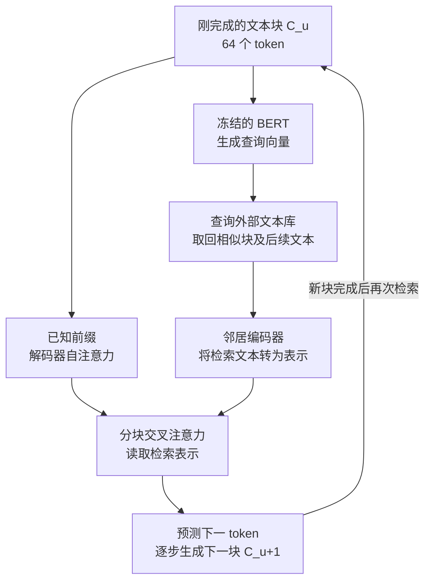

# RETRO：把大规模文本库接入语言模型的逐块预测

**论文**：Improving Language Models by Retrieving from Trillions of Tokens  
**作者与年份**：Sebastian Borgeaud 等，DeepMind，ICML 2022（预印本发表于 2021 年）  
**来源**：[正式发表页面](https://proceedings.mlr.press/v162/borgeaud22a.html) · [本地论文原文](RETRO_Original/RETRO.pdf)  
**标签**：检索增强预训练、外部文本记忆、模型与数据库扩展

## 1. 研究问题：能否通过扩大可查询的知识库，让较小的模型做好语言预测？

扩大模型通常同时增强计算能力和记忆训练资料的能力。RETRO 想探索另一条扩展路线：让知识以原始文本保留在模型外部，生成时按需读取，减少仅靠增加参数来记住知识的压力。问题的关键是，怎样从万亿 token 的数据库中及时找到有用内容，并让它实际影响下一 token 的预测。[引言、§2](RETRO_Original/RETRO.pdf#page=1)

## 2. 核心思路：每生成一块文本，就用刚才的内容查找相似片段及其后续

RETRO 将文本划成每块 64 个 token。数据库用 BERT（将文本编码为上下文表示的模型）为每块生成向量，用来查找语义相近的文本；查到的内容包括相似块及它后面的 64 个 token。这样，模型既能看到“别人在哪里谈过类似内容”，也能看到“接下来通常怎样展开”。BERT 在检索阶段保持冻结，数据库向量不必随着语言模型训练反复重算。[§2.1、§2.3](RETRO_Original/RETRO.pdf#page=2)

生成时，每完成一块，就用它检索，再通过编码器处理检索文本。模型内部新增的分块交叉注意力（让生成端读取对应检索片段的表示）将信息用于下一块的预测。因此，检索根据已经生成的内容持续更新，也不会使用尚未生成的下一块作为查询。例如，刚生成了一段关于某个历史事件的文字，模型可以找到资料中的相似叙述及其后续，辅助继续生成。[§2.4、图2](RETRO_Original/RETRO.pdf#page=3)

这条读取路径参与下一 token 预测训练，模型由此学习怎样使用检索结果。推理时沿用同样的逐块检索机制；论文也验证了冻结已有主模型、只训练新增检索模块的改造方式。[§2.5、§4.2](RETRO_Original/RETRO.pdf#page=5)

**Pipeline：用上一块检索，辅助下一块生成。**

图中省略了重复的模型层和块边界对齐，突出生成时的数据流：先完成查询块，再利用检索结果预测后续 token。训练时，冻结的检索器允许提前算好邻居；编码器和交叉注意力等模块通过下一 token 预测目标学习使用资料。[§2.3—2.5、图2](RETRO_Original/RETRO.pdf#page=3)

## 3. 主要发现：数据库规模有效，但收益必须结合任务和数据重叠判断

- **同一模型可以受益于更大的库。**常规训练从约 600B token 的库检索，评估库扩大到约 1.75T token。图1显示，扩大评估库可以继续改善预测；约 7.5B 参数的 RETRO 在多数已评估的 Pile 子集上超过 Jurassic-1 178B 和 Gopher 280B。这里衡量的是文本预测质量，不能据此断言各类能力都超过这些大模型。[§2.1、§4.1、图1与图4](RETRO_Original/RETRO.pdf#page=6)
- **巨大改善中包含利用重复文本的收益。**Wikitext103 的一组实验中，检索库由 Wikipedia 扩大到 MassiveText，测试困惑度（衡量模型预测文本有多困难，越低越好）从 18.97 降到 3.92。作者指出其中部分收益来自文本重叠；进一步限制评估片段与训练库的最长连续重复长度后，RETRO 仍然优于基线，支持其收益还包含利用非逐字重复信息的能力。[表2、§4.4、图5](RETRO_Original/RETRO.pdf#page=7)
- **语言建模收益可以迁移到问答，但并非当时最强。**在 Natural Questions 上，经问答微调并使用 DPR（依据问题检索相关段落的模型）提供资料后，RETRO 得到 45.5 的精确匹配分数；无检索的 7B 基线为 30.4，FiD（分别编码多篇检索文档、再融合生成答案的方法）为 51.4。这证明检索路径有用，也显示预训练的成功不能直接等同于问答任务上的领先。[§4.3、表3](RETRO_Original/RETRO.pdf#page=8)

## 4. 研究位置与边界：把检索变成模型计算的一部分，也带来额外系统成本

与 kNN-LM 在输出端混合模型预测和检索得到的 token 概率不同，RETRO 把检索文本送入模型内部，让神经网络学习如何利用这些内容。与以问题为查询、融合文档回答问题的 FiD 相比，RETRO 面向一般语言建模，在长序列生成过程中反复检索。[§3](RETRO_Original/RETRO.pdf#page=5)

收益依赖库中是否有用得上的内容。论文在数学等部分子集上没有观察到相对同规模基线的改善。参数较少也不代表整个系统更便宜：仍需存储和查询大规模索引，并承担检索编码与注意力计算；“约25倍更少参数”不能换算成同等倍数的总成本节省。文本重叠过滤缓解了评估疑问，但不能视为消除了所有形式的数据污染。[§2.3、§4.1、§4.4](RETRO_Original/RETRO.pdf#page=3)

## 5. 阅读所得：将知识容量与模型参数量分开考虑

最值得留下的是：增强模型可用知识，还可以扩大它能够读取的外部资源；检索结果怎样进入计算过程，与检索库有多大同样重要。评估这类方法时，应同时看参数量、数据库规模、访问成本和测试文本重叠程度。

若继续阅读，优先看图2及§2.4，理解逐块检索怎样保持因果性；再看§4.4，学习如何区分检索利用已有知识与直接利用重复文本的收益。
